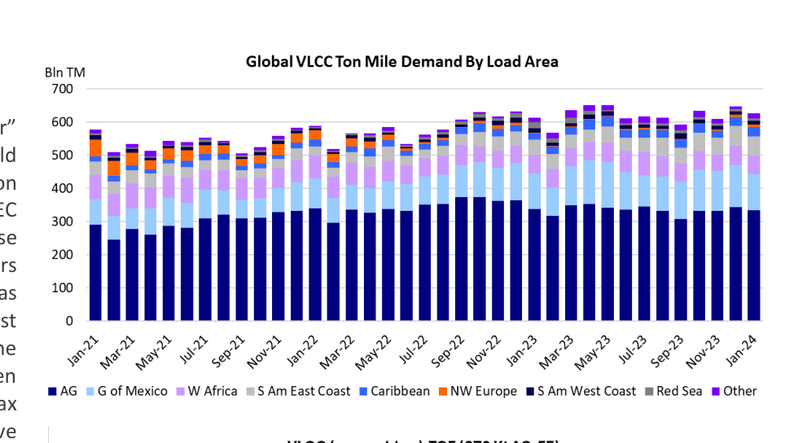
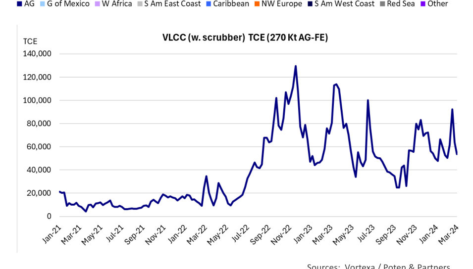

# Does Size Still Matter

### What is the outlook for VLCC demand in the coming years?

For many years, VLCCs have been regarded as the “bellwether” of the tanker market. Improvements in the market would frequently start with VLCCs and given their dominant position in the Middle East crude oil export trades, the fortunes of OPEC and the VLCC market would often be tied. The size of these vessels, carrying around 2 million barrels of oil, offers charterers of VLCCs unparallelled economies of scale. Trade disruptions as a result of conflicts or geopolitical tension in the Middle East would frequently boost VLCC rates more than those of the smaller crude oil tankers. However, this pattern has been somewhat disrupted since the end of the pandemic. Suezmax and Aframaxes tankers have outperformed VLCCs on a relative basis since 2021. There are unique circumstances and temporary factors that can explain this unusual situation. The more interesting questions is: What is likely to happen in the future? That will be the topic of this Weekly Tanker Opinion.

During the pandemic, tanker rates suffered from low tanker demand and, while the global economies started to recover in the second half of 2021, it wasn’t until Russia invaded Ukraine that tanker rates picked up in a meaningful way. Sanctions on Russian exports scrambled global trade flows and the limitations of Russian export infrastructure boosted Aframax and Suezmax ton-mile demand relative to VLCC demand.

Chart 1, depicting global VLCC ton-mile demand by load area illustrates some of the interesting developments in the VLCC market over the last three years. After recovering nicely from the pandemic slump, growth in VLCC demand from the Arabian Gulf (AG) stagnated from October 2022 onwards, as some Middle East OPEC producers (in particular Saudi Arabia) started to cut back production and exports. This was in response to rapid growth in non-OPEC production. The market share of the AG, which had increased from around 50% of total VLCC tonmile demand in early 2021 to more than 60% in the fall of 2022, stagnated and dropped to 52% in the middle of 2023. Exports from the Gulf of Mexico (mainly the U.S.) expanded during this timeframe and represented 20% of global VLCC ton-mile demand in 2023 (up from 13% in 2021). Another growth area was Brazil. Towards the end of 2023, exports from the East Coast of South America represented 9% of the total (up from 6% in 2021/2022). Market share losers over the last few years have been West Africa and the North Sea. Production problems contributed to the former, while the Russian invasion of Ukraine was the main reason that long-haul exports from the North Sea suffered. European countries kept most of their crude in the region after losing the Russian barrels.

What are the expectations for these markets going forward? As one would expect, there are a lot of moving parts. In the short-term, global oil demand growth will be the most important driver. Most forecasters expect demand growth to be rather anaemic, in the 1-1.5 million b/d range for 2024 and 2025. However, for ton-mile demand, the distances are just as important. As mentioned before, growth in U.S. exports have been a key component of ton-mile demand growth. This could be less of a factor in the coming years, as U.S. production and export growth are expected to slow. The startup of the Trans Mountain Expansion pipeline in Q2 of 2024 may also reduce the Canadian barrels available for export in the U.S. Gulf and could affect long haul imports into the US West Coast. Over the longer term, the focus of oil demand growth in Asia is expected to switch from China to India. This is not favourable for VLCC demand growth: China imports 74% of its crude oil on VLCCs, while India relies more on Suezmaxes and Aframaxes. India imports only 39% of its crude on VLCCs. Since India is located right next to the Middle East, the ton-mile impact is even greater.

*Chart: Global VLCC Ton Mile Demand By Load Area*

*Chart: VLCC (w. scrubber) TCE (270 Kt AG-FE)*

*Sources: Vortexa / Poten & Partners*

Despite a mixed outlook for VLCC ton-mile demand going forward, the expectation is that VLCC rates will be remain strong in the coming years due to the lack of meaningful newbuilding deliveries in 2024 and 2025. However, in recent months, there seems to be more appetite for new orders, with several owners putting pen to paper at the shipyards, despite high prices and relatively long lead times. We are not in the danger zone yet, but an acceleration of VLCC ordering could put a sustained market recovery in jeopardy.

## Market Exhibits & Charts

> **Exhibit 1: Global VLCC Ton Mile Demand By Load Area**  
> Unit: Bln TM · X-axis: Jan-21 to Jan-24  
> Series: AG, G of Mexico, W Africa, S Am East Coast, Caribbean, NW Europe, S Am West Coast, Red Sea, Other  
> *Source: Vortexa / Poten & Partners*  
> [Chart image (200 DPI PNG)](../../../charts/poten/2024/poten_2024-03-01_does-size-still-matter_chart1.png)

> **Exhibit 2: VLCC (w. scrubber) TCE (270 Kt AG-FE)**  
> Unit: TCE · X-axis: Jan-21 to Mar-24  
> Series: TCE (270 Kt AG-FE)  
> *Source: Vortexa / Poten & Partners*  
> [Chart image (200 DPI PNG)](../../../charts/poten/2024/poten_2024-03-01_does-size-still-matter_chart2.png)
