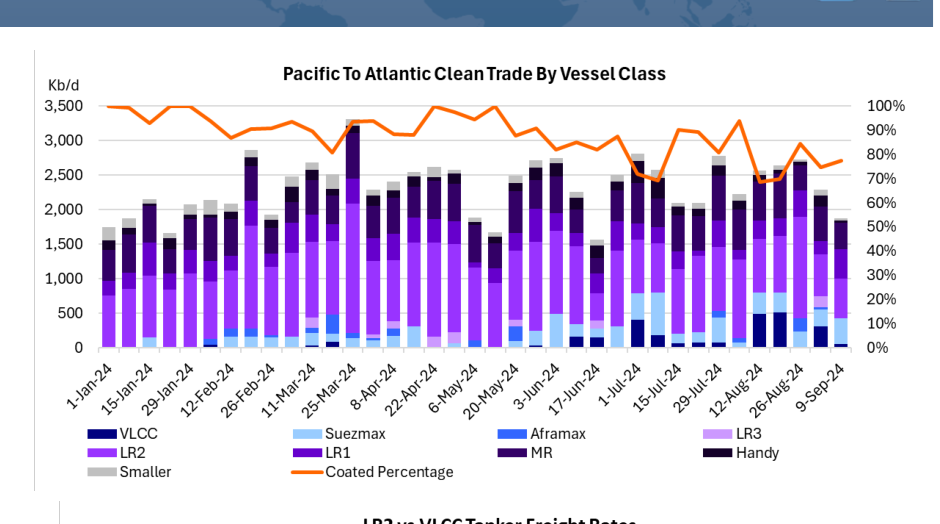
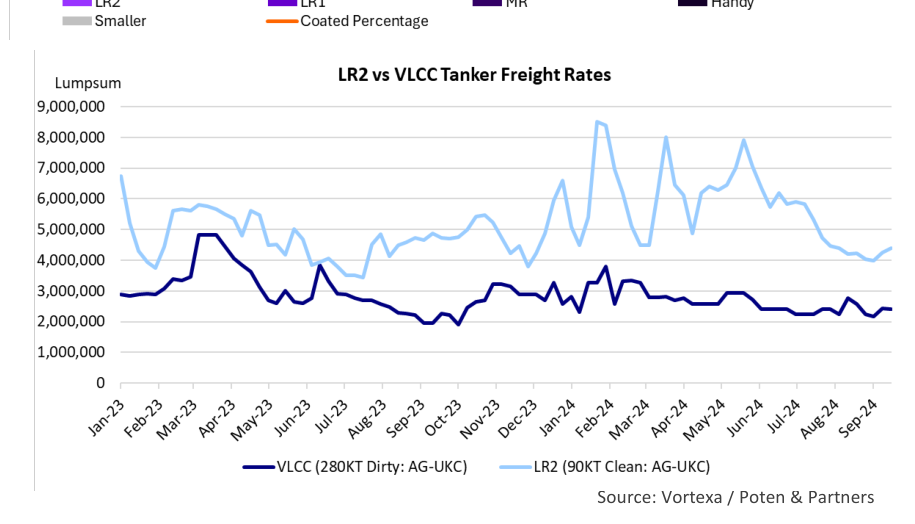

# Very Large Clean Carriers

OK

*Chart*

*Source: Vortexa / Poten & Partners*

### Unusual markets create unusual trades

The tanker industry has a reputation for being a very traditional business. Compared to other industries there has not been a lot of innovation in the way crude oil and petroleum products are moved. This is not a negative judgement. It is a testament to the fact that the global deep-sea shipping markets are already highly efficient and offer a very competitive product. Every now and then, however, there are innovations, sometimes technological, sometimes in business practices. One of those innovations is the use of large crude oil tankers to move refined products. This practice was regularly utilized for newbuilding tankers, transporting refined products on their maiden voyage out of the shipyard. However, now ship owners and operators have started to “clean up” tankers that traditionally traded crude oil and utilized them to transport refined products. What caused this development, what is involved and is this a temporary phenomenon, or is this operational innovation here to stay?

Why would VLCCs and Suezmax crude oil tankers, which are able to move 2 million and 1 million barrels of cargo be employed in the clean products trades? The reason is simple. Bigger ships deliver better economies of scale and the biggest ships would theoretically provide the lowest per barrel transportation costs. That’s why our industry is always driven towards bigger ships. However, there are limitations to using crude tankers for clean products on their maiden voyage out of the yard. these large tankers for clean petroleum products. Many Enabling a VLCC that has been moving crude oil to switch to clean products is product export and import ports are not equipped to handle not straightforward. It is time consuming and expensive. The charterer will these giant tankers. Furthermore, the size of a VLCC cargo is typically use a time-chartered ship for such a voyage. If the entire voyage, three to five times the size of a standard LR1 or LR2 parcel and including about 30 days for clean-up, takes around 90 days, we estimate the many export and import terminals don’t have the tankage to hire at $4 Million (at $45,000/day). Adding to that the costs for fuel and deal with such large cargoes. This means that Ship-To-Ship chemicals, de-slopping charges, the additional manpower cost, as well as transfers may be required on one or both sides of the voyage, bunkers and lightering costs would bring the total cost of the voyage to $7.0 M. increasing the length and the cost of the voyage. However, despite these restrictions, VLCCs and Suezmaxes are However, a quick back-of-the-envelope calculation illustrates that the savings increasingly being utilized for clean cargoes.

on freight are so high that (at least at the moment) it is worth it. In today’s market, moving a 90,000 Metric Ton (MT) cargo of diesel on an LR2 from the A contributing factor to the shift toward clean product Arabian Gulf to the UKC costs $4.4 million, or $49/ton. This is almost double transportation is the relative underperformance of crude oil the cost of the VLCC, which is $7 million for 280,000 tons, or $25/ton. tankers (in particular VLCCs) in the freight market relative to clean product tankers. The Russia – Ukraine war and the Obviously, switching from product tankers to (cleaned) crude tankers is not for conflict in the Middle East, boosted ton-mile demand for everyone or every cargo. The vessels engaged in this trade tend to be modern product tankers. The same development as well as the cutbacks VLCCs. The charterers involved are mostly traders who control the whole in Middle East OPEC production in combination with a voyage and use their own tonnage. The products involved are mostly middle slowdown in the Chinese economy caused the large crude distillates, such as diesel and gasoil. The potential risk of contamination tankers, in particular the VLCCs, to underperform. High freight discourages the use of cleaned up VLCCs for gasoline or jet fuel. rates for product tankers and lower earnings potential for VLCCs This freight arbitrage will likely continue until the growing number of cleaned created the opportunity of using (some of) these large tankers up crude tankers tips the balance back in favor of the dedicated product fleet in the clean product trades. The low level of newbuilding and/or a pickup in oil movements pulls the crude fleet back in their core trades. deliveries also deprived the market of the opportunity to utilize

## Market Exhibits & Charts

> **Exhibit 1: Pacific To Atlantic Clean Trade By Vessel Class**  
> Unit: Kb/d | Percentage · X-axis: 1-Jan-24 to 9-Sep-24  
> Series: VLCC, Suezmax, Aframax, LR3, LR2, LR1, MR, Handy, Smaller, Coated Percentage  
> [Chart image (200 DPI PNG)](../../../charts/poten/2024/poten_2024-09-20_very-large-clean-carriers_chart1.png)

> **Exhibit 2: LR2 vs VLCC Tanker Freight Rates**  
> Unit: Lumpsum · X-axis: Jan-23 to Sep-24  
> Series: VLCC (280KT Dirty: AG-UKC), LR2 (90KT Clean: AG-UKC)  
> *Source: Vortexa / Poten & Partners*  
> [Chart image (200 DPI PNG)](../../../charts/poten/2024/poten_2024-09-20_very-large-clean-carriers_chart2.png)
