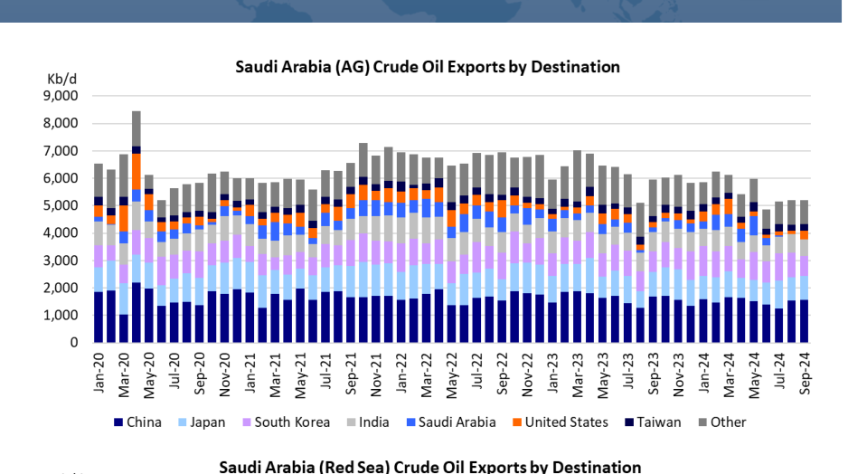
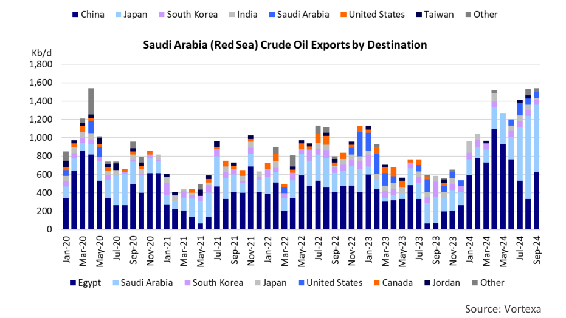

# The Kingdom Has Options

OK

*Chart*

*Source: Vortexa*

### Saudi Arabia is using alternative export outlets

Saudi Arabia is the dominant player in the OPEC cartel. It has the highest export quota and the most spare capacity. That is why pundits always look at the Kingdon to try to determine where OPEC policy might be heading. The Saudi’s play their cards close to their vest, so it is difficult, if not impossible, to gauge their next steps before a decision is taken. The oil markets are in the midst of rising geopolitical tension, face a very close U.S. election and have been dealing with stagnating oil demand in China. On top of that, Saudi oil flows are being directly impacted by the Houthi attacks on commercial shipping. Traditionally, we look at the impact of these events on global supply – demand dynamics, but in this week’s Tanker Opinion, we decided to zero-in on just Saudi Arabia.

Saudi Arabia has long been OPEC’s largest producer. According to the IEA, the country produced 9.04 Mb/d in September 2024, slightly (30,000 b/d) more than in July and August, but considerably less than the 9.61 Mb/d that they averaged in 2023. Globally, only the United States (20.3 Mb/d) and Russia (9.11 Mb/d) produce more crude oil. In 2023, Saudi Arabia held an estimated 17% of the world’s proved oil reserves and 22% of OPEC’s proved reserves, according to OPEC data. In April 2020, the Kingdom briefly produced 12 Mb/d, flooding the market during the Saudi-Russian price war. Shortly thereafter, the pandemic forced oil producers to dramatically cut production.

There are also flows from Saudi Arabia’s east coast to its refineries on the Red Saudi production bottomed at 7.55 Mb/d in June 2020. Since Sea coast as well as export barrels headed towards the Sumed pipeline and the then, production has been gradually brought back. By Suez Canal (Chart 2). Saudi Aramco typically used tankers to move 350-400,000 September 2022, Saudi Arabian production was back to 11 b/d of crude oil from the oil fields on the east coast to its refineries on the west Mb/d. However, increasing non-OPEC output, in particular coast, complementing the flows to its mammoth East-West pipeline, also from the Americas (U.S., Canada, Brazil and Guyana) forced known as the Petroline. In recent months, these seaborne flows from East to OPEC to cut back production and exports once again. Saudi West have diminished, presumably in response to the deteriorating security Arabia, in particular throttled back output to try to balance the situation in the Arabian Gulf and to reduce the Saudi’s exposure to Houthi market and support prices. In addition to its participation in the attacks in the Red Sea. regular OPEC cuts, it committed to an additional 1.5 Mb/d of reductions. These cuts are scheduled to be reversed starting in Switching some oil exports from the Arabian Gulf to the Red Sea allows the December 2024. The oil markets are keeping a close eye on Saudis to better target customers in the Atlantic Basin, which is especially what the Saudis will do. Given the slowdown in global oil attractive now that oil demand growth in the Far East in general and in China in demand growth in general and in China in particular, there is particular has slowed. Having “safe” access to the Sumed pipeline and the Suez not a lot of room in the market to being back production.

Canal gives Saudi Aramco a competitive edge compared to other Middle Additional output will probably put downward pressure on Eastern exporters (for both crude oil and petroleum products) who will need to prices, a scenario that is unattractive to most OPEC+ members ship their barrels around the Cape of Good Hope if they want to sell into Atlantic and Russia in particular, who desperately needs the money for Basin markets. their war against Ukraine.

It is clear that Saudi Arabia has more options than most producers in the Middle Saudi Arabia is not directly involved in the conflict in the Middle East and will be able to use different export outlets to get their product (crude East, but due to its geographical location, it is affected and products) to markets, despite its proximity to the geopolitical hot spots in significantly. The kingdom exports the majority of its crude oil the region. They are also one of the few producers with ample spare from the Arabian Gulf and these barrels are almost exclusively production capacity (around 3.0 Mb/d), which allows them to ramp up exports heading east to China, Japan, South Korea, India, etc. (Chart 1).

and increase their market share, if they thought that would be in their interest.

## Market Exhibits & Charts

> **Exhibit 1: Saudi Arabia (AG) Crude Oil Exports by Destination**  
> Unit: Kb/d · X-axis: Jan-20 to Sep-24  
> Series: China, Japan, South Korea, India, Saudi Arabia, United States, Taiwan, Other  
> [Chart image (200 DPI PNG)](../../../charts/poten/2024/poten_2024-10-25_the-kingdom-has-options_chart1.png)

> **Exhibit 2: Saudi Arabia (Red Sea) Crude Oil Exports by Destination**  
> Unit: Kb/d · X-axis: Jan-20 to Sep-24  
> Series: Egypt, Saudi Arabia, South Korea, Japan, United States, Canada, Jordan, Other  
> [Chart image (200 DPI PNG)](../../../charts/poten/2024/poten_2024-10-25_the-kingdom-has-options_chart2.png)
