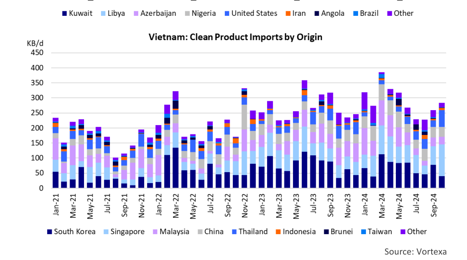

# Energy Independence In Asia

OK

*Chart*

*Source: Vortexa*

### Vietnam’s growth ambitions could change trade flows

Vietnam is an oil producer, crude oil importer and exporter. It plans to continue to invest in the petroleum sector. The country already boasts two refineries, but is planning to add more capacity since it still needs to import products. The country is also an important shipbuilding nation. In short, Vietnam has a little bit of everything, and this combination of factors makes it an important player in the oil and tanker markets of South East Asia. We thought it a good idea to put the spotlight on Vietnam in this week’s Tanker Opinion. Vietnam is one of Asia’s fastest growing economies with more than 100 million people and this represents significant opportunities the oil and tanker markets in the region.

Oil exploration in Vietnam started in earnest in the 1970s, and first oil was produced from the Bach Ho field in 1986. Production gradually increased until the early 2000s. In August 2004, Vietnam’s oil production reached an all-time high of 417,000 barrels per day (b/d). Production averaged around 300,000 b/d from 2000-2015, after which a gradual decline set in. Current production is around 170,000 b/d. Most of Vietnam’s crude oil is refined domestically, but limited volumes (around 30,000 b/d) are exported to a variety of countries in the region, including Thailand, Australia, Japan, China, Singapore, Malaysia, and South Korea.

Vietnam has approximately 350,000 b/d of refining capacity.

demand. This means that Vietnam has to import significant volumes of refined The oldest facility is the Dung Quat Refinery in Quang Ngai products. Over the last two years, Vietnam imported an average of 280,000 Province, on the east coast of central Vietnam. This refinery, b/d, mostly from regional suppliers in South Korea, Singapore, Malaysia, China which opened in 2010 has a capacity of 130,000 b/d. It and Thailand. Given the volumes and distances involved, it is no surprise that processes mostly domestic crude from the Bach Ho Basin, Vietnam’s product imports are mostly done on MRs, Handys and smaller known for its low sulfur content. The second facility is the Nghi vessels. The use of larger product carriers, such as LR1s is extremely rare. Son Refinery and Petrochemical Complex, which has been Vietnam has ambitions to further expand its refining capacity using foreign operational since 2018. This refinery is located in the Thanh Hoa investments. Their ultimate goal is to be self-sufficient in refined product Province in northern Vietnam, 200 kilometers south of Hanoi.

supply. Earlier this year, Australian investors committed $720 million to This 200,000 b/d facility is designed to process heavy crude oil Vietnam to boost product output and upgrade existing facilities. Saudi Aramco from Kuwait. Kuwait Petroleum owns 35.1% of the Nghi Son is another company that is interested in investing in Vietnam. At the end of refinery and they are the sole provider of crude oil. Chart 1 October, PetroVietnam (Vietnam’s state-owned oil company) and Aramco shows the Vietnams crude oil imports by country of origin.

signed a collaboration framework agreement on oil and gas trading. A potential While there are several countries that supply small quantities to investment of Aramco in a new refinery in Vietnam is consistent with the Saudi the Dung Quat Refinery, the exclusive deal that the Kuwaiti’s strategy of securing demand for their crude oil by investing in downstream have with the Nghi Son refinery, means that they dominate facilities in other counties, while securing a long-term supply agreement. If a Vietnams crude oil imports, providing an average 80% of total deal is done, it would probably be along the lines of the Kuwaiti investment in crude oil imports over the last four years. This refinery can the Nghi Son refinery. In exchange for a substantial investment, the Saudis will receive VLCCs, and virtually all crude from Kuwait is delivered supply the crude to the facility, probably using VLCCs. on VLCCs. On July 5, 2024, the Nghi Son refinery received the 200th VLCC at its facility.

If Vietnam builds up its refining capacity, it will require more crude oil imports, most likely from the Middle East, which would benefit VLCCs. At the same time, The two main refineries in Vietnam only produce enough to it will reduce the need for product imports, limiting employment opportunities cover around 50% of the country’s oil product and chemical for MR and Handysize product carriers in the Pacific.

## Market Exhibits & Charts

> **Exhibit 2: Vietnam: Clean Product Imports by Origin**  
> Unit: KB/d · X-axis: Jan-21 to Sep-24  
> Series: South Korea, Singapore, Malaysia, China, Thailand, Indonesia, Brunei, Taiwan, Other  
> *Source: Vortexa*  
> [Chart image (200 DPI PNG)](../../../charts/poten/2024/poten_2024-11-01_energy-independence-in-asia_chart2.png)
