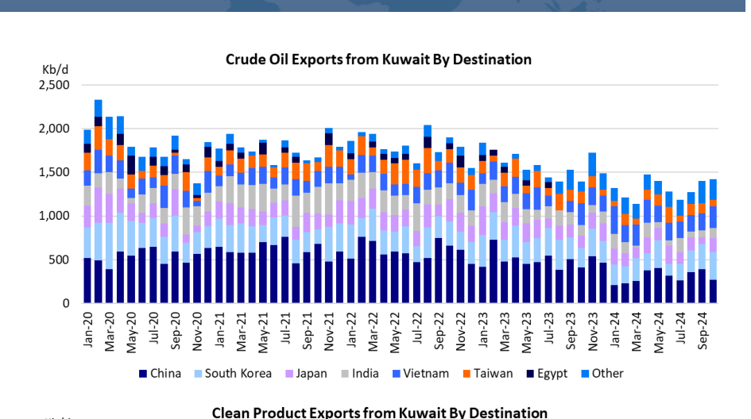
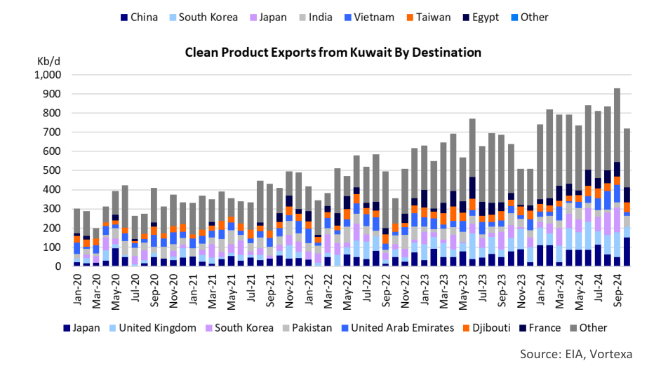

# Kuwait Has Growth Ambitions

### $30 Billion investment plan to boost production

In a recent interview, Sheikh Nawaf Al-Sabah, the CEO of Kuwait Petroleum Corp. (KPC) indicated that they intend to grow their production capacity to 3.2 million barrels per day (Mb/d) next year and to 4.0 Mb/d in 2035. The Kuwaiti's don't ignore the trend towards lower oil demand growth, but even in a scenario with stable global oil demand, the world needs to replace at least 3.0 Mb/d from oil fields that are in decline. So new resources need to be developed and KPC expects to take advantage of the fact that they are a low-cost producer with a low carbon intensity. Due to its large (and growing) refining sector, Kuwait has established itself as a significant exporter of both crude oil and refined products. The impact of KPC on the (spot) tanker market has been relatively limited due to its focus on long-term supply contracts and the utilization of its own tanker fleet to move both crude and products.

Kuwait's oil industry goes back to the early 20th century. In 1934, the Kuwait Oil Company (KOC), a joint venture between the Anglo-Persian Oil Company (now BP) and Gulf Oil Corporation (now Chevron) signed its first oil concession agreement. KOC struck first oil in 1938 and in 1946, Kuwait exported its first crude oil shipments. This established Kuwait as a player in the international oil market. Kuwait built its first refinery in 1949. When the Organization of Petroleum Exporting Countries was formed in Bagdad in 1960, Kuwait was one of the five founding members. During the 1970s, the Kuwaiti government gradually acquired full control over KOC and by 1976, Kuwait had complete control over its oil resources. Kuwait Petroleum Corporation (KPC) was founded in 1980 and consolidated various national oil companies under one umbrella, streamlining operations across exploration, production, refining and marketing.

In 1965, Kuwait's crude oil production was 2.4 Mb/d. This made it the 4th largest oil producer in the world, behind the United States, the Soviet Union and Venezuela, but ahead of Saudi Arabia, Iran and Iraq. Kuwait reached its highest production level in 1972 at 3.34 Mb/d. Current output (according to the IEA Oil Market Report) is around 2.5 Mb/d. While Kuwait's crude oil output has shown limited growth over the last 25 years, its refining capacity has expanded dramatically. It surged from 600,000 b/d in early 2021 to 1.83 Mb/d in 2024 (including their participation in refineries abroad). The biggest contribution has been the completion of the 615,000 b/d Al-Zour refinery, which was officially inaugurated in May 2024. KPC also operates two other domestic refineries: the Mina Al-Ahmadi refinery dates back to 1949, although it has been significantly expanded (current capacity 442,000 b/d); and the 270,000 b/d Mina Abdullah refinery. Kuwait also has investments in, and ships crude oil to, three refineries abroad: in Italy, Vietnam and Oman. Most of these shipments are done on tankers by KPC's shipping arm Kuwait Oil Tanker Company (KOTC).

The growth in domestic refining capacity has reduced Kuwait's ability to export crude oil. As a matter of fact, crude oil exports have been trending down in recent years ([Chart 1](file:///C:/Users/Dell/Github/Shipping/data/extracted/charts/poten/2024/poten_2024-11-22_kuwait-has-growth-ambitions_chart1.png)). However, the exports of refined products have more than doubled over the same time period as a result of the dramatic expansion of refining capacity ([Chart 2](file:///C:/Users/Dell/Github/Shipping/data/extracted/charts/poten/2024/poten_2024-11-22_kuwait-has-growth-ambitions_chart2.png)).

> **Exhibit 1: Kuwait Has Growth Ambitions (Chart 1)**  
> *Source: Poten & Partners*  
> **Interactive Data & Source:** [Local Asset (200 DPI PNG)](file:///C:/Users/Dell/Github/Shipping/data/extracted/charts/poten/2024/poten_2024-11-22_kuwait-has-growth-ambitions_chart1.png)

> **Exhibit 2: Kuwait Has Growth Ambitions (Chart 2)**  
> *Source: Poten & Partners*  
> **Interactive Data & Source:** [Local Asset (200 DPI PNG)](file:///C:/Users/Dell/Github/Shipping/data/extracted/charts/poten/2024/poten_2024-11-22_kuwait-has-growth-ambitions_chart2.png)

From a shipping perspective, it is natural that KPC's emphasis has shifted somewhat from crude oil to refined products. While KOTC is still a significant VLCC owner, it also employs a growing fleet of product carriers. As Kuwait is planning to expand its crude oil production capacity, crude oil exports may start to increase again, since there are no significant refinery expansions on the horizon. Most of the Kuwaiti crude is shipped to Asia on VLCCs, so this could provide a small boost to this segment. However, it is important to remember that there are limits to how much Kuwait can produce. The country is bound by the OPEC quota system. Together with several other OPEC+ members, Kuwait even committed to additional voluntary cuts in April and November 2023. While the plan was to start returning barrels to the market in 2024, these cuts have been extended several times as a result of stagnant global oil demand and low prices. Ultimately, global oil demand will drive production levels of all OPEC members, including Kuwait.
