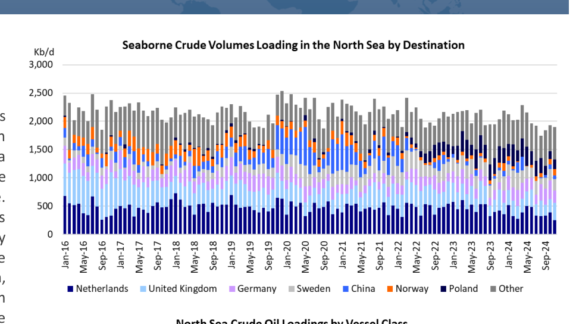
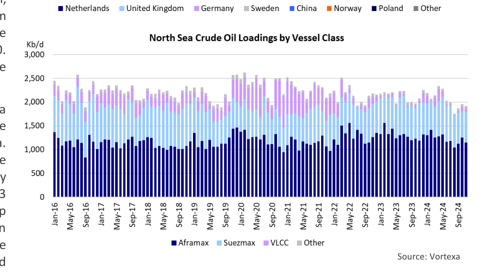

# Approaching The End Of An Era

OK

*Chart: Seaborne Crude Volumes Loading in the North Sea by Destination*

*Chart: North Sea Crude Oil Loadings by Vessel Class*

*Source: Vortexa*

### Lower North Sea output accelerates fall in ton-mile demand

Yesterday, Equinor and Shell, two major European oil companies with a rich history of exploration and production in the North Sea decided to combine their UK offshore oil and gas assets in a 50/50 Joint Venture (JV). The JV is not growth oriented. To the contrary, the JV will harvest value as the assets naturally decline. The objective is to improve the tax efficiency of the operations and pool their costs. It is the latest development in the rapidly maturing UK North Sea basin. While the situation in the Norwegian Continental Shelf is more positive in the short-term, with output expected to grow slightly in 2025, the long-term trajectory for Norway is also challenging. The IEA expects the total North Sea production will decline by 400,000 b/d by 2030. These changes in North Sea production and exports have obvious implications for the tanker market.

The first significant offshore oil discovery in the North Sea occurred in 1969, when Phillips Petroleum discovered the Ekofisk field in the Norwegian sector of the North Sea. Production started in 1971 and today, Ekofisk remains one of the most important oil fields in the region, producing approximately 127,000 b/d. The oil crises of the 1970s, including the 1973 OPEC oil embargo and the 1979 Iranian revolution led to sharp increase in oil prices, causing widespread economic turmoil in Western Europe and the United States. As a result, these countries, realizing their dependence on the Middle East and other external sources of energy, started to focus on developing UK, Germany, Sweden), primarily in Aframax and Suezmax tankers. In alternative sources of energy supply. The significant increase in 2018/2019, China became a more significant importer of North Sea crude. prices also created an economic incentive for countries to These volumes were transported on VLCCs. The North Sea – Asia route is one develop their own oil resources. The UK and Norway of the world’s longest for crude oil tankers and the increase in Chinese demand accelerated exploration and production efforts in the North Sea.

was a boost for tanker ton-miles. Chinese demand for North Sea crude increased further in 2020 – 2022, coinciding with the startup of the massive Prior to 1970, Romania (!) was the largest oil producer in Europe Johan Sverdrup field. During this period, China was the largest importer of this (outside of the Soviet Union). By the mid-1970s, production in new medium sour crude, which was a good fit for Chinese refiners. Norway and the United Kingdom started to ramp up. In 1970, their combined production was only 4,000 b/d. By 1976, this When Russia invaded Ukraine, everything changed. European refiners stopped had increased to 537,000 b/d. North Sea production surpassed buying Russian Ural crudes and North Sea crudes partially filled the gap, 2.0 Mb/d in 1979, 3.0 Mb/d in 1983 and 4.0 Mb/d in 1991.

reducing the availability of these crudes for Asian refiners. Instead, China is North Sea crude oil output peaked in 2000 at close to 6.5 Mb/d now buying significant volumes of Ural crudes. These changes have altered the before a gradual decline set in. This drop in production stopped shipping dynamics. The VLCC trade ex-North Sea, which was booming in 2020-and stabilized in 2012/2013. Output has been fairly stable since 2021, collapsed and the utilization of Aframaxes and Suezmaxes increased. then, with declines in the UK compensated for by increases in It is difficult to be definitive about the changes that are in store for the future. Norwegian production. For the moment Norway remains Refiners in countries like Sweden, Finland and Poland are now significant buyers committed to continued exploration and production. However, of North Sea crude and it is unlikely that they will revert back to buying Urals, the expectation is that the longer-term trend is for production even if the conflict in Ukraine ends. This could permanently reduce the to go down as European countries are moving away from fossil availability of North Sea grades for Asian buyers. This means that the long-haul fuels due to environmental concerns and legal challenges.

VLCCs trade that was blossoming in the years prior to the Russian invasion may Historically, a significant portion of the North Sea output has not come back, and be reduced to the occasional arbitrage shipment. been shipped to short-haul destinations in Europe (Netherlands, Aframaxes and Suezmaxes will be in charge of the North Sea crude oil trade.

## Market Exhibits & Charts

> **Exhibit 1: Seaborne Crude Volumes Loading in the North Sea by Destination**  
> Unit: Kb/d · X-axis: Jan-16 to Sep-24  
> Series: Netherlands, United Kingdom, Germany, Sweden, China, Norway, Poland, Other  
> [Chart image (200 DPI PNG)](../../../charts/poten/2024/poten_2024-12-06_approaching-the-end-of-an-era_chart1.png)

> **Exhibit 2: North Sea Crude Oil Loadings by Vessel Class**  
> Unit: Kb/d · X-axis: Jan-16 to Sep-24  
> Series: Aframax, Suezmax, VLCC, Other  
> *Source: Vortexa*  
> [Chart image (200 DPI PNG)](../../../charts/poten/2024/poten_2024-12-06_approaching-the-end-of-an-era_chart2.png)
