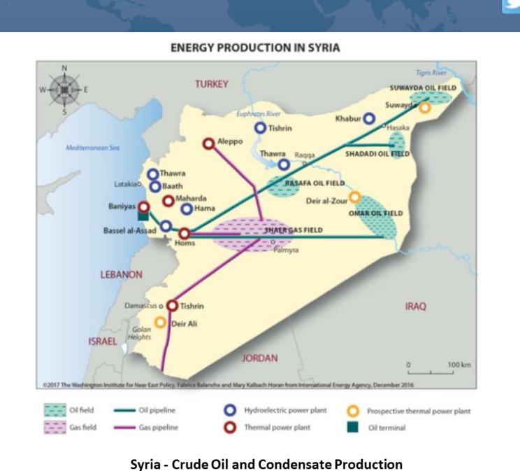
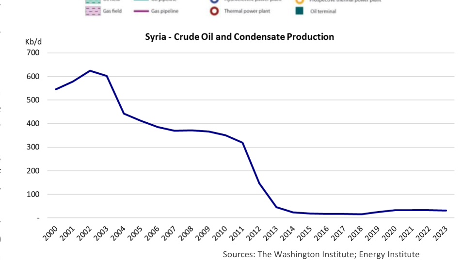

# Heightened Uncertainty In The Middle East

OK

*Chart: Syria - Crude Oil and Condensate Production*

*Sources: The Washington Institute; Energy Institute*

### What is next for a key player in the region?

On December 8, 2024, the regime of Bashar al-Assad, the President of Syria, collapsed after rebel forces quickly took over some of the major cities, including Aleppo and ultimately the capital Damascus. The offensive was led by the group Hayat Tahir al-Sham (HTS), but other groups were involved as well. The conflict dates back to the start of the Syrian civil war in 2011, which was rooted in the broader Arab Spring movement. The Assad government was able to remain in power with the help of Russia, Iran and Hezbollah. However, tensions remained and the opposition groups were able to successfully topple the regime 13 years later. While Syria is not a major oil producer like some other countries in the Middle East, it plays an important strategic role in the region. We’ll discuss some of the potential implications of the recent changes in Syria for the oil and tanker markets in this week’s Tanker Opinion.

Prior to the civil war, Syria’s crude oil production ranged between 350,000 and 400,000 barrels per day (b/d), of which 140,000 b/d were exported, primarily to Europe. Syria has three export terminals on the Mediterranean Sea, all operated by the Syrian Company for Oil Transport (SCOT). Syria has two crude oil export blends, Syrian Light and Syrian Heavy (also known as Souedieh). In 2010, oil exports accounted for roughly 25% of Syria’s government revenue. However, the 2011 civil war decimated the oil and gas industry in the country and in 2012, Syria became a net importer of oil. According to the U.S. Energy Information Administration (EIA), production declined to 25,000 b/d in 2015. Recent years showed a small recovery, with production in 2023 estimated to be around 90,000 b/d. The about the future of oil supplies. Syria clearly has upside potential from the problem for the government was that most of Syria’s oil fields current situation. However, even if the political situation in the country are located in the Eastern part of the country, much of which is stabilizes (a big “if”), rebuilding Syria’s oil infrastructure will take a lot of time controlled by the Syrian Democratic Forces (SDF), a Kurdish and money. One of the key hurdles are the strict international sanctions that dominated coalition of militias, backed by the United States.

are in place. Syria is one of the most heavily sanctioned countries in the world and without lifting or easing these sanctions it will be difficult to rebuild the It is estimated that Syria has proved oil reserves of about 2.5 country’s energy infrastructure. billion barrels. Most of Syria’s conventional oil is heavy and sour. Syria also has shale oil resources, but a bidding round to develop In the short-term, Russia and Iran, who supported the previous government, these resources – scheduled for November 2011 – was delayed will be most impacted. Russia which had been bombing the rebels currently in because of the political situation in the country. After the civil power for more than a decade, risks losing two military bases in the country. war, many western countries placed sanctions on Syria. Exports For Iran, they lose a key ally in their “Axis of Resistance” and one of the few dried up and the government was forced to import crude and remaining customers for their oil. This is a blow to the regime in Tehran, which products to meet domestic demand. Iran became Syria’s already suffered from its conflict with Israel and the weakening of its other primary supplier of crude oil providing approximately 60-70,000 proxies in the region, such as Hamas and Hezbollah. b/d of oil.

In the short-to medium-term, the events in Syria create more uncertainty in an After the fall of the Assad regime, the situation in Syria has already volatile region of the world. There is the potential for an increase in the become highly uncertain and it will take some time to figure out geopolitical risk premium on oil prices. The fact that many global and regional what’s next. The opposition rebels have appointed a powers have been meddling for decades in Syria, increases the risk that the transitional government, and experts are waiting for clarity regime change could spill over into neighboring countries.

## Market Exhibits & Charts

> **Interactive Asset:** [Local Asset (200 DPI PNG)](../../../charts/poten/2024/poten_2024-12-13_heightened-uncertainty-in-the-middle-east_chart1.png)

> **Exhibit 2: Syria - Crude Oil and Condensate Production**  
> Unit: Kb/d · X-axis: 2000 to 2023  
> Series: Syria - Crude Oil and Condensate Production  
> *Source: The Washington Institute; Energy Institute*  
> [Chart image (200 DPI PNG)](../../../charts/poten/2024/poten_2024-12-13_heightened-uncertainty-in-the-middle-east_chart2.png)
