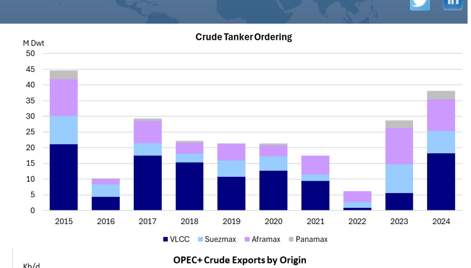
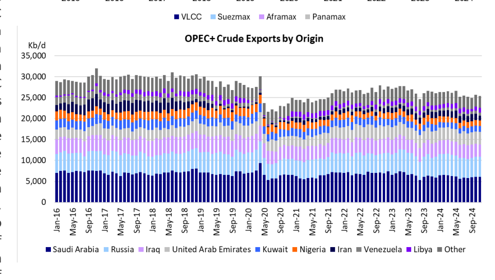

# Our 2024 Forecast Review

### Looking back at our projections for 2024

On January 19th of this year, we discussed several trends/developments that we expected to happen in the tanker market in 2024 ("Looking Ahead"). As we are approaching the end of December, it is time to look back at our predictions and see how we did.

1. VLCC newbuilding orders will take off in 2024.

We hit it out of the park on this one. VLCC orders did take off in 2024 (see [Chart 1](file:///C:/Users/Dell/Github/Shipping/data/extracted/charts/poten/2024/poten_2024-12-20_our-2024-forecast-review_chart1.png)). The year 2022 was the low point in VLCC contracting with only 0.9 Mdwt (3 vessels), not surprising given a terrible 2020/2021 as a result of the pandemic. The Russian invasion of Ukraine gave Aframaxes and Suezmaxes a boost in 2022 and 2023, while VLCCs earnings underperformed. VLCC ordering did pick up to 5.6 Mdwt (18 vessels), but Suezmaxes (9.1 Mdwt) and Aframaxes/LR2's were still more in demand in 2023. In 2024, VLCC took center stage. Improving rates in the second half of 2023 and the first half of 2024, gave owners more optimism. This was underpinned by an ageing fleet and the prospects for longer haul oil demand due to the expectation that OPEC+ would roll back (some of) their production cuts. Despite stubbornly high newbuilding prices, owners flocked to the shipyards. Ordering activity slowed in the second half of 2024 as VLCC rates declined, but the year 2024 will end with an estimated 18.2 Mdwt of new VLCC orders, the highest level of contrasting of this size segment since 2015.

> **Exhibit 1: Crude Tanker Ordering**  
> Unit: M Dwt · X-axis: 2015 to 2024  
> Series: VLCC, Suezmax, Aframax, Panamax  
> [Chart image (200 DPI PNG)](../../../charts/poten/2024/poten_2024-12-20_our-2024-forecast-review_chart1.png)

2. (Geo) Politics will dominate the tanker market in 2024.

It is hard to argue against this one as well. Major elections in important global democracies (USA, India, UK and Mexico, just to name a few) headlined the political landscape. In total, 70 countries held elections in 2024. In the US, President Trump reclaiming the White House is already having a significant impact on the world stage, well before his inauguration on January 20, 2025. None of the conflicts that were raging in 2023 came to a conclusion this year. The war in Ukraine continues unabated; the conflicts in the Middle East have expanded with a deeper involvement of Iran and its "Axis of Resistance", including the Houthi's terrorizing the Bab el-Mandeb Strait. Just a few weeks ago, the Assad regime in Syria was toppled. In Latin America, Mr. Maduro declared himself the winner of the Presidential election in Venezuela, which was widely regarded as marred by irregularities and fraud. All these events had an impact (directly or indirectly) on the oil and tanker markets.

3. Tanker recycling will pick up in 2024 as some vessels of the "dark fleet" will start to be phased out This forecast did not materialize. To the contrary, although the final numbers are not yet in, it is estimated that tanker recycling in 2024 was at the same low levels as in 2023, despite a rapidly ageing tanker fleet. The main drivers were relatively strong earnings and the continued availability of buyers that were willing to employ ageing vessels in the sanctioned, but lucrative, dark fleet. The increased scrutiny facing these dark fleet vessels, has limited their options in the recycling market. The cash buyers, acting as middlemen in these transactions, are unwilling to engage with the owners of the vessels in fear of facing sanctions.

### 4. OPEC+ will reverse some of their voluntary production cuts

This did not happen. Non-OPEC production continued to increase, while global oil demand growth was rather anemic. In their latest Oil Market Report, the IEA estimates that oil demand will grow by 840,000 b/d in 2024, a sharp deceleration from 2023, which saw 2.0 Mb/d of growth relative to 2022. China was the main drag on oil demand growth. In 2023, China rebounded from the pandemic with a strong 1.35 Mb/d growth. For this year, the IEA expects China to grow by only 140,000 b/d (10% of last year's growth). As a result, there was no room for OPEC+ to expand production and/or reverse some of the voluntary cuts that were made in 2022/2023, without putting significant downward pressure on oil prices. With a rather subdued long-term outlook for global oil demand, it remains to be seen how long OPEC+ can maintain internal unity and continue its policy of production restraint. For the moment, they remain focused on supporting prices rather than maintaining market share.

So, our forecasting record for 2024 was a mixed bag. We nailed two predictions but missed the boat on two others. Next month we will look ahead to 2025.

## Market Exhibits & Charts

> **Exhibit 2: OPEC+ Crude Exports by Origin**  
> Unit: Kb/d · X-axis: Jan-16 to Sep-24  
> Series: Saudi Arabia, Russia, Iraq, United Arab Emirates, Kuwait, Nigeria, Iran, Venezuela, Libya, Other  
> [Chart image (200 DPI PNG)](../../../charts/poten/2024/poten_2024-12-20_our-2024-forecast-review_chart2.png)
