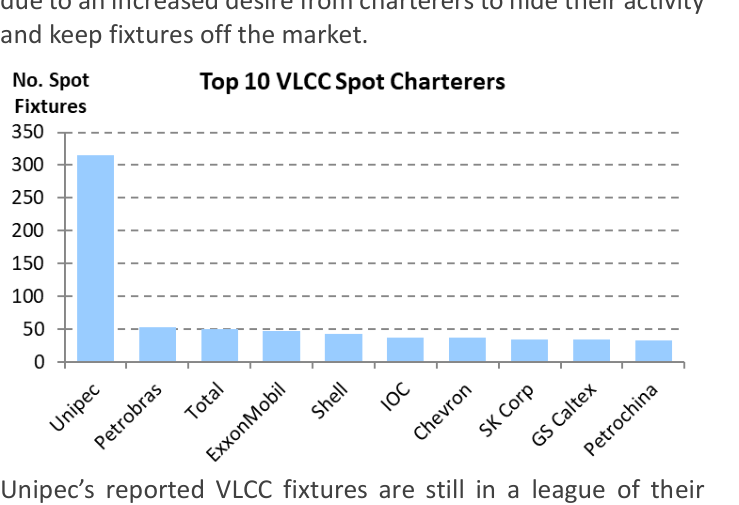
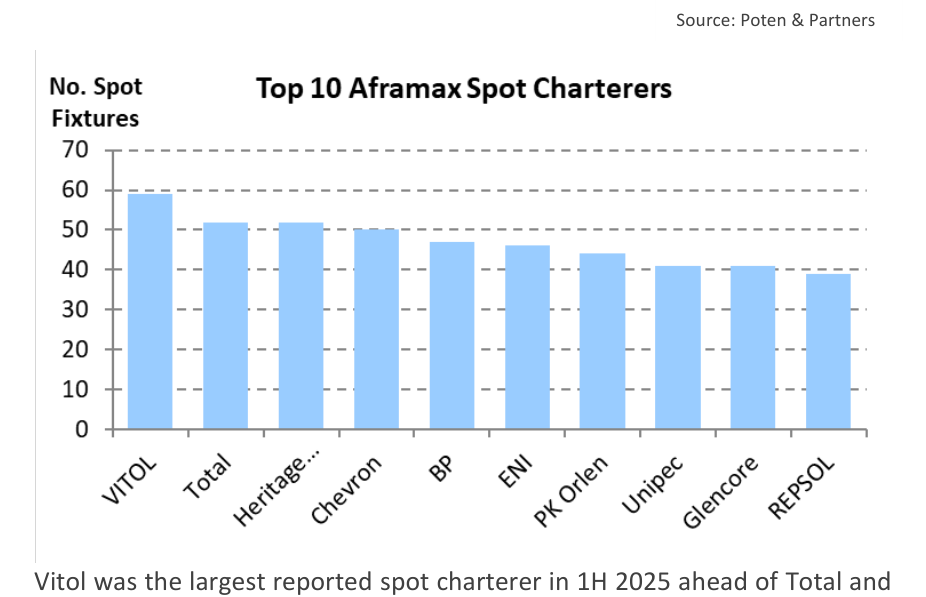
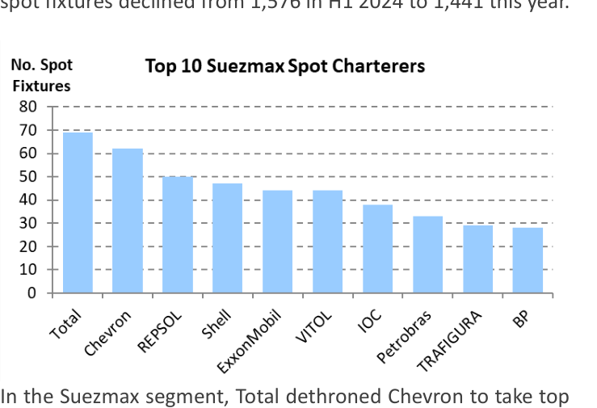

# Tanker Midterms   2025 Edition

### Reported % of Total 2025 H1 Total Cargo Dirty 2024  H1 2025 H1 Rank Charterer (MT 000's) Cargoes Rank Fixtures Top Reported Dirty Spot Charterers for 1H 2025*

Six months into 2025, we'll take stock again of the movements in the dirty tanker spot market. Unipec is still on top, but since China imports substantial volumes of crude oil from sanctioned countries such as Iran and Russia, its dominance in the (reported) spot market has been waning. Unipec is down from 422 reported fixtures in 1H 2024 to 380 in the first half of this year. Overall fixture volumes are down 4.5% from 1H 2024, partly as a result of an increase in sanctioned trades, but also due to an increased desire from charterers to hide their activity and keep fixtures off the market.

Unipec's reported VLCC fixtures are still in a league of their own, despite a decrease fixtures volume from 344 in H1 2024 to 315 in H1 2025. Petrobras (53 fixtures) maintained its second place, testament to Brazil's growing crude oil exports to the Far East. French oil major Total moved up to third, from eight spot one year ago. Overall, the number of reported VLCC spot fixtures declined from 1,576 in H1 2024 to 1,441 this year.

In the Suezmax segment, Total dethroned Chevron to take top spot with 69 fixtures, moving up from the seventh spot last year. Chevron claimed second spot with 62, followed by REPSOL (50), Shell (47), Exxon and VITOL (both at 44). Trafigura returned to the top 10, while Unipec dropped out (to #12).

| Rank | Charterer | Reported Total Cargo (MT 000s) | % of Total Dirty Cargoes | Prev Rank | Fixtures |
| --- | --- | --- | --- | --- | --- |
| 1 | Unipec | 90,470 | 15.3% | 1 | 380 |
| 2 | Total | 26,540 | 4.5% | 5 | 181 |
| 3 | Chevron | 22,430 | 3.8% | 2 | 159 |
| 4 | ExxonMobil | 21,325 | 3.6% | 4 | 135 |
| 5 | Shell | 20,058 | 3.4% | 3 | 139 |
| 6 | Petrobras | 18,655 | 3.2% | 8 | 93 |
| 7 | VITOL | 18,178 | 3.1% | 7 | 150 |
| 8 | IOC | 15,233 | 2.6% | 6 | 84 |
| 9 | BP | 14,150 | 2.4% | 10 | 115 |
| 10 | Petrochina | 13,465 | 2.3% | 9 | 85 |
| 11 | REPSOL | 11,085 | 1.9% | 15 | 99 |
| 12 | TRAFIGURA | 10,937 | 1.8% | 21 | 90 |
| 13 | PTT | 10,125 | 1.7% | 11 | 54 |
| 14 | SK Corp | 9,505 | 1.6% | 13 | 38 |
| 15 | GS Caltex | 9,215 | 1.6% | 12 | 35 |
| 16 | Equinor | 8,683 | 1.5% | 20 | 63 |
| 17 | Glencore | 7,621 | 1.3% | 23 | 73 |
| 18 | Aramco | 7,451 | 1.3% | 18 | 67 |
| 19 | NSRP | 6,480 | 1.1% | 25 |  |
| 20 | Phillips 66 | 6,400 | 1.1% | 16 |  |

Vitol was the largest reported spot charterer in 1H 2025 ahead of Total and Heritage Energy. In the Aframax segment, Chevron, which took the top spot last year, moved down to fourth in the first six months of 2025. Aframax activity was down across the board. Reported Aframax fixtures dropped 14%, from 1254 in 1H 2024 to 1081 in the same period this year. * The above report has been assembled from market intelligence and reported spot market activity. As such, it may not provide a complete picture of the market due to the private nature of many spot market fixtures.

## Market Exhibits & Charts

> **Exhibit 1: Top 10 VLCC Spot Charterers**  
> Unit: No. Spot Fixtures · X-axis: Unipec to Petrochina  
> Series: Unipec, Petrobras, Total, ExxonMobil, Shell, IOC, Chevron, SK Corp, GS Caltex, Petrochina  
> [Chart image (200 DPI PNG)](../../../charts/poten/2025/poten_2025-07-11_tanker-midterms-2025-edition_chart1.png)

> **Exhibit 2: Top 10 Aframax Spot Charterers**  
> Unit: No. Spot Fixtures · X-axis: VITOL to REPSOL  
> Series: VITOL, Total, Heritage..., Chevron, BP, ENI, PK Orlen, Unipec, Glencore, REPSOL  
> [Chart image (200 DPI PNG)](../../../charts/poten/2025/poten_2025-07-11_tanker-midterms-2025-edition_chart2.png)

> **Exhibit 3: Top 10 Suezmax Spot Charterers**  
> Unit: No. Spot Fixtures · X-axis: Total to BP  
> Series: Total, Chevron, REPSOL, Shell, ExxonMobil, VITOL, IOC, Petrobras, TRAFIGURA, BP  
> [Chart image (200 DPI PNG)](../../../charts/poten/2025/poten_2025-07-11_tanker-midterms-2025-edition_chart3.png)
