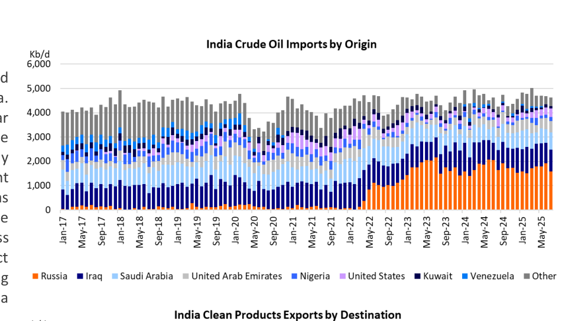
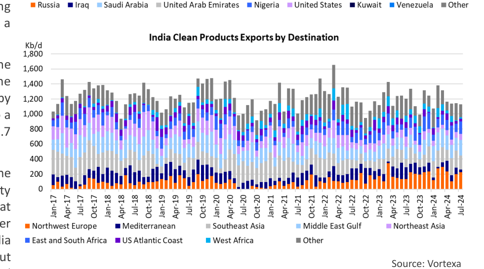

# Indias Catch 22

### Indian refiners are facing a dilemma

Today, on Friday, August 15, U.S. President Donald Trump and Russian President Vladimir Putin will meet in Anchorage, Alaska. The central focus of the meeting will be the ongoing war between Russia and Ukraine. This summit has captured the attention of the world. One country that will pay particularly close attention to the proceedings in Alaska is India. In recent weeks, India has been singled out by both the EU and the US as a major beneficiary of the war in Ukraine, and sanctions have been put in place (EU) or are being considered (US). Regardless of the outcome of the summit, crude oil and refined product flows to and from India will probably change in the coming months and into 2026. These changes in flows will have a meaningful impact on the tanker market as well.

India is the most populous country in the world. They are the 3rd highest energy consumer in the world behind China and the United States. The IMF projects India's economy to grow by 6.4% in both 2025 and 2026. India's oil consumption grew to a high of 5.6 Mb/d in 2024. The IEA expects demand to be 5.7 Mb/d in 2025 with a further growth of 160,000 b/d in 2026.

India has a large, modern and growing refining industry, the second largest in Asia (after China), with a nameplate capacity of just under 5.2 Mb/d in 2024. By 2028, the EIA estimates that another 0,5 - 2.4 Mb/d of capacity could be online, with further growth expected after that. The three largest refineries in India are located in Jamnagar and Vadinar on India's West Coast, but India has refineries all over the country. Many of the largest and most modern facilities are privately owned and mostly export oriented, while the state-owned refineries traditionally focus on satisfying domestic demand for refined products.

India has very limited domestic oil production (only around 700,000 b/d), so the refineries need to import the vast majority of their feedstock. In the first half of 2025, India imported an average of 4.8 Mb/d of crude oil.

For the purposes of this Opinion, we need to highlight what happened to India's crude oil and refined product flows after Russia invaded Ukraine. Following the start of the conflict, the EU, UK, the United States and several other Western countries sanctioned Russia and eliminated crude oil and refined products imports from the country. Russia was forced to heavily discount its oil to make it attractive to other buyers. India was one of these buyers. As can be seen in [Chart 1](../../../charts/poten/2025/poten_2025-08-15_indias-catch-22_chart1.png), India bought virtually no crude oil from Russia prior to the start of the war in Ukraine (February 2022), relying mostly on the Middle East, which makes sense given its geographical proximity. Since 2022, Russia has become India's largest supplier of crude oil. India is now importing less on VLCCs, and more on Aframaxes.

> **Exhibit 1: India Crude Oil Imports by Origin**  
> Unit: Kb/d · X-axis: Jan-17 to May-25  
> Series: Russia, Iraq, Saudi Arabia, United Arab Emirates, Nigeria, United States, Kuwait, Venezuela, Other  
> [Chart image (200 DPI PNG)](../../../charts/poten/2025/poten_2025-08-15_indias-catch-22_chart1.png)

The product side of the equation is also interesting. Prior to the war, Russia exported significant volumes of refined products to Europe. The imposition of sanctions after the invasion of Ukraine, closed this market, and Europe needed to look for alternative supplies. India was one of the countries that picked up the slack (see [Chart 2](../../../charts/poten/2025/poten_2025-08-15_indias-catch-22_chart2.png)). Ironically, some of these Indian products were probably refined from Russian crude.

> **Exhibit 2: India Clean Products Exports by Destination**  
> Unit: Kb/d · X-axis: Jan-17 to Jul-24  
> Series: Northwest Europe, Mediterranean, Southeast Asia, Middle East Gulf, Northeast Asia, East and South Africa, US Atlantic Coast, West Africa, Other  
> [Chart image (200 DPI PNG)](../../../charts/poten/2025/poten_2025-08-15_indias-catch-22_chart2.png)

Indian refiners were able to benefit from discounted crude prices while selling the refined products at regular market prices in Europe and elsewhere. This was highly lucrative until both Europe and the U.S. decided to clamp down on this profitable arbitrage in recent weeks. Europe started by sanctioning an Indian refiner that is partially owned by the Russians and also announced a boycott of petroleum products refined from Russian crude. Earlier this month, U.S. President Trump announced an additional 25% tariff on Indian exports to the U.S. because of India's imports of Russia crude. This potentially put India in a difficult spot. They could go back to their pre-2022 crude oil slate and cut back on Russian imports, but this will be more expensive. At the same time, Russia will struggle to replace India as a customer. Mr. Trump will want to use this as leverage in his discussions with Mr. Putin. If a deal can be reached (or substantial progress is made), sanctions relief may be on the cards. However, if the summit fails, India may need to change its buying behavior if it wants to please the EU and US. Interesting times ahead.
