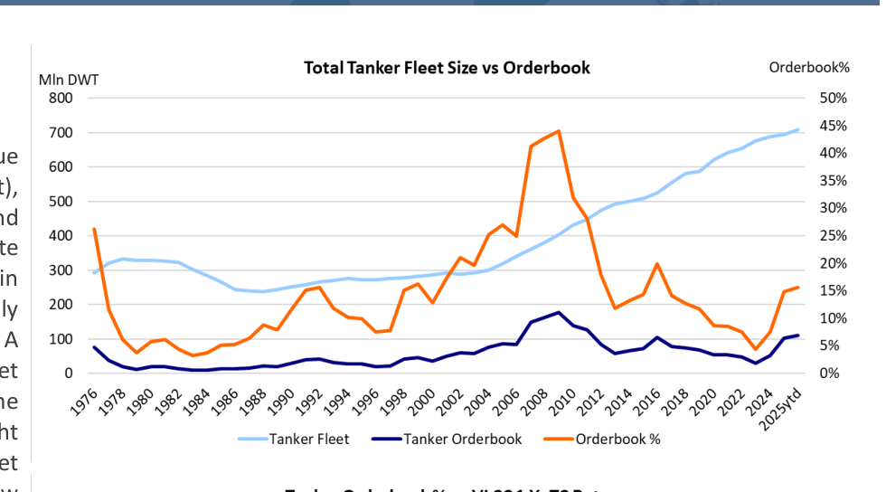
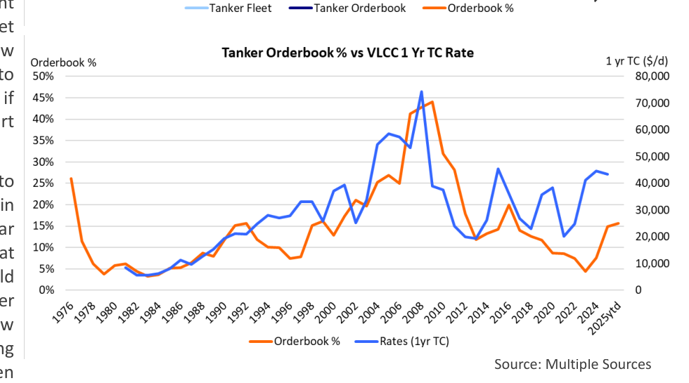

# Orderbook or Orderboom

### Is the orderbook getting too high?

The tanker market has been on a roll in the last few months due to a combination of factors. Increased sanctions (enforcement), resilient oil demand, partly due to stock building in China, and growing OPEC+ supply all contributed to create a rate environment we have not seen since the freight rate boom in the early days of the pandemic. Very limited fleet supply growth, both in 2024 and 2025 has contributed as well. A tightening supply-demand balance has made the freight market more susceptible to small changes in ton-mile demand. The strong cashflows that are being generated in the current freight market has given owners added confidence to look at fleet growth and renewal. In this Tanker Opinion, we will review existing ordering trends to see how they compare to developments in the past. The objective is to determine if current ordering behavior is something that owners should start worrying about.

Tanker orders were modest during 2021 and 2022, which led to the low deliveries in 2024 and 2025. Contracting accelerated in the years following the Russian attack on Ukraine, in particular of Aframax/LR2 and Suezmax tankers, the segments that benefited the most from the Russian aggression. Owners sold older secondhand vessels into the "dark fleet" at ever higher prices and reinvested at least some of these proceeds into new orders. VLCCs joined the party in 2024 with new orders tripling relative to the previous year. For 2025 YTD, ordering has been lower than in 2024, but despite the slowdown, the overall orderbook for delivery over the next three to five years has grown significantly. The total tanker orderbook as percentage of the existing fleet is currently 16%, solidly in the double digits. Recent headlines from the trade press suggest that more orders are in the pipeline, especially for larger crude oil tankers.

Tanker contracting activity is highly cyclical and is driven to a large extent by current cashflows and owners' confidence in future markets. Unfortunately, tanker markets are notoriously hard to predict, and it always takes a leap of faith to commit many millions of dollars to build an asset that will only deliver several years into the future. The benefit of new construction is that shipyards offer installment plans allowing owners to spread out payments. Only a 10-20% payment is usually required upfront. Eye-popping freight rates, for VLCCs in particular, seem to have convinced at least some owners that new tonnage could be a good investment. Other factors that are often quoted are the age profile of the fleet. Limited recycling (scrapping) of older tankers has gradually increased the average age of the fleet, and the rationale is that these ships will eventually have to go. However, many of these older vessels are part of the dark fleet and employed in highly lucrative sanctioned trades. Only a part of this fleet will be recycled when these sanctions are lifted, and the timing of this sanction's relief is highly uncertain.

As mentioned before, the current (2025) tanker orderbook stands at 15% of the fleet, which is relatively high, but not unprecedented (see [Chart 1](../../../charts/poten/2025/poten_2025-11-07_orderbook-or-orderboom_chart1.png)). In 1991/1992, the orderbook reached these levels as well as the global tanker fleet started its transition from single-hull to double-hull vessels. Ordering levels remained elevated for an extended period of time (about 10 years), because the whole world tanker fleet needed to be replaced. The period from 2001-2009 was another period of exceptionally high orders. During this "super cycle" shipping markets were fueled by the rapid growth of the Chinese economy. In 2007-2009, the tanker orderbook exceeded 40% of the fleet. However, the global financial crisis caused markets to crash. It took the tanker market many years to work through the oversupply.

> **Exhibit 1: Total Tanker Fleet Size vs Orderbook**  
> Unit: Mln DWT | Orderbook% · X-axis: 1976 to 2025ytd  
> Series: Tanker Fleet, Tanker Orderbook, Orderbook %  
> [Chart image (200 DPI PNG)](../../../charts/poten/2025/poten_2025-11-07_orderbook-or-orderboom_chart1.png)

The most recent orderbook spike occurred in 2015/2016 after OPEC decided to flood the market to maintain market share. A surge in oil on the water increased the use of tankers as floating storage, amplifying the spike in rates. The current tanker market boom has some similar short-term catalysts, albeit in a very different geopolitical environment. There is one more important caveat: long-term oil demand growth will be limited, and excessive fleet growth cannot be absorbed by growing ton-mile demand. Owners will need to keep this in mind when considering placing even more newbuilding orders.

## Market Exhibits & Charts

> **Exhibit 2: Tanker Orderbook % vs VLCC 1 Yr TC Rate**  
> Unit: Orderbook % | 1 yr TC ($/d) · X-axis: 1976 to 2025ytd  
> Series: Orderbook %, Rates (1yr TC)  
> *Source: Multiple Sources*  
> [Chart image (200 DPI PNG)](../../../charts/poten/2025/poten_2025-11-07_orderbook-or-orderboom_chart2.png)
