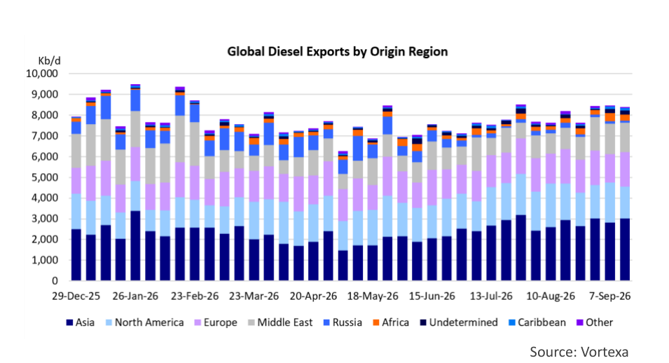
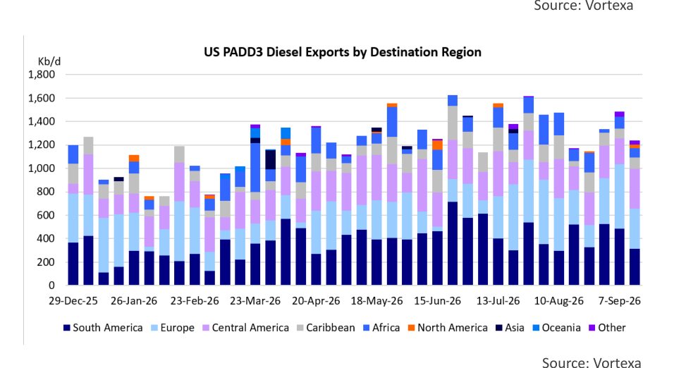

# Do We Need To Plan For A Diesel Export Ban

### A diesel export ban would reshuffle trade flows

High fuel prices and upcoming elections are a bad combination, and politicians will do (almost) anything to prevent getting blamed for it. Instead, they would like to be seen doing something about it. Record high U.S. diesel prices less than six weeks before the U.S. midterm elections on November 3rd have focused the mind of politicians. One of the ideas that has been floated is to ban diesel exports from the U.S. for a period of time, like 90 days. Even a temporary ban would create severe disruptions in the global seaborne diesel trade. We'll discuss some of the implications, as well as unintended consequences in this week's Tanker Opinion.

The current situation is as follows. Average retail diesel prices in the U.S. are $6.50 per gallon according to the AAA. One month ago the price was $5.62 and one year ago the average price was $3.69/gallon. Two factors in particular have contributed to these rapid price increases: the war in the Middle East, which restricted the availability of refined products and the Ukrainian attacks on Russian refiners, which traditionally produced (and exported) significant volumes of diesel.

Under normal circumstances, the global seaborne diesel trade is about 8 Million barrels per day (Mb/d). The United States exports about 1.5 Mb/d, representing about 20% of global trade. Countries in Europe and Central & South America are highly dependent on U.S. diesel. In 2026 YTD, the U.S. exported about 135,000 b/d of diesel to Mexico, 125,000 b/d to Chile, and 100,000 b/d to Brazil. In Europe, France (85,000 b/d) and the United Kingdom (70,000 b/d) were the biggest importers. A suspension of U.S. diesel exports, even for a limited period of time, would create significant problems which would reverberate around the world. Europe and South/Central America would try to source their diesel from other countries, primarily India, Singapore, Korea and (maybe) China. This would increase demand in an already tight global market, pushing up prices. A country like Australia, with limited domestic refining capacity, imports some 550,000 b/d of diesel, primarily from South Korea, Singapore and Taiwan. If the U.S. implements an export ban, would the Australians suddenly find themselves competing with European and Latin American buyers?

If U.S. Gulf refiners could no longer export diesel, domestic stocks for this product would quickly replenish and prices come down, especially if the halt on overseas shipments would be combined with an existing waiver of the Jones Act. After a while, to try to prevent a domestic diesel glut, U.S. refiners would try to optimize their yields toward gasoline and jet production, while filling up diesel stocks. After some time (30- 45 days), when diesel inventories are rebuilt, U.S. refiners will be forced to reduce runs. This would also limit gasoline and jet fuel production, pushing up prices for these products (one of the unintended consequences). Cuts in refinery runs would reduce crude oil demand in the U.S., making more crude oil available for export. This crude could be exported to Europe and Asia, eventually facilitating more refining output (including diesel).

The implications for the freight market of a U.S. diesel export ban would be significant as well. Once the export ban is announced, refiners will try to export as many barrels of diesel as they can before it is enacted. This will cause a mad rush to fix MR product tankers in the U.S. Gulf, spiking TC14, the benchmark shipping route that tracks the cost of transporting clean petroleum products from the US Gulf to Europe. However, this will be only a short-term spike. When the ban is in effect, MR demand in the U.S. Gulf will drop and remain subdued. To the extent that customers in Europe and Latin America will try to source diesel from Asia, that will boost rates for product tankers in that region (MRs and potentially LRs), especially since these will be long-haul trades.

On the crude side, we may see a pickup in exports from the U.S. when domestic refiners cut runs to prevent a domestic diesel glut. The Brent/WTI spread will expand, making WTI more attractive in export markets. This could boost Aframax employment for moves to Europe while more VLCCs could make their way to Asia with U.S. crude.

## Market Exhibits & Charts

> **Interactive Asset:** [Local Asset (200 DPI PNG)](file:///C:/Users/Dell/Github/Shipping/data/extracted/charts/poten/2026/poten_2026-09-25_do-we-need-to-plan-for-a-diesel-export-ban_chart1.png)

> **Interactive Asset:** [Local Asset (200 DPI PNG)](file:///C:/Users/Dell/Github/Shipping/data/extracted/charts/poten/2026/poten_2026-09-25_do-we-need-to-plan-for-a-diesel-export-ban_chart2.png)
