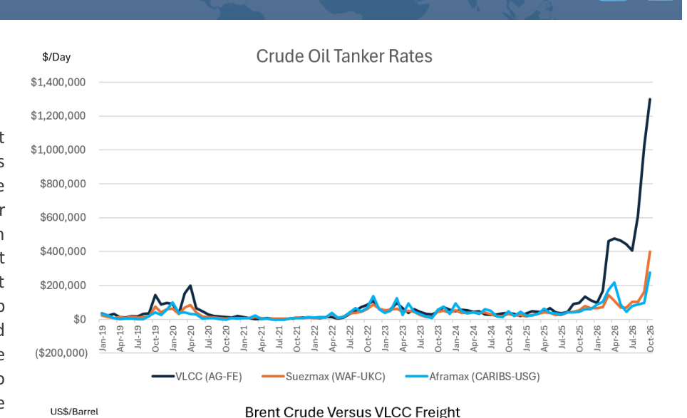
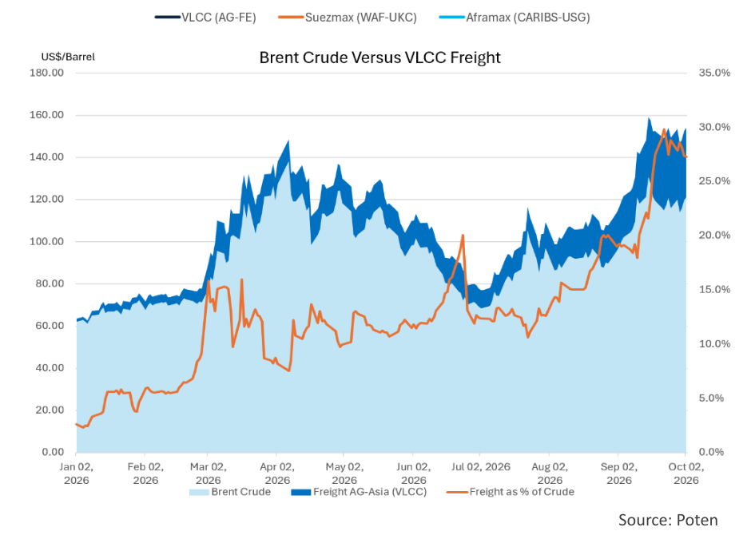

# Tanker Demand Destruction

### Could high freight rates restrict tanker demand

A review of Poten's Daily Market Report, which monitors spot freight rates on many of the key tanker trade routes, shows eyewatering numbers. Across the board, tanker rates have reached levels never seen before (see [Chart 1](file:///C:/Users/Dell/Github/Shipping/data/extracted/charts/poten/2026/poten_2026-10-02_tanker-demand-destruction_chart1.png)). The reasons for the sky-high tanker rates are well documented. The wars in Europe and the Middle East have created significant inefficiencies in the market. On top of that, there is the threat of attacks in areas like the Strait of Hormuz, the Bab el-Mandeb Strait and the Black Sea, which have spiked insurance rates and risk premiums. Widespread sanctions have also limited the availability of mainstream vessels that have the flexibility to trade worldwide. Last, but not least, ownership of the large tanker fleet (in particular VLCCs) is more concentrated than in the past, which, in combination with the other factors, has shifted some of the negotiating power from the charterers to the owners. The big question is: How high can it go and how long will it last? It is safe to say that it has already gone higher and lasted longer than most people expected. The follow up question could be: is there a level at which freight rates start to restrict oil demand?

> **Exhibit 1: Crude Oil Tanker Rates**  
> Unit: $/Day · X-axis: Jan-19 to Oct-26  
> Series: VLCC (AG-FE), Suezmax (WAF-UKC), Aframax (CARIBS-USG)  
> [Chart image (200 DPI PNG)](../../../charts/poten/2026/poten_2026-10-02_tanker-demand-destruction_chart1.png)

In the oil markets, when prices spike (like in the early weeks of the war against Iran), people start talking about which price levels will lead to demand destruction. Obviously, there are no hard and fast numbers, it very much depends on the circumstances and which countries/regions they are talking about. However, oil analysts typically focus on quoted oil prices for Brent, WTI, etc. when discussing this topic. In the current market, that is a mistake. Freight needs to be taken into account. Historically, freight was such a small component of the delivered cost of a barrel of oil that it could be easily ignored. As recently as January of this year, this was still the case. While Brent crude was priced at around $62 per barrel. VLCC rates for the benchmark AG-Far East route in the early days of 2026 were around $30,000/day, equivalent to $1.73 per barrel, adding 3% to the delivered cost of crude oil (on the Middle East to Asia route). Today's physical market price for Brent crude is estimated to be around $120 per barrel. In contrast, VLCC rates have reached unprecedented levels and are now at $1.3 million per day (43 times the January number). This is equivalent to almost $33/barrel, or 27% of the delivered cost of the crude. [Chart 2](file:///C:/Users/Dell/Github/Shipping/data/extracted/charts/poten/2026/poten_2026-10-02_tanker-demand-destruction_chart2.png) shows the dramatic increase of tanker freight as a percentage of Brent crude prices.

> **Exhibit 2: Brent Crude Versus VLCC Freight**  
> Unit: US$/Barrel | % · X-axis: Jan 02, 2026 to Oct 02, 2026  
> Series: Brent Crude, Freight AG-Asia (VLCC), Freight as % of Crude  
> *Source: Poten*  
> [Chart image (200 DPI PNG)](../../../charts/poten/2026/poten_2026-10-02_tanker-demand-destruction_chart2.png)

These exceptional freight levels do have an impact on trade flows. Refiners will buy the oil that gives them the best refining margin. In the past, this would primarily be driven by the crude grade and its yield. However, if the margin for the ideal crude grade becomes too small or disappears because of high freight cost, refiners will consider other crude grades from sources closer to home as long as the savings in transportation cost compensate for the lower yield. If this is not possible, refiners may need to consider cutting runs. Unfortunately for refiners, the global oil market remains really tight, and refiners do not have many options. For the moment that means that most charterers will pay up to get access to the crude they need.

Even in a crazy market, shipowners tend to make rational decisions. A VLCC owner that discharged in Asia faces a choice: Ballast all the way to the U.S. Gulf to pick up a long-haul cargo to Asia, currently yielding around $400,000/day or take a (shorter) ballast voyage to West Africa or Brazil for a cargo to Asia, generating TCE's of around $650,000/day. Or, he can brave the AG market and potentially earn more than $1.0 Million/day. This earnings discrepancy has kept VLCCs closer to the Asian market, leaving it to Suezmaxes and Aframaxes to do the heavy lifting out of the U.S. Gulf, turbo-charging their earnings. Our expectation is that as long as there is more crude oil demand than supply, tanker rates will remain strong. However, as soon as the crude oil market loosens, tanker rates will come off the boil quickly.
