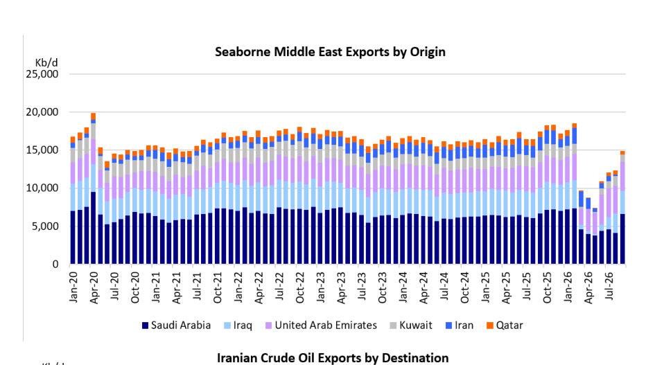
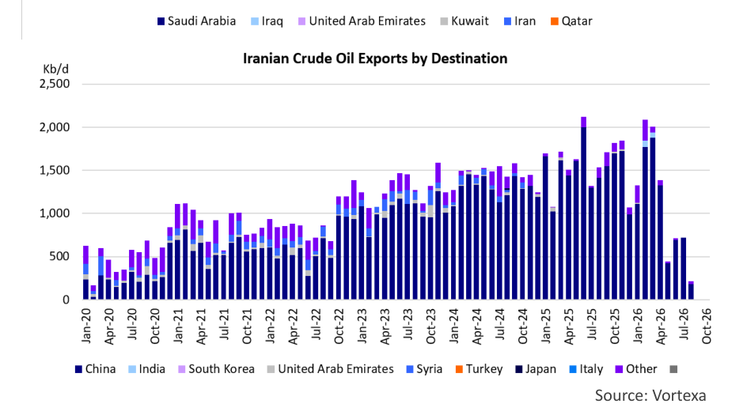

# A Tale Of Two Straits

### The continuously shifting control of the Strait of Hormuz

A lot has been written about the Strait of Hormuz this year. It is a vital global energy choke point situated between the Persian Gulf and the Gulf of Oman, bordered by Iran to the north and Oman and the United Arab Emirates to the south. In the oil and tanker markets it was well known as a potential risk factor because roughly 20% of the world's seaborne oil trade (crude oil and refined products) passes through this 20-24-mile-wide passageway. However, after the start of the U.S. - Iran conflict on February 28 of this year, the Strait of Hormuz has also featured frequently in the mainstream press, and it has become a household name. Shortly after the start of the conflict, Iran declared the Strait of Hormuz "closed", wreaking havoc in the oil markets. Ever since, there has been a tug of war between the United States and Iran about control of this waterway.

In the early stages of the war, Iran seemed to have the upper hand in the Strait of Hormuz. Immediately following the US strikes, Iran effectively closed the Strait. Traffic through the waterway plummeted by over 95%, leaving hundreds of tankers (and other ships) stranded and causing historic disruptions to global energy supplies. Iran used its control over the Strait of Hormuz to choke of Persian Gulf exports from Saudi Arabia, Iraq, Kuwait and Qatar, while - at least initially - being able to maintain its own exports. There was a big difference in dropoff between the countries that have access to bypass pipelines (Saudi Arabia and the United Arab Emirates), and the ones that do not (Iraq and Kuwait). For example, between February and March 2026, Saudi Arabia's exports fell from 7.35 Mb/d to 4.57 Mb/d (-38%), while the UAE dropped from 3.47 Mb/d to 2.08 Mb/d (-40%). The Saudis expanded the use of the East-West pipeline to the Red Sea port of Yanbu, while the UAE had access to the Abu Dhabi Crude Oil Pipeline. Contrast this with the dropoff in exports from Iraq (-82%), Kuwait (-81%) and Qatar (- 80%). During the same period, Iran was able to maintain its exports at around 2.0 Mb/d. Exports from the region (including Iran) continued to fall through April and May, especially after the United States implemented a naval blockade on Iranian ports and coastal areas to prevent Iranian oil exports.

There was a brief recovery in flows after the U.S. and Iran signed a Memorandum of Understanding (June 17), which established an immediate 60-day ceasefire and a framework to reopen the Strait of Hormuz. However, this MOU collapsed in July following renewed clashes and retaliatory strikes. On July 14, President Trump reinstated the naval blockade on Iran, which remains in place until today.

By the end of July, the Houthi's got involved in the conflict by announcing a naval blockade on Saudi Arabia, forcing Yanbu exports to be re-routed north via the Sumed pipeline and the Suez Canal. An August attack on the East-West pipeline forced the Saudis to temporary halt exports via Yanbu and expand the use of their terminals in the Persian Gulf again. Although the East-West pipeline has been repaired and flows resumed, Saudi Arabia continues to make use of the "Hormuz Shuttle Service" to export crude. The expanded use of the Hormuz Shuttle Service, in combination with the flows through the pipelines of the Saudis and the Emeratis, has pushed seaborne crude oil exports from the Middle East close to pre-war levels. It should be noted that refined product flows are still far below pre-war levels.

Ironically, the Iranians, who still claim to "control" the Strait of Hormuz, are currently the ones who are not able to get their crude oil to market. This is in stark contrast to the beginning of the conflict, when the roles were reversed. Frustrated, and in an attempt to reassert control, Iran has stepped up its attacks on the tankers shuttling the crude utilizing the southern route along the Omani coastline. As a result, transits have dipped in recent days, but ships continue to cross. It is a highly lucrative trade for those involved and willing to take the risk.

The situation in the Strait of Hormuz will likely continue to ebb and flow until either the US or Iran decides that it is in their best interest to restart negotiations. That is unlikely to happen before the midterm elections in the U.S. Until that time, we expect that tanker rates will remain close to current (record) levels.

## Market Exhibits & Charts

> **Interactive Asset:** [Local Asset (200 DPI PNG)](../../../charts/poten/2026/poten_2026-10-09_a-tale-of-two-straits_chart1.png)

> **Interactive Asset:** [Local Asset (200 DPI PNG)](../../../charts/poten/2026/poten_2026-10-09_a-tale-of-two-straits_chart2.png)
