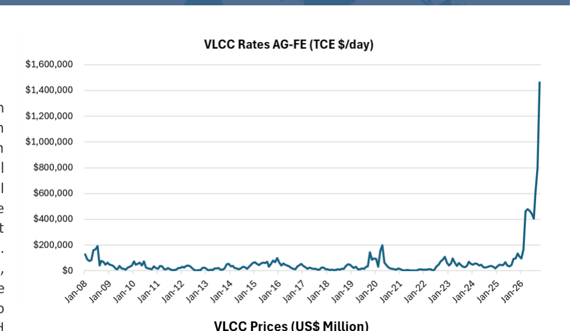
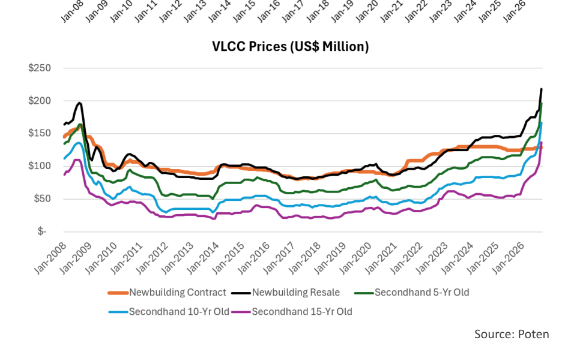

# The Price Is Right

### Prices for secondhand tankers are soaring

In the United States there is a long running popular television game show called "The Price Is Right". Contestants compete in a variety of games to determine the prices of products which they may win. The contestant whose bid is closest to the actual retail price of the product without going over wins. As far as I know, secondhand oil tankers have never featured in this game show, but if they did, contestants would have a very difficult time determining the correct price. Especially at the moment. Unlike newbuilding prices, which are primarily cost-driven, second-hand prices are intensely market-driven. And in the current freight market, which has reached extreme levels due to the various geopolitical conflicts around the world, secondhand prices have gone through the roof. We'll discuss some of these developments and their underlying drivers in more detail in this week's Tanker Opinion. We are focusing on VLCCs because this is the highest-profile tanker segment with the most extreme price movements. However, similar developments are taking place in the other tanker sectors.

In a "normal" market, the cost of a newbuilding acts as the upper benchmark for the pricing of a secondhand vessel. However, a newbuilding ordered today will not be delivered until, at the earliest, 2029. So, in the current freight market, in which VLCCs can earn in excess of $1 million per day (see [Chart 1](../../../charts/poten/2026/poten_2026-10-16_the-price-is-right_chart1.png)), there is an extreme "prompt delivery premium." Secondhand vessels, which can be employed immediately in the current (red hot) market, are much more valuable than newbuildings for which you have to wait three years. This is reflected in the current prices for secondhand tonnage ([Chart 2](../../../charts/poten/2026/poten_2026-10-16_the-price-is-right_chart2.png)). According to Poten's Marine Project Report, you can order a newbuilding VLCC (Forward Delivery) for $130 Million. However, a prompt resale (delivery today) is valued at $235 Million, an 82% premium. If that is too expensive, you can try to buy a 5-Yr old VLCC for $210 Million or a 10-Yr old for $180 Million. Even a 15-Yr old VLCC is higher priced than a newbuilding contract. There are no bargains in this market. It is also important to note that the market for secondhand tonnage is very illiquid. While the shipping press is full of rumored transactions, relatively few deals are actually concluded, because the bid-ask spread is so wide. Shipowners with tonnage on the water make so much money that they are reluctant to sell their ship and with prices rising so much, so quickly, nobody wants to sell too soon. After all, prices may be higher tomorrow and, in the meantime, owners are collecting record earnings. One way to deal with that conundrum is to sell a ship forward, i.e. agree on a price now for delivery in 6 months. While you may not get the highest price, the owner will be able to continue to partake in the high freight market for a while longer. Publicly listed owners can use their (currently highly valued) shares as currency to facilitate transactions. That's another way to create liquidity.

> **Exhibit 1: The Price Is Right (Chart 1)**  
> *Source: as printed on the chart*  
> **Interactive Data & Source:** [Local Asset (200 DPI PNG)](../../../charts/poten/2026/poten_2026-10-16_the-price-is-right_chart1.png)

> **Exhibit 2: The Price Is Right (Chart 2)**  
> *Source: as printed on the chart*  
> **Interactive Data & Source:** [Local Asset (200 DPI PNG)](../../../charts/poten/2026/poten_2026-10-16_the-price-is-right_chart2.png)

The last time that newbuilding resales and 5-Yr old secondhand tankers were valued above newbuilding contract prices was in 2008, at the tail end of the commodity and shipping "super cycle" (and right before the Global Financial Crisis). However, the situation is different this time. During the previous boom, high tanker rates were driven by years of supercharged (Chinese) demand growth. The current rate spike is triggered by recent geopolitical events that have caused massive inefficiencies in the market. This has created some unique circumstances. The only way to for Middle East producers to get meaningful volumes of oil out of the Persian Gulf is to participate in the Hormuz Shuttle Service. However, constant Iranian attacks on tankers passing the Strait of Hormuz have made this a perilous trade, and only a very limited number of independent owners are willing to expose their crew and vessels to these risks. This has encouraged Middle East producers to try to acquire more vessels, so they can use their own tonnage to move their oil. This has driven up prices of tonnage even further, with a significant premium for prompt delivery in the AG.

The market shows eye-popping numbers for secondhand tonnage, but based on current rates, it does not take long to earn back the premium that you have to pay (if somebody is willing to sell you a ship). Maybe the price is right?
