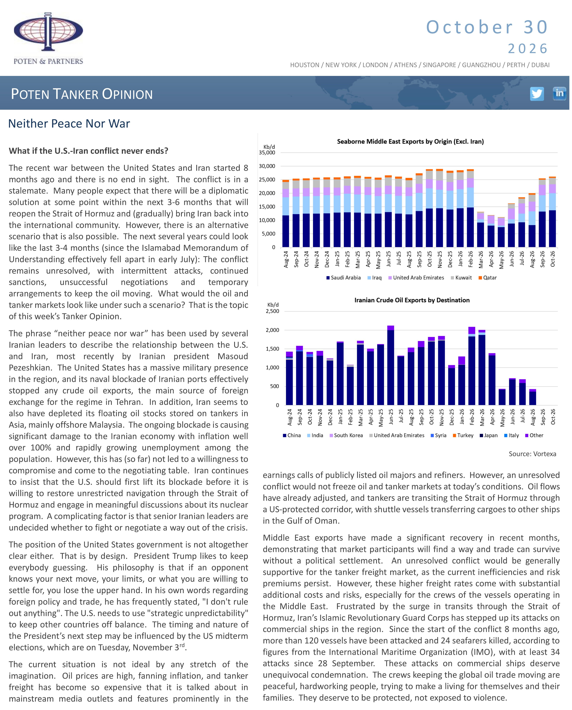

# Neither Peace Nor War

### What if the U.S.-Iran conflict never ends?

The recent war between the United States and Iran started 8 months ago and there is no end in sight. The conflict is in a stalemate. Many people expect that there will be a diplomatic solution at some point within the next 3-6 months that will reopen the Strait of Hormuz and (gradually) bring Iran back into the international community. However, there is an alternative scenario that is also possible. The next several years could look like the last 3-4 months (since the Islamabad Memorandum of Understanding effectively fell apart in early July): The conflict remains unresolved, with intermittent attacks, continued sanctions, unsuccessful negotiations and temporary arrangements to keep the oil moving. What would the oil and tanker markets look like under such a scenario? That is the topic of this week’s Tanker Opinion.

The phrase “neither peace nor war” has been used by several Iranian leaders to describe the relationship between the U.S. and Iran, most recently by Iranian president Masoud Pezeshkian. The United States has a massive military presence in the region, and its naval blockade of Iranian ports effectively stopped any crude oil exports, the main source of foreign exchange for the regime in Tehran. In addition, Iran seems to also have depleted its floating oil stocks stored on tankers in Asia, mainly offshore Malaysia. The ongoing blockade is causing significant damage to the Iranian economy with inflation well over 100% and rapidly growing unemployment among the population. However, this has (so far) not led to a willingness to compromise and come to the negotiating table. Iran continues to insist that the U.S. should first lift its blockade before it is willing to restore unrestricted navigation through the Strait of Hormuz and engage in meaningful discussions about its nuclear program. A complicating factor is that senior lranian leaders are undecided whether to fight or negotiate a way out of the crisis.

The position of the United States government is not altogether clear either. That is by design. President Trump likes to keep everybody guessing. His philosophy is that if an opponent knows your next move, your limits, or what you are willing to settle for, you lose the upper hand. In his own words regarding foreign policy and trade, he has frequently stated, "I don't rule out anything". The U.S. needs to use "strategic unpredictability" to keep other countries off balance. The timing and nature of the President’s next step may be influenced by the US midterm elections, which are on Tuesday, November 3".

The current situation is not ideal by any stretch of the imagination. Oil prices are high, fanning inflation, and tanker freight has become so expensive that it is talked about in mainstream media outlets and features prominently in the earnings calls of publicly listed oil majors and refiners. However, an unresolved conflict would not freeze oil and tanker markets at today’s conditions. Oil flows have already adjusted, and tankers are transiting the Strait of Hormuz through a US-protected corridor, with shuttle vessels transferring cargoes to other ships in the Gulf of Oman.

Middle East exports have made a significant recovery in recent months, demonstrating that market participants will find a way and trade can survive without a political settlement. An unresolved conflict would be generally supportive for the tanker freight market, as the current inefficiencies and risk premiums persist. However, these higher freight rates come with substantial additional costs and risks, especially for the crews of the vessels operating in the Middle East. Frustrated by the surge in transits through the Strait of Hormuz, Iran’s Islamic Revolutionary Guard Corps has stepped up its attacks on commercial ships in the region. Since the start of the conflict 8 months ago, more than 120 vessels have been attacked and 24 seafarers killed, according to figures from the International Maritime Organization (IMO), with at least 34 attacks since 28 September. These attacks on commercial ships deserve unequivocal condemnation. The crews keeping the global oil trade moving are peaceful, hardworking people, trying to make a living for themselves and their families. They deserve to be protected, not exposed to violence.

## Page image

