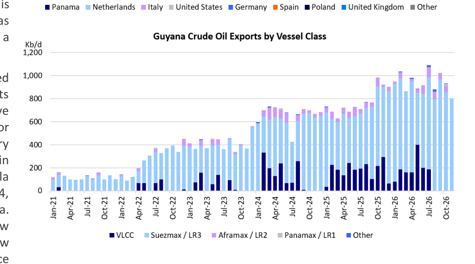
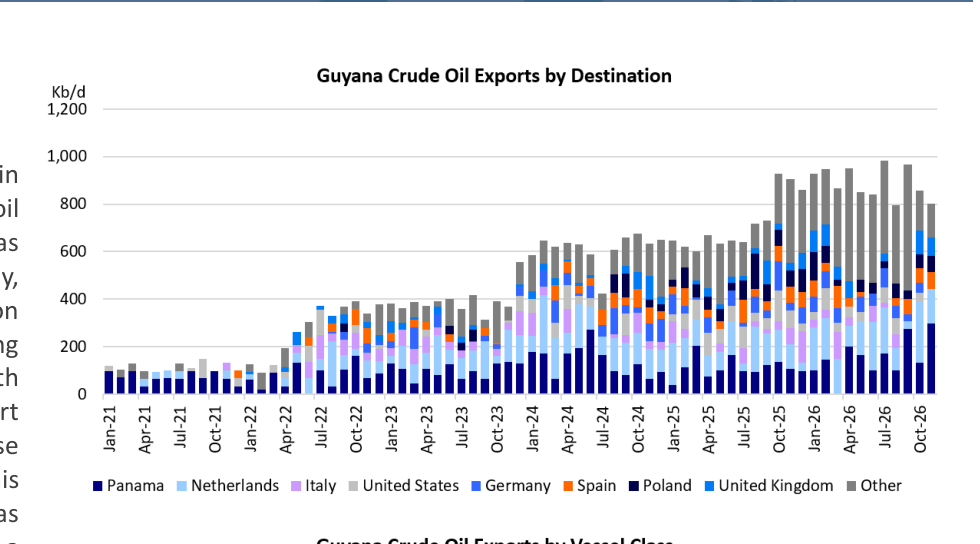

# The Gift That Keeps On Giving

### ExxonMobil approves further Guyana expansion

The first time we dedicated a Tanker Opinion to Guyana was in October 2019 before any oil had reached the market. First oil started to flow in 2020. Since those early days, Guyana has become a major non-OPEC producer and exporter. Thursday, ExxonMobil announced that it made a final investment decision on the Longtail development offshore Guyana after receiving final government and regulatory approvals. This is the eighth development on the Stabroek block, and it is expected to start up in 2030. Because all of Guyana’s oil is being exported, these developments have been a boon for the tanker market. In this Tanker Opinion, we will go back to the early days, what has happened since and what can we expect for the future, with a particular focus on the impact on the tanker markets.

Ever since Guyana’s gained its independence from the United Kingdom in 1966, companies have been looking for oil. Its neighboring countries, in particular Venezuela and Brazil have significant oil reserves, and the expectation was the same for Guyana. However, for decades, oil explorers only drilled dry holes. ExxonMobil initiated oil and gas exploration activities in Guyana in 2008. Plagued by border disputes with Venezuela and Suriname and after a collapse in the oil price in 2014, several international oil companies pulled out of Guyana. However, Exxon remained committed. It brought in new partners: Nexen in 2012 (now CNOOC), and Hess in 2014 (now Chevron). In May 2015, it announced that it struck oil. Since then, Guyana has become one of the most successful oil exploration sites in the world. The consortium led by ExxonMobil has, in relatively quick succession, developed the following fields: Liza 1 (120,000 b/d), Liza 2, (220,000 b/d), Payara (220,000 b/d) and Yellowtail (250,000 b/d). The Uaru field (250,000 b/d) is currently being commissioned, while Whiptail (250,000 b/d) is under construction with startup targeted for 2027. All fields are located offshore in the Stabroek block and serviced by Floating Production, Storage and Offloading vessels (FPSO’s). Except for the first unit, the Liza Destiny, which was converted from an existing VLCC, all FPSO’s are newbuildings with a storage capacity of 2.0 million barrels.

Suezmaxes have dominated the trade ever since exports started (Chart 2). While there were some initial restrictions on the use of VLCCs, the main reason for the use of Suezmaxes was the fact that most of Guyana oil went to short-to-medium haul destinations, ideally suited to the 1-Million-barrel tanker. Europe has been the main destination, especially since the initial ramp-up in Guyana exports coincided with the Russian invasion of Ukraine, which forced European refiners to look for alternative feedstock. Since early 2024, more VLCCs were utilized to export Guyana’s crude to destinations in Asia such as China, India and Thailand. However, in August 2026, Guyana’s exports have again become the exclusive domain of the Suezmax. This coincided with an exponential increase in VLCC rates which reduced the availability and competitiveness of this vessel class in the Guyana export trade. China continues to import crude from Guyana (China’s CNOOC holds a 25% stake in the Stabroek block), using Suezmaxes to shuttle their crude to Chiriquí Grande, the Caribbean entrance of the Trans-Panama Pipeline. Different tankers pick up the crude from the other end of the pipeline in Puerto Armuelles on Panama’s Pacific coast.

*Chart: Guyana Crude Oil Exports by Destination*

*Chart: Guyana Crude Oil Exports by Vessel Class*

*Source: Vortexa*

In September 2026, ExxonMobil and its partners produced the 1 Billionth barrel of oil from Stabroek. The company currently estimates that Guyana has a resource base of around 11 billion oil-equivalent barrels. This ranks Guyana among the world’s top twenty oil reserve holders. The country’s crude oil exports are expected to increase from 900-925,000 b/d currently to 1.7 Mb/d in 2030. The future appears bright for Guyana and the tanker market. The risk of conflict with Venezuela has subsided after the fall of Maduro and the country appears to have little appetite to join OPEC (and its quota system) As the freight market normalizes, we expect the VLCCs to re-renter the market, but continued production growth keeps expanding the export pie, so there will be growing employment opportunities for all the main crude tanker segments.

## Market Exhibits & Charts

> **Exhibit 2: Guyana Crude Oil Exports by Destination**  
> Unit: Kb/d · X-axis: Jan-21 to Oct-26  
> Series: Panama, Netherlands, Italy, United States, Germany, Spain, Poland, United Kingdom, Other  
> *Source: Vortexa*  
> [Chart image (200 DPI PNG)](../../../charts/poten/2026/poten_2026-11-14_the-gift-that-keeps-on-giving_chart2.png)

> **Exhibit 1: Guyana Crude Oil Exports by Vessel Class**  
> Unit: Kb/d · X-axis: Jan-21 to Oct-26  
> Series: VLCC, Suezmax / LR3, Aframax / LR2, Panamax / LR1, Other  
> *Source: Vortexa*  
> [Chart image (200 DPI PNG)](../../../charts/poten/2026/poten_2026-11-14_the-gift-that-keeps-on-giving_chart1.png)
