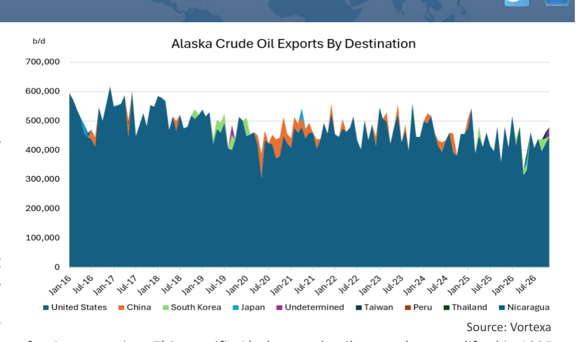

# Barrels Without Borders

### Alaskan crude oil production returns to growth

On November 10, the Energy Information Administration (EIA) published its latest Short-Term Energy Outlook (STEO). In this report, the EIA stated that, after decades of decline, crude oil production in Alaska is growing again, driven by two projects on Alaska’s North Slope . The EIA projects that Alaskan production will grow by 23,000 b/d (6%) in 2026, followed by a 60,000 b/d increase in 2027. If this growth is realized, Alaska will produce 505,000 b/d in 2027, the highest output since 2014. According to the EIA, the last time Alaska saw production increases of this magnitude was in the 1980s, when production peaked at 2.0 Mb/d. At that time, Alaska was the biggest oil producing state in the United States. While the recent increases in Alaskan output are noteworthy, they pale in comparison to the production boost that is expected when ConocoPhillips’ massive Willow development comes online in 2029. At peak production, Willow could add up to 180,000 b/d to Alaska’s output. Virtually all of Alaska’s production is shipped out of state. In this Tanker Opinion, we discuss the unique nature of crude oil shipments from Alaska, and the impact a significant increase in available crude could have on the maritime sector servicing Alaska.

Alaska’s crude oil production expanded dramatically after major discoveries in the Kenai Peninsula (1957) and Prudhoe Bay (1968) on Alaska’s North Slope. In 1971 the U.S. Congress passed the Alaska Native Claims Settlement Act, helping clear hurdles for major infrastructure projects such as the 800-mile Trans-Alaska Pipeline System (TAPS). The pipeline, which connects the North Slope oil field in northern Alaska with the port of Valdez on the Pacific coast, was built between 1973 and 1977. After the first shipment in July 1977, exports grew as production expanded. By the end of 1980, production reached 1.5 Mb/d, peaking at 2.0 Mb/d in late 1987/early 1988.

Ever since the start of exports from Valdez, almost all Alaskan crude oil has moved on U.S.-flagged vessels to U.S. ports due to a combination of federal cabotage laws (the Jones Act), historical export restrictions, and West Coast refining economics. Under the Jones Act, any cargo transported between two U.S. ports must travel on vessels that are U.S.-built, U.S.-flagged, U.S.-owned, and predominantly U.S.-crewed. This means that moving Alaskan crude to refineries in Washington, California, or Hawaii requires the use of Jones Act-tankers. Other factors played a role. In the 1970s, U.S. maritime unions and shipbuilders backed construction of the Trans Alaska Pipeline specifically because it guaranteed demand for a dedicated fleet of American-built crude carriers. Geopolitics got involved as well. Congress authorized the Trans-Alaska Pipeline in 1973 in the midst of the OPEC oil embargo, and it simultaneously prohibited the export of TAPS crude oil to foreign countries. This specific Alaskan crude oil export ban was lifted in 1995, but to protect American mariners, Alaskan crude still had to be carried on U.S.-flagged and U.S.-crewed tankers (the U.S.-built requirement was dropped). This ensured that virtually all oil continued to flow to the U.S. West Coast (USWC), because exports to Asia were rarely cost competitive. This U.S. flag mandate remained in place until the broader U.S. crude oil export ban was lifted in December 2015. Since then, there have been occasional one-off exports, but the vast majority of Alaskan crude continues to be shipped to the USWC. Refineries in California and Washington State rely heavily on waterborne crude and were configured specifically to process Alaskan North Slope grades.

*Chart: Alaska Crude Oil Exports By Destination*

*Source: Vortexa*

What does the future look like? Crude oil exports from Alaska will rebound in the coming years especially when the giant Willow development comes online. Crude oil supply from Canada’s West Coast is also increasing. The TMX expansion, which added 590,000 b/d, came online in 2024, and more export capacity is being planned. These Canadian barrels are competing with Alaskan crude on the USWC. Unfortunately, this is a shrinking market as several refineries in California have been shutting down. The natural alternative destination is Asia. Canadian crude is already being shipped to China and other Asian markets. Would Asia present a growth opportunity for Alaska as well?

As explained earlier, the shipping situation in Alaska is complicated. Historically, Alaskan exports have been exclusively the domain of Jones Act tankers. Some American oil companies that ship crude from Alaska have previously invested in their own fleet, while others typically use Jones Act compliant tankers that are owned by independent U.S. shipping companies. However, the fleet of Jones Act compliant crude oil tankers is relatively small. While these vessels are kept in very good condition, they are also ageing and, with growing exports in the future, the producers are facing a choice: Do they invest in the expansion or renewal of their Jones Act fleet, or would they consider foreign flag alternatives? Building crude oil tankers in the U.S. is expensive and will involve long lead times. There are also size limitations. U.S. shipyards are currently maxed out at Aframax size tankers. Selling crude into Asia would be easier if the charterers could use foreign flag Suezmaxes or ideally VLCCs (which Valdez can accommodate). At the moment flows from Alaska are served ably by the Jones Act fleet, but Alaska’s next production chapter could also become a new chapter for Pacific tanker trades, with more barrels heading to Asia aboard foreign-flag vessels.

## Market Exhibits & Charts

> **Exhibit 1: Alaska Crude Oil Exports By Destination**  
> Unit: b/d · X-axis: Jan-16 to Jul-26  
> Series: United States, China, South Korea, Japan, Undetermined, Taiwan, Peru, Thailand, Nicaragua  
> *Source: Vortexa*  
> [Chart image (200 DPI PNG)](../../../charts/poten/2026/poten_2026-11-23_barrels-without-borders_chart1.png)
