# Weekly Dry Market Monitor: Week 44, 2026

*Published on 05 November 2026*

## SPOTLIGHT OF THE WEEK | CAPESIZE ROUTES

## Brazil Premium Rebuilds: C3–C5 Spread Back Above $21/mt

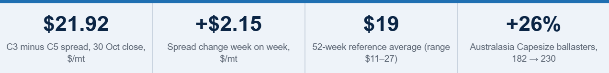

> **Figure 1: Brazil Premium Rebuilds: C3–c5 Spread Back Above $21/mt**  
> **Interactive Data & Source:** [Signal Ocean Platform](https://www.thesignalgroup.com/weekly-market-monitor/weekly-dry-market-monitor-week-44-2026) | [Local Asset](../../../../../../corpus/07-signal/images/6aec48669dc65a9300adc582_e889722c.png)

**Brazil–China freight pulled away from West Australia–China for a second week.** C3 Tubarao–Qingdao rose by $2.93/mt to $36.80/mt; C5 West Australia–Qingdao rose by only $0.78/mt to $14.88/mt. At the 30 October close, the spread was **$21.92/mt**, up $2.15/mt from $19.77/mt a week earlier and above its 52-week reference average of $19/mt. It had fallen from about $27/mt in late September to about $18/mt in mid-October. A later reading, on 2 November, put it near $22.7/mt.

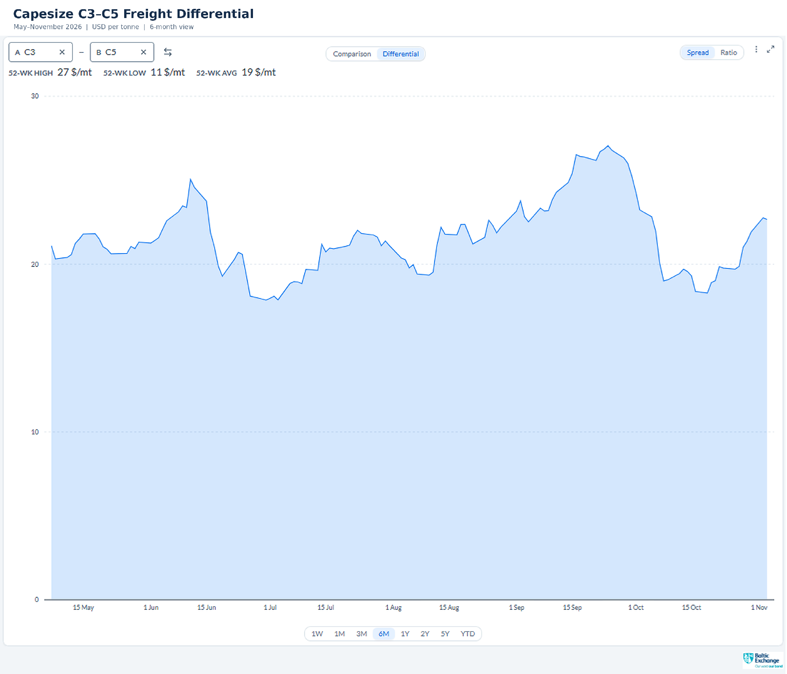

> **Figure 1: Capesize C3–c5 Freight Differential (C3 Tubarao–qingdao Minus C5 West Australia–qingdao), $/mt, May–november 2026**  
> *Figure 1: Capesize C3–C5 freight differential (C3 Tubarao–Qingdao minus C5 West Australia–Qingdao), $/mt, May–November 2026. (Source: Signal/ Baltic Exchange).*  
> **Interactive Data & Source:** [Signal Ocean Platform](https://www.thesignalgroup.com/weekly-market-monitor/weekly-dry-market-monitor-week-44-2026) | [Local Asset](../../../../../../corpus/07-signal/images/6aec48967f7d814441914953_1dddfd01.png)

## SUPPLY & DEMAND | Weekly Volatility

In the Capesize market, C3 Brazil–China tightened slightly as available ship counts fell below expected cargoes to around day 36, while C5 West Australia–China moved into surplus as vessel supply expanded to 205 against 170 cargoes by day 15. Panamax forward counts showed little net change overall; however, P1/P2/P7 Atlantic and P3 Pacific experienced slight loosening, whereas P5 Indonesia–China tightened slightly and P6 Singapore–Atlantic remained unchanged. Across geared vessel segments, US Gulf Supramax routes (S4A/S1C and S4B) and Continent Handysize (HS1/HS2) loosened further, with vessel surpluses widening. Conversely, Supramax S5 West Africa, S8/S10 Asia, and Handysize routes HS5 SE Asia, HS6 North China, and HS7 North China all tightened, with HS7 swinging from near-even balance into a 21-ship shortfall.

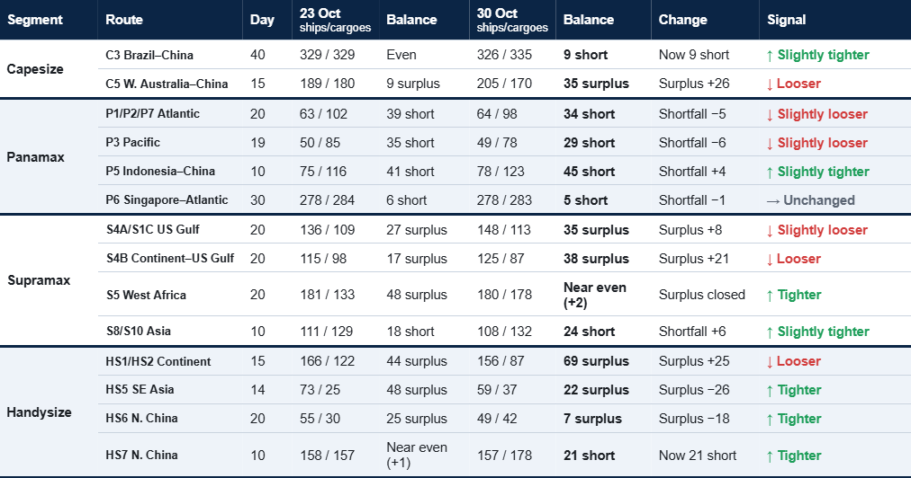

> **Table 2: Available Ships vs Expected Cargoes, Cumulative Counts Read From the Signal Dashboards at the Same Forecast Day for Both Weeks (Approximate)**  
> *Table 2: Available ships vs expected cargoes, cumulative counts read from the Signal dashboards at the same forecast day for both weeks (approximate). Balance = ships minus cargoes: “short” = fewer ships than cargoes (tight); “surplus” = more ships than cargoes (loose); within ±3 = even. Change = how the shortfall or surplus moved week on week. Signal rule: a move of 3 ships or less, or under 2.5% of cargoes = Unchanged; under 10% = Slightly tighter/looser; 10% or more = Tighter/Looser. Previous = 23 Oct dashboards; this week = 30 Oct. Forecast horizons differ by route.*  
> **Interactive Data & Source:** [Signal Ocean Platform](https://www.thesignalgroup.com/weekly-market-monitor/weekly-dry-market-monitor-week-44-2026) | [Local Asset](../../../../../../corpus/07-signal/images/6aec48d624b79cc4ee5b306b_69eb2e67.png)

**Demand vs supply ratio.** A slower, fleet-wide measure. Each index compares the current four-week mean with the same four weeks a year earlier (×100).

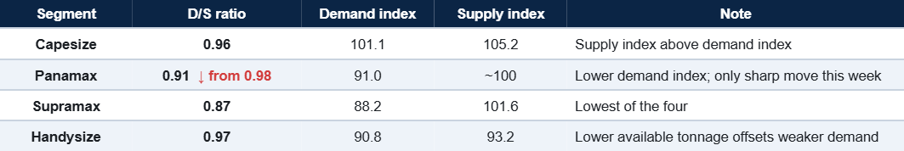

> **Table 3: Tonne-Mile Demand Index and Available-Tonnage Supply Index (Prior Year = 100) and Their Ratio, Week Ending 29 Oct 2026**  
> *Table 3: Tonne-mile demand index and available-tonnage supply index (prior year = 100) and their ratio, week ending 29 Oct 2026. Latest readings provisional. Capesize supply excludes contract-committed VLOC tonnage; Handysize demand is Voyage API tonne-miles only (Source: Signal – Voyage API, Vessel Daily Status).*  
> **Interactive Data & Source:** [Signal Ocean Platform](https://www.thesignalgroup.com/weekly-market-monitor/weekly-dry-market-monitor-week-44-2026) | [Local Asset](../../../../../../corpus/07-signal/images/6aec491a28ea5fd000b46c42_732eaf7f.png)

## FREIGHT MARKET OVERVIEW

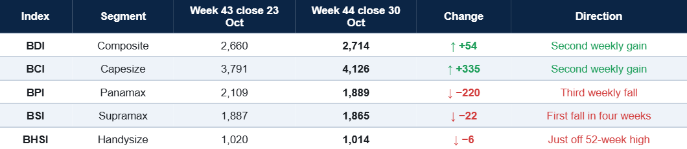

> **Table 4: Baltic Indices, Weekly Close**  
> *Table 4: Baltic indices, weekly close. Week 43 close = 30 Oct close less the Baltic weekly change (Source: Baltic Exchange).*  
> **Interactive Data & Source:** [Signal Ocean Platform](https://www.thesignalgroup.com/weekly-market-monitor/weekly-dry-market-monitor-week-44-2026) | [Local Asset](../../../../../../corpus/07-signal/images/6aec494ef2609e8b655a47ca_a643db17.png)

**From Week 43 to Week 44.** Capesize led the market: the BCI rose 335 points to 4,126, and C5TC(180) rose $3,040/day to $33,917/day, with every route higher. Panamax went the other way: the BPI fell 220 points to 1,889, and P5TC fell by $1,982/day to $16,999/day, with every route lower. The BDI closed October at 2,714, down 399 points on the month and up 731 on the year.

**Geared sizes pause near the top.** The BSI fell 22 points to 1,865, 25 below its 52-week high; the BHSI fell 6 points to 1,014, 6 below its own. Against the Week 43 readings, Supramax ballasters rose 5%, and Handysize ballasters fell 3%.

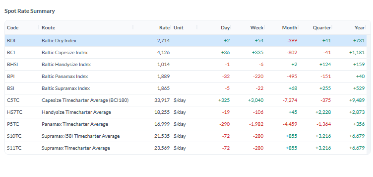

> **Figure 2: Baltic Spot Rate Summary, Close 30 Oct 2026**  
> *Figure 2: Baltic spot rate summary, close 30 Oct 2026. BDI 52-week reference values: high 3,628, low 1,532, average 2,555 (Source: Baltic Exchange).*  
> **Interactive Data & Source:** [Signal Ocean Platform](https://www.thesignalgroup.com/weekly-market-monitor/weekly-dry-market-monitor-week-44-2026) | [Local Asset](../../../../../../corpus/07-signal/images/6aec4968213df78a144ce9e6_07469860.png)

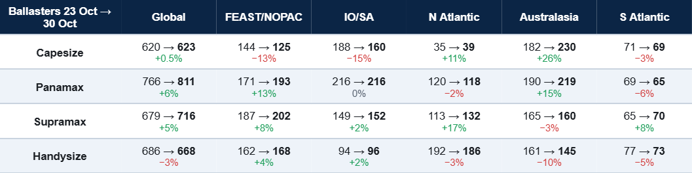

> **Table 5: Ballasters (Empty Ships Heading to Load), Week 43 (23 Oct) → Week 44 (30 Oct) Reading, and Change**  
> *Table 5: Ballasters (empty ships heading to load), Week 43 (23 Oct) → Week 44 (30 Oct) reading, and change. The dashboards' own week-on-week percentages use a different base and are not used here (Source: Signal).*  
> **Interactive Data & Source:** [Signal Ocean Platform](https://www.thesignalgroup.com/weekly-market-monitor/weekly-dry-market-monitor-week-44-2026) | [Local Asset](../../../../../../corpus/07-signal/images/6aec49992b82939fb5563d54_d24e64a7.png)

## KEY TAKEAWAY

- **Capesize:** C3 ships stay below cargoes to about day 36 (day 20 a week earlier), while C5 ships now cover cargoes throughout; Australasia ballasters rose 26% to 230. The C3–C5 spread closed at $21.92/mt, above its 52-week average.
- **Panamax:** third weekly fall, every route lower. Forward route counts moved little, but the D/S ratio fell to 0.91 from 0.98, and global ballasters rose 6% to 811.
- **Supramax and Handysize:** near 52-week highs. US Gulf and Continent surpluses widened and are the main drag for the next fixing window; Asian shortfalls (S8/S10, HS7) are the support.

## CAPESIZE

**Freight.** The BCI rose 335 points to 4,126, and C5TC(180) rose by $3,040/day to $33,917/day (C5TC(182) $37,420/day). Every route gained: C14\_182 +$3,455/day to $37,355/day, C10\_182 +$3,287/day to $40,155/day, C3 +$2.93/mt to $36.80/mt, and C5 +$0.78/mt to $14.88/mt. C9\_182 remains the top route at $68,111/day.

**Cargo backdrop.** Iron ore hit a two-year low: SGX touched $89.25/t on 27 October. China’s October manufacturing PMI dropped to 49.3 from 50.1, back in contraction. Weaker steel demand is the risk to Q4 ore buying; so far Capesize rates have moved the other way.

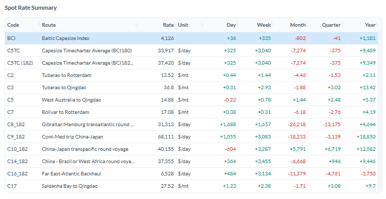

> **Figure 3: Capesize Route Rates, Close 30 Oct 2026**  
> *Figure 3: Capesize route rates, close 30 Oct 2026 (Source: Baltic Exchange).*  
> **Interactive Data & Source:** [Signal Ocean Platform](https://www.thesignalgroup.com/weekly-market-monitor/weekly-dry-market-monitor-week-44-2026) | [Local Asset](../../../../../../corpus/07-signal/images/6aec49d996675eaf1dd6fdea_b2d682ba.png)

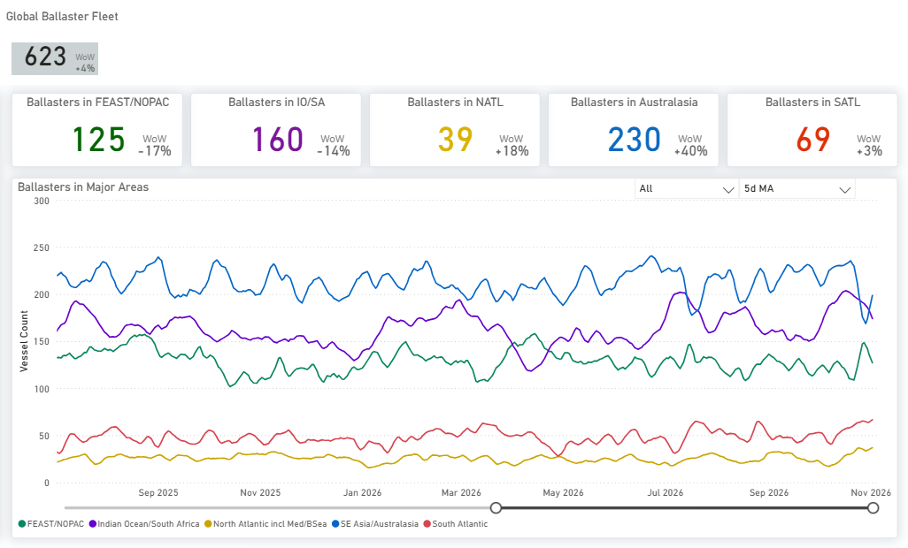

> **Figure 4: Capesize Ballasters by Region, 5-Day Ma; Dashboard WoW Uses Its Own Base, See Table 5**  
> *Figure 4: Capesize ballasters by region, 5-day MA; dashboard WoW uses its own base, see Table 5 (Source: Signal).*  
> **Interactive Data & Source:** [Signal Ocean Platform](https://www.thesignalgroup.com/weekly-market-monitor/weekly-dry-market-monitor-week-44-2026) | [Local Asset](../../../../../../corpus/07-signal/images/6aec49f5e5c87092c40cdddb_3443d0d4.png)

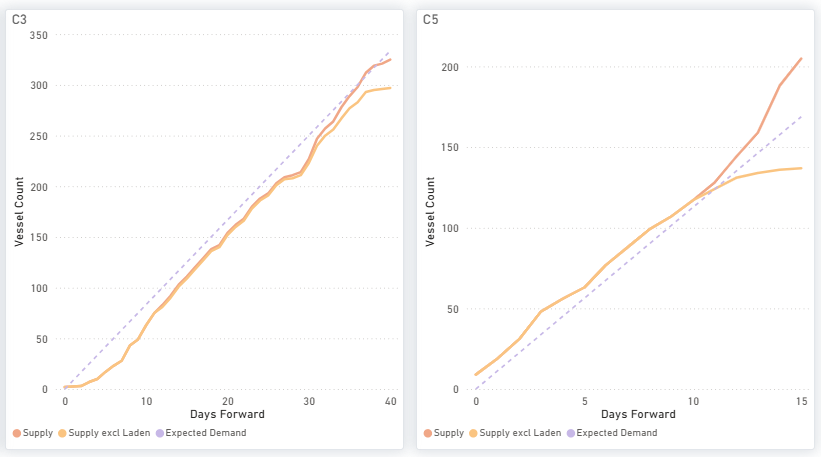

> **Figure 5: Capesize Available Ships (Supply) vs Expected Cargoes (Demand), by Days Ahead**  
> *Figure 5: Capesize available ships (supply) vs expected cargoes (demand), by days ahead (Source: Signal).*  
> **Interactive Data & Source:** [Signal Ocean Platform](https://www.thesignalgroup.com/weekly-market-monitor/weekly-dry-market-monitor-week-44-2026) | [Local Asset](../../../../../../corpus/07-signal/images/6aec4a0c5896a8c2c84b4daf_db58f4cb.png)

**Ships vs cargoes.** C3: ships below cargoes to about day 36 (326 vs 335 by day 40). C5: ships at or above cargoes throughout (205 vs 170 by day 15). Ballasters vs Week 43: Australasia 182→230 (+26%); FEAST/NOPAC 144→125 (−13%); IO/SA 188→160 (−15%).

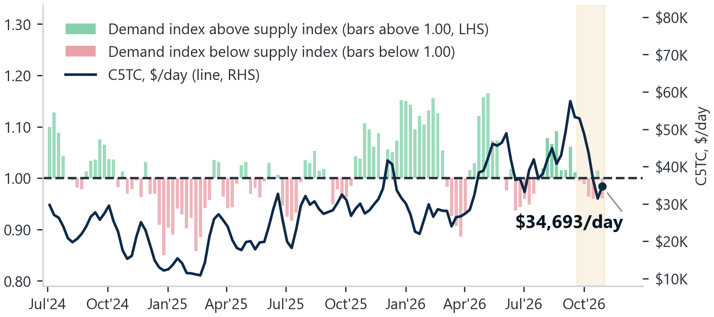

> **Figure 6: Capesize D/s Ratio (Bars, LHS) and C5TC Weekly Average (Line, RHS), Jul 2024–oct 2026; Shaded = Latest Six Weeks, Provisional**  
> *Figure 6: Capesize D/S ratio (bars, LHS) and C5TC weekly average (line, RHS), Jul 2024–Oct 2026; shaded = latest six weeks, provisional (Source: Baltic Exchange; Signal).*  
> **Interactive Data & Source:** [Signal Ocean Platform](https://www.thesignalgroup.com/weekly-market-monitor/weekly-dry-market-monitor-week-44-2026) | [Local Asset](../../../../../../corpus/07-signal/images/6aec4a2528ea5fd000b4df21_9ae0325d.png)

**Demand vs. supply.** D/S ratio **0.96**: demand index 101.1, supply index 105.2. The rate gain came with the ratio below 1.00, consistent with a positioning-led move rather than fleet-wide tightness.

## PANAMAX

**Freight.** The BPI fell 220 points to 1,889, and P5TC fell by $1,982/day to $16,999/day, a third weekly fall, with every route lower. The Atlantic led: P2A\_82 −$3,678/day to $22,842/day (still the top route) and P1A\_82 −$3,504/day to $14,232/day. P5\_82 fell by $2,411/day to $18,361/day and P7 by $3.58/mt to $68.36/mt.

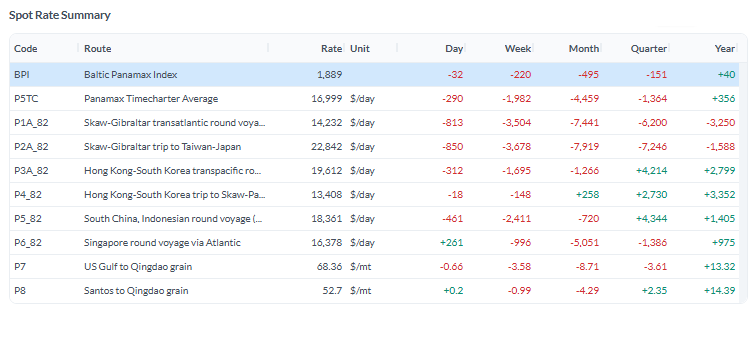

> **Figure 7: Panamax Route Rates, Close 30 Oct 2026**  
> *Figure 7: Panamax route rates, close 30 Oct 2026 (Source: Baltic Exchange).*  
> **Interactive Data & Source:** [Signal Ocean Platform](https://www.thesignalgroup.com/weekly-market-monitor/weekly-dry-market-monitor-week-44-2026) | [Local Asset](../../../../../../corpus/07-signal/images/6aec4a56f9b56966fe125000_bcb2519c.png)

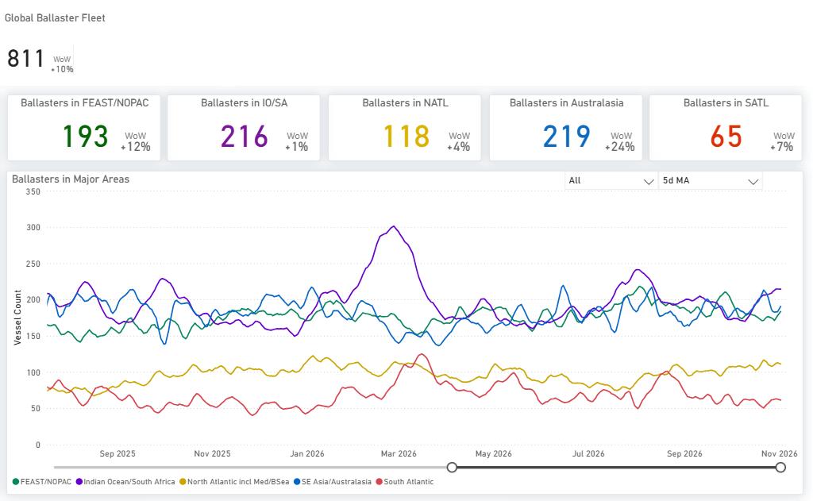

> **Figure 8: Panamax Ballasters by Region, 5-Day Ma; Dashboard WoW Uses Its Own Base, See Table 5**  
> *Figure 8: Panamax ballasters by region, 5-day MA; dashboard WoW uses its own base, see Table 5 (Source: Signal).*  
> **Interactive Data & Source:** [Signal Ocean Platform](https://www.thesignalgroup.com/weekly-market-monitor/weekly-dry-market-monitor-week-44-2026) | [Local Asset](../../../../../../corpus/07-signal/images/6aec4a6265c5f03733fee2ca_9efc375f.png)

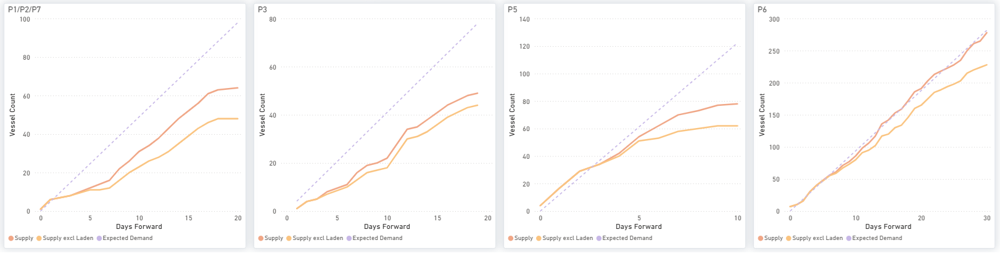

> **Figure 9: Panamax Available Ships (Supply) vs Expected Cargoes (Demand), by Days Ahead**  
> *Figure 9: Panamax available ships (supply) vs expected cargoes (demand), by days ahead (Source: Signal).*  
> **Interactive Data & Source:** [Signal Ocean Platform](https://www.thesignalgroup.com/weekly-market-monitor/weekly-dry-market-monitor-week-44-2026) | [Local Asset](../../../../../../corpus/07-signal/images/6aec4a7ba63600b1ca9f2269_1d4f0f98.png)

**Ships vs cargoes.** Little net change. P1/P2/P7 64 vs 98 by day 20 (shortfall 5 smaller); P3 49 vs 78 by day 19 (6 smaller); P5 78 vs 123 by day 10 (4 larger); P6 278 vs 283 by day 30 (unchanged). Ballasters vs Week 43: global 766→811 (+6%); Australasia 190→219 (+15%); FEAST/NOPAC 171→193 (+13%).

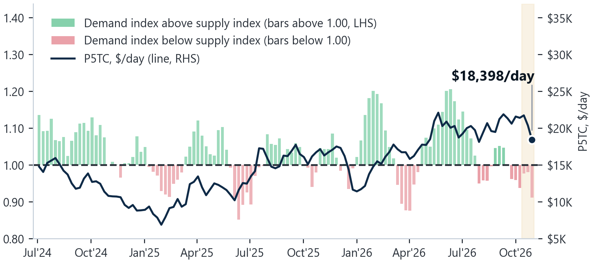

> **Figure 10: Panamax D/s Ratio (Bars, LHS) and P5TC Weekly Average (Line, RHS), Jul 2024–oct 2026; Shaded = Latest Three Weeks, Provisional**  
> *Figure 10: Panamax D/S ratio (bars, LHS) and P5TC weekly average (line, RHS), Jul 2024–Oct 2026; shaded = latest three weeks, provisional (Source: Baltic Exchange; Signal).*  
> **Interactive Data & Source:** [Signal Ocean Platform](https://www.thesignalgroup.com/weekly-market-monitor/weekly-dry-market-monitor-week-44-2026) | [Local Asset](../../../../../../corpus/07-signal/images/6aec4a9565c5f03733fefa2a_91cf5316.png)

**Demand vs supply.** D/S ratio **0.91**, from 0.98: demand index 91.0, supply index broadly unchanged. Route counts cover the next 10–30 days on specific routes; the ratio covers four weeks of fleet-wide tonne-miles against a year earlier, so the two can diverge.

## SUPRAMAX

**Freight.** The BSI fell 22 points to 1,865, ending three weeks of gains 25 points below its 52-week high, and S11TC fell by $280/day to $23,569/day. The Atlantic led the fall: S4A −$965/day to $29,888/day, S5 −$950/day, and S1C −$719/day to $29,450/day. Asia held up: S3 +$300/day to $24,467/day and S2 +$131/day.

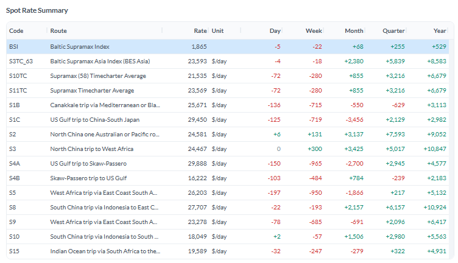

> **Figure 11: Supramax Route Rates, Close 30 Oct 2026**  
> *Figure 11: Supramax route rates, close 30 Oct 2026 (Source: Baltic Exchange).*  
> **Interactive Data & Source:** [Signal Ocean Platform](https://www.thesignalgroup.com/weekly-market-monitor/weekly-dry-market-monitor-week-44-2026) | [Local Asset](../../../../../../corpus/07-signal/images/6aec4ab8efa101c6a9d42d90_953fe207.png)

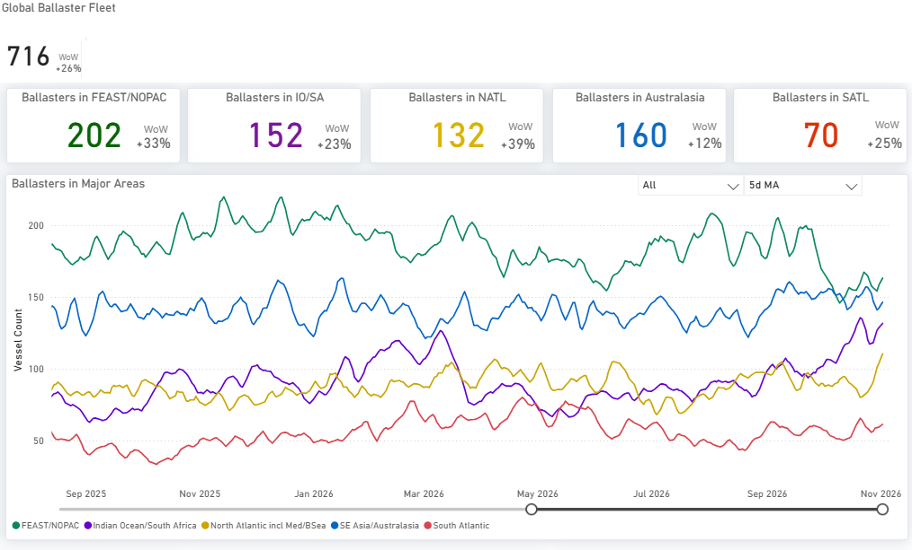

> **Figure 12: Supramax Ballasters by Region, 5-Day Ma; Dashboard WoW Uses Its Own Base, See Table 5**  
> *Figure 12: Supramax ballasters by region, 5-day MA; dashboard WoW uses its own base, see Table 5 (Source: Signal).*  
> **Interactive Data & Source:** [Signal Ocean Platform](https://www.thesignalgroup.com/weekly-market-monitor/weekly-dry-market-monitor-week-44-2026) | [Local Asset](../../../../../../corpus/07-signal/images/6aec4acefaf3181ba29df8d7_f2d92e95.png)

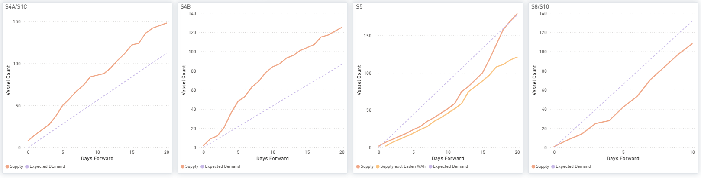

> **Figure 13: Supramax Available Ships (Supply) vs Expected Cargoes (Demand), by Days Ahead**  
> *Figure 13: Supramax available ships (supply) vs expected cargoes (demand), by days ahead (Source: Signal).*  
> **Interactive Data & Source:** [Signal Ocean Platform](https://www.thesignalgroup.com/weekly-market-monitor/weekly-dry-market-monitor-week-44-2026) | [Local Asset](../../../../../../corpus/07-signal/images/6aec4adb739a22e10a90eb65_db0072b7.png)

**Next fixing window.** The US Gulf surplus is the main drag and widened: 148 ships vs 113 cargoes on S4A/S1C and 125 vs 87 on S4B by day 20. Asia is the support: S8/S10 108 vs 132 by day 10. S5 West Africa tightened to near balance (180 vs 178 by day 20, from 181 vs 133). Ballasters vs Week 43: global 679→716 (+5%); North Atlantic 113→132 (+17%).

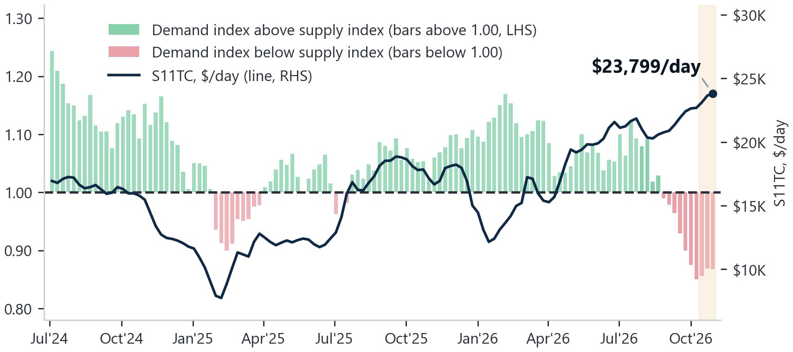

> **Figure 14: Supramax D/s Ratio (Bars, LHS) and S11TC Weekly Average (Line, RHS), Jul 2024–oct 2026; Shaded = Latest Three Weeks, Provisional**  
> *Figure 14: Supramax D/S ratio (bars, LHS) and S11TC weekly average (line, RHS), Jul 2024–Oct 2026; shaded = latest three weeks, provisional (Source: Baltic Exchange; Signal).*  
> **Interactive Data & Source:** [Signal Ocean Platform](https://www.thesignalgroup.com/weekly-market-monitor/weekly-dry-market-monitor-week-44-2026) | [Local Asset](../../../../../../corpus/07-signal/images/6aec4af7d6831a328e7bfae2_119aeac7.png)

**Demand vs. supply.** D/S ratio **0.87**, the lowest of the four: demand index 88.2, supply index 101.6. The BSI near its 52-week high reflects a few strong routes, not a broad demand recovery.

## HANDYSIZE

**Freight.** The BHSI fell 6 points to 1,014, 6 below its 52-week high, and HS7TC fell by $106/day to $18,255/day. HS4\_38 (US Gulf) fell by $1,100/day to $18,557/day. Asia firmed: HS7\_38 +$237/day to $18,675/day, HS6\_38 +$106/day, and HS5\_38 +$63/day. HS3\_38 (South Atlantic) remains the top route at $29,933/day.

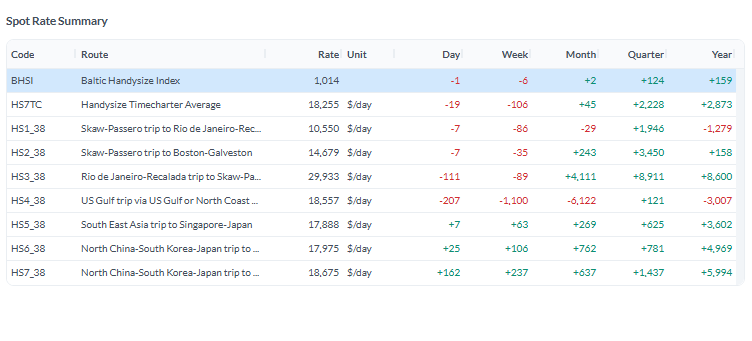

> **Figure 15: Handysize Route Rates, Close 30 Oct 2026**  
> *Figure 15: Handysize route rates, close 30 Oct 2026 (Source: Baltic Exchange).*  
> **Interactive Data & Source:** [Signal Ocean Platform](https://www.thesignalgroup.com/weekly-market-monitor/weekly-dry-market-monitor-week-44-2026) | [Local Asset](../../../../../../corpus/07-signal/images/6aec4b162c31a02c44dbc0af_5f475a79.png)

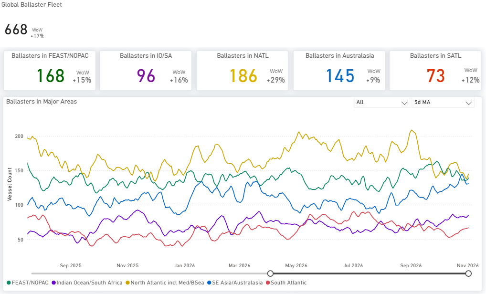

> **Figure 16: Handysize Ballasters by Region, 5-Day Ma; Dashboard WoW Uses Its Own Base, See Table 5**  
> *Figure 16: Handysize ballasters by region, 5-day MA; dashboard WoW uses its own base, see Table 5 (Source: Signal).*  
> **Interactive Data & Source:** [Signal Ocean Platform](https://www.thesignalgroup.com/weekly-market-monitor/weekly-dry-market-monitor-week-44-2026) | [Local Asset](../../../../../../corpus/07-signal/images/6aec4b336855a64d9e68cc8c_2b5505f7.png)

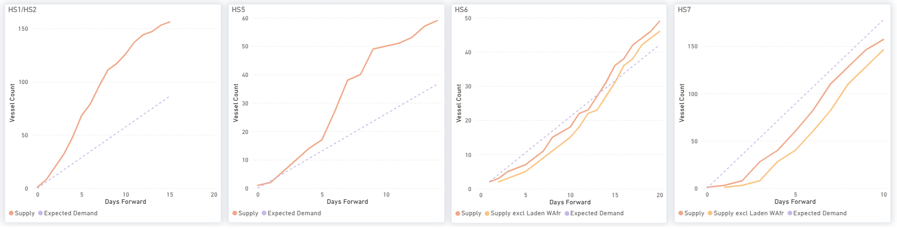

> **Figure 17: Handysize Available Ships (Supply) vs Expected Cargoes (Demand), by Days Ahead**  
> *Figure 17: Handysize available ships (supply) vs expected cargoes (demand), by days ahead (Source: Signal).*  
> **Interactive Data & Source:** [Signal Ocean Platform](https://www.thesignalgroup.com/weekly-market-monitor/weekly-dry-market-monitor-week-44-2026) | [Local Asset](../../../../../../corpus/07-signal/images/6aec4b336855a64d9e68cc8f_0a672926.png)

**Next fixing window.** HS7 is the nearest-dated support: 157 ships vs 178 cargoes by day 10, from a balance a week earlier. HS1/HS2 is the main drag: 156 vs 87 by day 15. The HS5 surplus narrowed (59 vs 37 by day 14, from 73 vs 25) and HS6 is near balance (49 vs 42 by day 20). Ballasters vs Week 43: global 686→668 (−3%); Australasia 161→145 (−10%).

***Disclaimer:*** *This report has been prepared by Signal Group for general information purposes only. It does not constitute, and should not be relied upon as, investment, financial, trading, legal or commercial advice, or as a recommendation to enter into any transaction. While reasonable efforts have been made to ensure that the information is accurate and reliable at the date of publication, no representation or warranty, express or implied, is given as to its accuracy, completeness or continued availability. Certain figures may be estimates or provisional and may subsequently be revised. Market conditions and other external factors may change without notice and may not be reflected in this report. Readers should conduct their own assessment and seek appropriate professional advice before making any decision. To the fullest extent permitted by law, Signal Group accepts no liability for any loss or damage arising from the use of, or reliance on, this report.*

***Copyright notice:*** *© 2026 Signal Group. All rights reserved. Except where otherwise stated or permitted by law, this report may not be copied, reproduced, modified, published or redistributed, in whole or in part, without the prior written consent of Signal Group. Third-party data and content remain the property of their respective owners and are used subject to the applicable terms and licences.*
