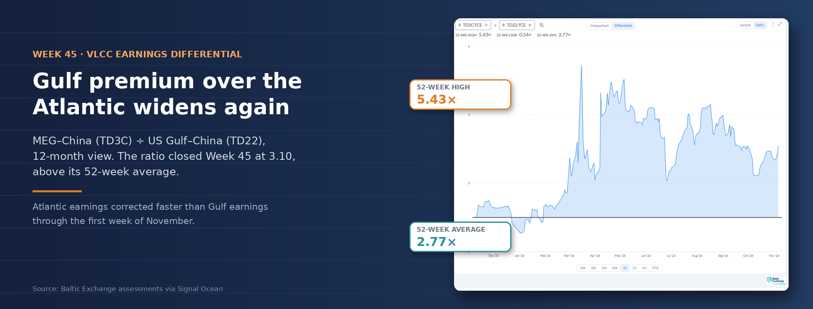
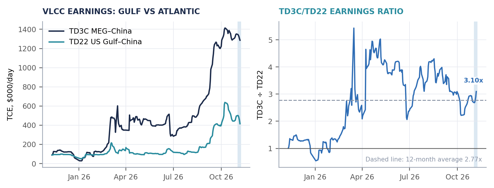
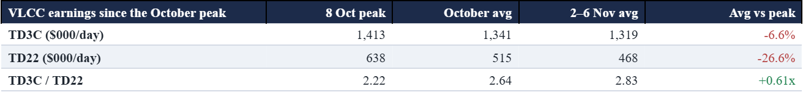
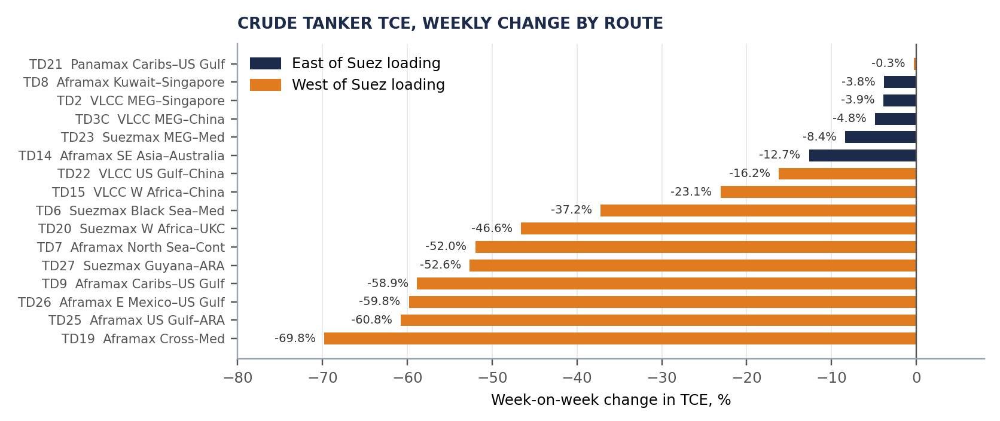
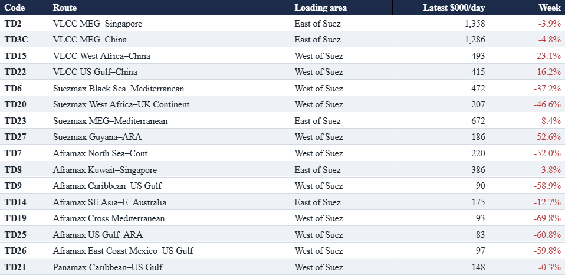
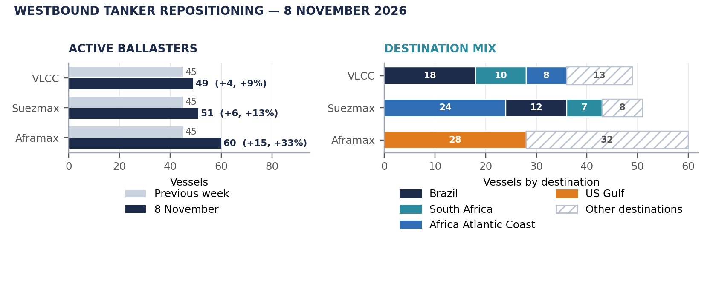
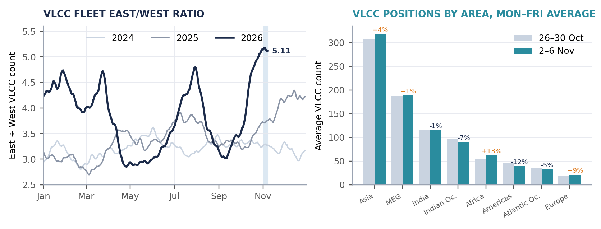
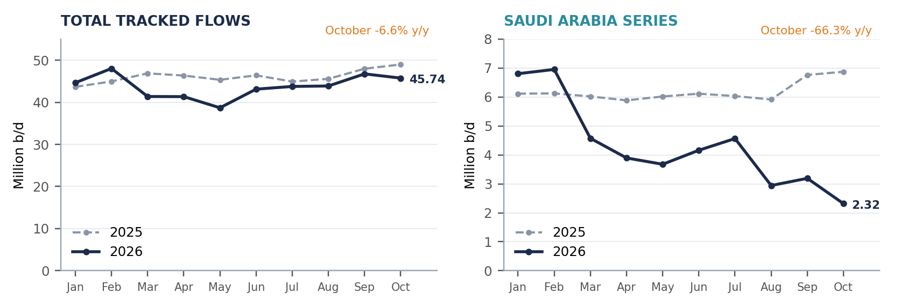
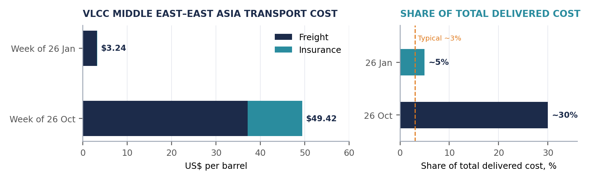

# Weekly Tanker Market Monitor: Week 45 2026

*Published on 10 November 2026*

**Weekly Tanker Market Monitor**

**Beyond Hormuz · Week 45, 2026**

Published November 2026

**By Maria Bertzeletou · Senior Market Analyst, Signal**

> **Figure 1: Heading**  
> **Interactive Data & Source:** [Signal Ocean Platform](https://www.thesignalgroup.com/weekly-market-monitor/weekly-tanker-market-monitor-week-45-2026) | [Local Asset](../../../../../../corpus/07-signal/images/6af2d4dcf010dfa11c796e88_745005be.png)

## SPOTLIGHT OF THE WEEK

**Atlantic Tanker Earnings Fall Faster Than Gulf Earnings**

The TD3C/TD22 earnings ratio rose from 2.73 on 30 October to **3.10 on 6 November**, as US Gulf–China VLCC earnings fell **16.2%** to around $415,000/day, against a **4.8%** decline on Middle East Gulf–China to $1.29 million/day. All 16 dirty tanker benchmarks fell over the week, with the steepest declines in the Atlantic and Mediterranean. Several Suezmax and Aframax routes lost 50% or more of their earnings, while Middle East Gulf VLCC losses remained below 5%.

> **Chart 1: Daily TD3C and TD22 TCE Assessments and Their Ratio, 10 November 2025–6 November 2026**  
> *Chart 1. Daily TD3C and TD22 TCE assessments and their ratio, 10 November 2025–6 November 2026. Source: Baltic Exchange assessments via Signal Ocean. Daily TCEs derived from the Signal Ocean TD3C/TD22 differential series; derived values match the route assessments for 30 October and 6 November.*  
> **Interactive Data & Source:** [Signal Ocean Platform](https://www.thesignalgroup.com/weekly-market-monitor/weekly-tanker-market-monitor-week-45-2026) | [Local Asset](../../../../../../corpus/07-signal/images/6af2d4dcf010dfa11c796e85_33ace712.png)

Both TD3C (Middle East Gulf–China) and TD22 (US Gulf–China) reached their October earnings peaks on 8 October, although the subsequent correction has been considerably sharper on the Atlantic route. By 6 November, TD22 earnings had fallen **34.9%** from their October high, compared with a **9.0%** decline on TD3C. The sharper fall in Atlantic earnings pushed the TD3C/TD22 ratio to 3.10 at the end of the week, its highest level since 18 September and above its 12-month average of 2.77.

> **Figure 3: Period Averages Are Arithmetic Means of Daily Observations; the Ratio RoW Averages Daily Ratios.**  
> *Period averages are arithmetic means of daily observations; the ratio row averages daily ratios.*  
> **Interactive Data & Source:** [Signal Ocean Platform](https://www.thesignalgroup.com/weekly-market-monitor/weekly-tanker-market-monitor-week-45-2026) | [Local Asset](../../../../../../corpus/07-signal/images/6af2d4dcf010dfa11c796e8b_34463dbb.png)

## Freight: Atlantic Crude Routes Lead the Decline

The ten largest percentage declines in the dirty basket were all on routes loading West of Suez, as classified in Chart 2 and the table below. Suezmax West Africa–UK Continent (TD20) fell **46.6%**, Guyana–ARA (TD27) **52.6%,** and Black Sea–Mediterranean (TD6) **37.2%**, while MEG–Mediterranean (TD23) fell 8.4% and remained 3.2 times TD20. Among Aframaxes, Cross-Mediterranean (TD19) fell **69.8%** and US Gulf–ARA (TD25) fell **60.8%**, against 3.8% on Kuwait–Singapore (TD8). All 16 routes remain above their year-earlier and three-month reference levels.

> **Chart 2: Crude Tanker TCE, Percentage Change Against Each Route’s Prior-Week Reference, by Loading Area.source: Baltic Exchange TCE Assessments Via Signal Ocean.**  
> *Chart 2. Crude tanker TCE, percentage change against each route’s prior-week reference, by loading area.Source: Baltic Exchange TCE assessments via Signal Ocean.*  
> **Interactive Data & Source:** [Signal Ocean Platform](https://www.thesignalgroup.com/weekly-market-monitor/weekly-tanker-market-monitor-week-45-2026) | [Local Asset](../../../../../../corpus/07-signal/images/6af2d4ff072b478d2eff5f78_f1f26da9.png)

**Spot Rate Summary: dirty TCE, VLCC, Suezmax, Aframax and Panamax**

> **Figure 5: Baltic Exchange TCE Assessments Via Signal Ocean; Usd/day Rounded to the Nearest $1,000**  
> *Baltic Exchange TCE assessments via Signal Ocean; USD/day rounded to the nearest $1,000. Weekly change against each route’s prior-week reference. TD3C and TD22 reconcile to 6 November.*  
> **Interactive Data & Source:** [Signal Ocean Platform](https://www.thesignalgroup.com/weekly-market-monitor/weekly-tanker-market-monitor-week-45-2026) | [Local Asset](../../../../../../corpus/07-signal/images/6af2d5c301b435785fd7afa0_8056bfbb.png)

## Supply: Westbound Ballasters Rise as the Fleet Stays East

Signal Maritime recorded **49 active westbound VLCC ballasters on 8 November**, compared with 45 a week earlier. Of these, 43 originated in the Far East. Brazil was the leading destination with 18 vessels, followed by South Africa with 10 and the African Atlantic Coast with eight. The count remains below the late-October peak of 52, and monthly East-to-West ballast movements fell from 73 in September to 50 in October.

Westbound positioning rose faster in the smaller crude segments. Suezmax ballasters increased to **51 from 45** a week earlier, with 24 heading for the Africa Atlantic Coast. Aframax ballasters rose to **60 on 7 November from 45 on 31 October**, with 28 heading for the US Gulf. Arrival dates, onward employment and regional cargo demand will determine how much of this tonnage becomes available for fixing.

> **Chart 3: Active Westbound VLCC, Suezmax and Aframax Ballasters Compared with the Previous Week, and Their Destination Mix**  
> *Chart 3. Active westbound VLCC, Suezmax and Aframax ballasters compared with the previous week, and their destination mix. Active counts represent vessels in transit rather than immediately available tonnage.Source: Signal Maritime Key Insights, 8 November 2026. Aframax comparison: 31 October vs 7 November. “Other destinations” is the segment total minus the listed destinations.*  
> **Interactive Data & Source:** [Signal Ocean Platform](https://www.thesignalgroup.com/weekly-market-monitor/weekly-tanker-market-monitor-week-45-2026) | [Local Asset](../../../../../../corpus/07-signal/images/6af2d5f43406c85a38789c04_ce5485b7.png)

> **Chart 4: East/west VLCC Fleet Ratio by Calendar Day, 2024–2026, and Average VLCC Positions, 26–30 October vs 2–6 November 2026.sources: Signal Ocean Fleet Distribution and Distribution by Zone; International-Trading VLCCs, 200,000 DWT and Above.**  
> *Chart 4. East/West VLCC fleet ratio by calendar day, 2024–2026, and average VLCC positions, 26–30 October vs 2–6 November 2026.Sources: Signal Ocean Fleet Distribution and Distribution by Zone; international-trading VLCCs, 200,000 dwt and above.*  
> **Interactive Data & Source:** [Signal Ocean Platform](https://www.thesignalgroup.com/weekly-market-monitor/weekly-tanker-market-monitor-week-45-2026) | [Local Asset](../../../../../../corpus/07-signal/images/6af2d60014f7d4ff502e6066_2a2a2a66.png)

The increase in westbound ballasters contrasts with the continued concentration of VLCC tonnage east of Suez. The East/West fleet ratio stood at **5.11 on 7 November**, close to its 2026 high of 5.18, compared with 3.75 in 2025 and 3.27 in 2024. Regionally, VLCC positions increased by 13.0% around Africa and 9.2% in Europe, while the Americas recorded a 12.3% decline. The Middle East Gulf count was broadly unchanged at 189 vessels. These figures capture the geographical distribution of VLCCs across all employment states, rather than the number of vessels immediately available for new employment.

## Flows and Transport Costs

Signal Ocean tracked crude flows from all origins averaged **45.7 million b/d** in October, down 6.6% year on year but well above May’s low. Tracked flows attributed to Saudi Arabia averaged **2.32 million b/d**, down 66.3% year on year and below every earlier month of 2026. These are tracked and attributed flows, not a definitive measure of physical Saudi crude exports: the comparison does not establish how much of the decline reflects lower physical exports or changes in the attribution of ship-to-ship cargoes.

> **Chart 5: Signal Ocean Tracked Crude Flows, All Origins and Saudi Arabia Attribution, Monthly Averages, January–october 2026 vs 2025**  
> *Chart 5. Signal Ocean tracked crude flows, all origins and Saudi Arabia attribution, monthly averages, January–October 2026 vs 2025. Panels use different scales.Source: Signal Ocean crude export dataset; monthly volumes divided by calendar days. Country attribution reflects the loading location and ship-to-ship treatment; subject to revision.*  
> **Interactive Data & Source:** [Signal Ocean Platform](https://www.thesignalgroup.com/weekly-market-monitor/weekly-tanker-market-monitor-week-45-2026) | [Local Asset](../../../../../../corpus/07-signal/images/6af2d63b86fa7c05b67039d2_0fa7abff.png)

OPEC estimates that Middle East–East Asia VLCC freight rose from **$3.18/bbl** in the week of 26 January to **$37.13/bbl** in the week of 26 October, and insurance from $0.06/bbl to $12.29/bbl. On OPEC’s basis, freight and insurance combined accounted for about **30% of the total delivered cost** of a barrel of crude on this route, against about 5% in January. These are OPEC estimates of the cost borne by cargo, not tanker TCE earnings.

> **Chart 6: Opec Estimates for VLCC Middle East–east Asia Freight and Insurance Costs, and Their Share of Total Delivered Cost, Weeks of 26 January and 26 October 2026.source: Opec, Who Gets What From Shipping Crude Oil?, November 2026.**  
> *Chart 6. OPEC estimates for VLCC Middle East–East Asia freight and insurance costs, and their share of total delivered cost, weeks of 26 January and 26 October 2026.Source: OPEC, Who gets what from shipping crude oil?, November 2026.*  
> **Interactive Data & Source:** [Signal Ocean Platform](https://www.thesignalgroup.com/weekly-market-monitor/weekly-tanker-market-monitor-week-45-2026) | [Local Asset](../../../../../../corpus/07-signal/images/6af2d6566ca3909083900624_d313af6a.png)

## Hormuz Freight Watch: Macro Risks

Conditions around the Strait of Hormuz remained uncertain in early November. Diplomatic contacts continued without a confirmed agreement, and security incidents involving commercial vessels were reported in and around the strait during the week. For shipping, the practical effects are on owners’ willingness to accept Gulf employment, war-risk insurance terms and voyage times, none of which can be assumed to normalise on a fixed timetable. Oil prices fell sharply after the US midterm elections amid hopes of de-escalation, while TD22 declined 16.3% between 3 and 6 November; the freight data do not isolate the effect of the election from other market changes.

Transport costs remain elevated, with freight and insurance at about 30% of total delivered cost on Middle East–East Asia VLCC voyages on OPEC’s estimates. Seven OPEC+ producers maintained their December production targets on 1 November, leaving planned supply levels unchanged ahead of their next meeting on 29 November. Potential changes to tanker availability and export capacity remain unconfirmed: the approval process outlined on 19 October for acquiring and refurbishing sanctioned tankers has yet to result in confirmed additions to mainstream chartering capacity, while comments attributed to Saudi Arabia’s energy minister on 12 October indicated that converting a gas pipeline could add about 1.2 million b/d of crude capacity towards the Red Sea within seven to eight weeks; completion has not been confirmed, and Yanbu loading capacity remains a constraint.

## Market Takeaways

The tanker freight outlook remains difficult to assess, with geopolitical developments continuing to influence market expectations and vessel employment. Fresh reports of a possible agreement concerning the Strait of Hormuz on 9 November have renewed attention on the prospects for de-escalation, although no agreement or corresponding improvement in shipping conditions has been confirmed.

In the Atlantic, the timing of ballast arrivals and fresh cargo enquiry will be important in determining the supply balance for upcoming loadings. The Middle East Gulf presents a different picture, where security concerns, insurance costs and owners’ willingness to trade continue to influence vessel availability. **An increase in vessel transits would not, on its own, establish that normal chartering conditions have been restored.** With these differences persisting, the timing and scale of any freight adjustment remain uncertain.

***Disclaimer:*** *This report has been prepared by Signal Group for general information purposes only. It does not constitute, and should not be relied upon as, investment, financial, trading, legal or commercial advice, or as a recommendation to enter into any transaction. While reasonable efforts have been made to ensure the information is accurate and reliable at the date of publication, no representation or warranty, express or implied, is given as to its accuracy, completeness or continued availability. Certain figures may be estimates or provisional and may subsequently be revised. Market conditions and other external factors may change without notice and may not be reflected in this report. Readers should conduct their own assessment and seek appropriate professional advice before making any decision. To the fullest extent permitted by law, Signal Group accepts no liability for any loss or damage arising from the use of, or reliance on, this report.*

***Copyright notice:*** *© 2026 Signal Group. All rights reserved. This report may be republished in full or in part provided that Signal Group is credited and an active link to the source is included. Any other copying, reproduction, modification or redistribution requires the prior written consent of Signal Group. Third-party data and content remain the property of their respective owners and are used subject to the applicable terms and licences.*
