# Weekly Tanker Market Monitor: Week 46 2026

*Published on 17 November 2026*

**Weekly Tanker Market Monitor**

**Beyond Hormuz · Week 46, 2026**

Published November 2026

**By Maria Bertzeletou · Senior Market Analyst, Signal**

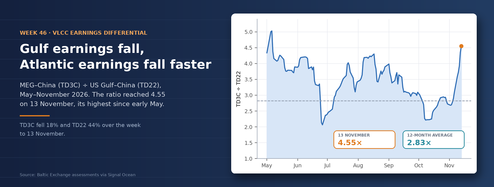

> **Figure 1: Heading**  
> **Interactive Data & Source:** [Signal Ocean Platform](https://www.thesignalgroup.com/weekly-market-monitor/weekly-tanker-market-monitor-week-46-2026) | [Local Asset](../../../../../../corpus/07-signal/images/6afc29ed9bb46b9ad35b3cd2_7cad88d8.png)

## SPOTLIGHT OF THE WEEK: Gulf Earnings Give Way as VLCC Ballasters Build East of Suez

In Week 46, freight weakness spread to Gulf routes, following a Week 45 correction that had primarily impacted the Atlantic (where Gulf VLCC earnings dropped under 5%). East of Suez, average ballast VLCC counts rose from **415 to 434 vessels**, while laden VLCC counts fell from **341 to 321**. Consequently, the ballast surplus expanded from 74 to **114 vessels**, over triple the Q3 2026 average of 37, in sharp contrast to the same period in 2025, when laden vessels held a slight majority over ballasters. Ballast VLCCs East of Suez surged to **450 by 12 November, marking their highest count since late March**, against 308 laden vessels.

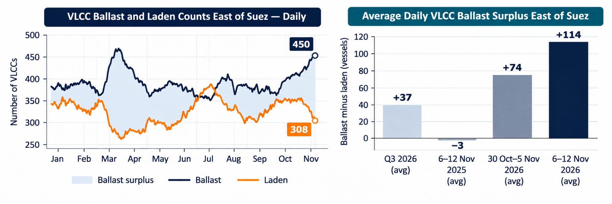

> **Chart 1: VLCCs East of Suez in Ballast and Laden, Daily, January–12 November 2026, and the Average Ballast Surplus (Ballast Minus Laden) Over Selected Windows**  
> *Chart 1. VLCCs East of Suez in ballast and laden, daily, January–12 November 2026, and the average ballast surplus (ballast minus laden) over selected windows. Source: Signal Ocean vessel positions*  
> **Interactive Data & Source:** [Signal Ocean Platform](https://www.thesignalgroup.com/weekly-market-monitor/weekly-tanker-market-monitor-week-46-2026) | [Local Asset](../../../../../../corpus/07-signal/images/6afc29ed9bb46b9ad35b3cdb_4817ac46.png)

The rise in ballast VLCCs East of Suez coincided with a **17.9% weekly decline** in Middle East Gulf–China (TD3C) earnings to **$1.06 million/day** on 13 November. However, the growing ballast count does not necessarily mean more vessels are available for prompt Gulf employment. Actual availability remains constrained by vessel positioning, existing charter commitments, and owners’ willingness to accept Gulf voyages.

## VLCC Earnings: The Gulf Follows the Atlantic

US Gulf–China (TD22) earnings fell **44.1%** over the week to **$232,000/day** on 13 November. TD3C lost about $230,000/day, more than the $183,000/day lost by TD22, but TD22’s larger percentage fall lifted the TD3C/TD22 ratio from 3.10 on 6 November to **4.55**, its highest level since 6 May.

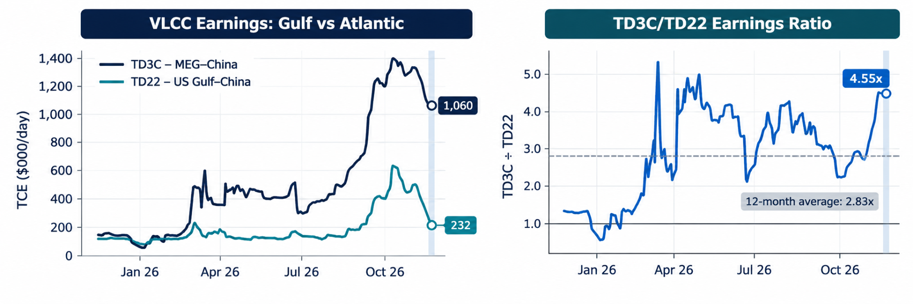

> **Chart 2: Daily TD3C and TD22 TCE Assessments and Their Ratio, 14 November 2025–13 November 2026**  
> *Chart 2. Daily TD3C and TD22 TCE assessments and their ratio, 14 November 2025–13 November 2026. Shading marks 9–13 November.Source: Baltic Exchange assessments via Signal Ocean. Daily TCEs derived from the Signal Ocean TD3C/TD22 differential series through 12 November and the route assessments for 13 November.*  
> **Interactive Data & Source:** [Signal Ocean Platform](https://www.thesignalgroup.com/weekly-market-monitor/weekly-tanker-market-monitor-week-46-2026) | [Local Asset](../../../../../../corpus/07-signal/images/6afc29ed9bb46b9ad35b3cc9_246320c4.png)

Both VLCC routes have retreated substantially from their 8 October peaks, with TD3C earnings down **25.2%** and TD22 down **63.6%** by 13 November. TD3C reached its lowest level since 14 September, while TD22 fell to its lowest since 9 September. Despite the sharper percentage decline in Atlantic earnings, the absolute earnings gap between the two routes narrowed to **$824,000/day**, from **$871,000/day** on 6 November.

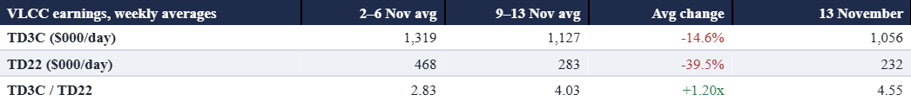

> **Figure 4: Weekly-Average Comparison: 9–13 November Against 2–6 November, Five Assessment Days Each**  
> *Weekly-average comparison: 9–13 November against 2–6 November, five assessment days each. Arithmetic means of daily observations; the ratio row averages daily ratios.*  
> **Interactive Data & Source:** [Signal Ocean Platform](https://www.thesignalgroup.com/weekly-market-monitor/weekly-tanker-market-monitor-week-46-2026) | [Local Asset](../../../../../../corpus/07-signal/images/6afc29ed9bb46b9ad35b3ccf_112ad548.png)

**MARKET SIGNAL:**  Gulf VLCC earnings declined in Week 46, although the correction was sharper on Atlantic routes. The TD3C/TD22 earnings ratio widened to 4.55 on 13 November, driven by the steeper fall in Atlantic earnings rather than stronger Gulf rates. Cargo demand and vessel positioning across both basins will remain key to the direction of freight rates.

## Freight: Gulf Routes Join the Largest Declines

All 16 dirty routes fell between 6 and 13 November. The largest declines were on US Gulf–China VLCC (TD22, **-44.1%**), West Africa–China VLCC (TD15, **-43.7%**), Black Sea–Mediterranean Suezmax (TD6, -35.9%) and North Sea–Continent Aframax (TD7, -35.8%). Unlike Week 45, four of the ten largest declines were on routes loading East of Suez: Southeast Asia–East Coast Australia Aframax (TD14, -32.1%), MEG–Singapore VLCC (TD2, -18.9%), MEG–China VLCC (TD3C, -17.9%) and Kuwait–Singapore Aframax (TD8, -14.7%). MEG–Mediterranean Suezmax (TD23) recorded the smallest decline, at 2.6%.

Weekly losses on several Atlantic Aframax routes were smaller than in Week 45, at between 6% and 10% for US Gulf–ARA (TD25), Cross-Mediterranean (TD19), Caribbean–US Gulf (TD9) and East Coast Mexico–US Gulf (TD26). On 13 November alone, TD25 rose 9.2%, TD26 5.6%, TD9 4.9% and West Africa–China VLCC 3.6%; a single assessment day does not establish a change in direction.

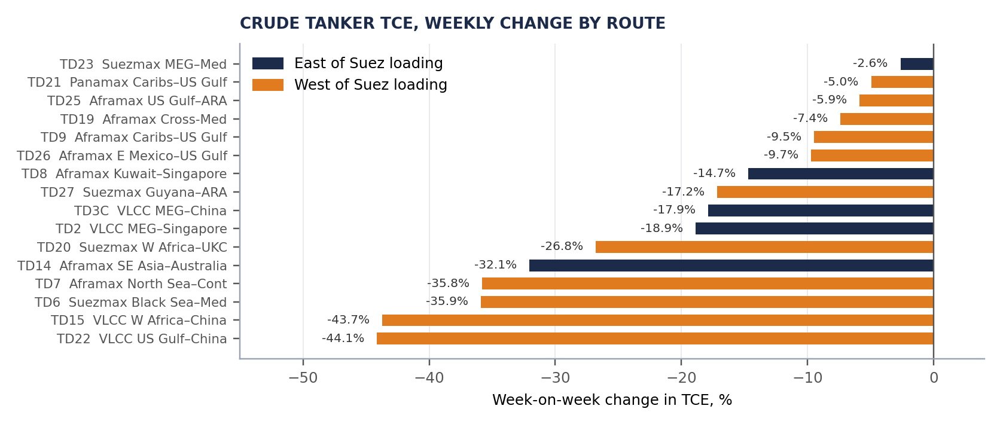

> **Chart 3: Crude Tanker TCE, Percentage Change From 6 to 13 November, by Loading Area.source: Baltic Exchange TCE Assessments Via Signal Ocean.**  
> *Chart 3. Crude tanker TCE, percentage change from 6 to 13 November, by loading area.Source: Baltic Exchange TCE assessments via Signal Ocean.*  
> **Interactive Data & Source:** [Signal Ocean Platform](https://www.thesignalgroup.com/weekly-market-monitor/weekly-tanker-market-monitor-week-46-2026) | [Local Asset](../../../../../../corpus/07-signal/images/6afc29ed9bb46b9ad35b3ce1_7a2aad44.png)

## Spot Rate Summary: Dirty TCE, VLCC, Suezmax, Aframax and Panamax

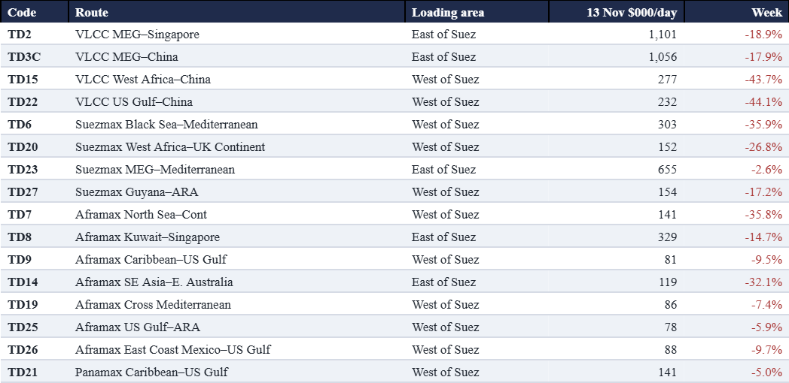

> **Figure 6: Spot Rate Summary: Dirty TCE, VLCC, Suezmax, Aframax and Panamaxbaltic Exchange TCE Assessments Via Signal Ocean, 13 November; Usd/day Rounded to the Nearest $1,000**  
> *Spot Rate Summary: dirty TCE, VLCC, Suezmax, Aframax and PanamaxBaltic Exchange TCE assessments via Signal Ocean, 13 November; USD/day rounded to the nearest $1,000. Weekly change is point-to-point from the 6 November reference.*  
> **Interactive Data & Source:** [Signal Ocean Platform](https://www.thesignalgroup.com/weekly-market-monitor/weekly-tanker-market-monitor-week-46-2026) | [Local Asset](../../../../../../corpus/07-signal/images/6afc29ed9bb46b9ad35b3cde_c2367195.png)

## Supply: Ballast and Laden Positions by Segment

**VLCCs.** **West of Suez**, average ballast VLCC counts increased by 7.0% to **76.4 vessels**, while laden counts declined by 3.4% to **72.0**. The balance shifted from a laden surplus of three vessels to a ballast surplus of four, with the ballast-to-laden ratio rising from 0.96 to 1.06. Ballast VLCCs have outnumbered laden vessels daily since 4 November, although the ratio remains below the Q3 2026 average of 1.15 and the 1.14 recorded a year earlier. Both ballast and laden counts remain **16–21% below** the corresponding week of 2025. **East of Suez**, the ratio increased from 1.22 to 1.35, above the Q3 average of 1.11 and 0.99 a year earlier, with ballast VLCC counts up 27% year-on-year.

**Suezmax and Aframax/LR2.** **West of Suez**, laden Suezmaxes continued to outnumber ballasters, although the gap narrowed from 35 to 27 vessels as laden counts declined by 2.7% to **235**. The ballast-to-laden ratio stood at 0.89, below the Q3 average of 1.06. East of Suez, Suezmax ballast counts rose 3.0% to **158.9**, bringing the ratio to 1.22, close to the Q3 average of 1.24. For Aframax/LR2s West of Suez, laden counts rose by 2.3% to **367.7**, up 32% year-on-year, reaching **377 vessels on 12 November**, the highest daily level since January 2023. The ballast-to-laden ratio remained at 0.88, below the Q3 average of 1.10. East of Suez, laden Aframax/LR2 counts declined by 4.0% to **285.4**, leaving ballast and laden populations virtually equal.

## Ballast and Laden Vessels: Week-on-Week Change

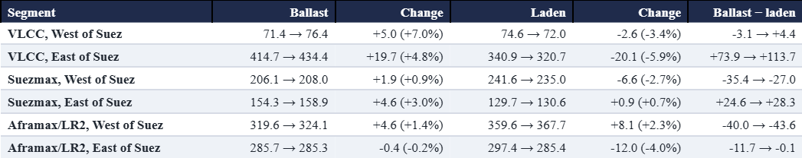

> **Figure 7: Average Daily Vessel Counts, 30 October–5 November → 6–12 November 2026**  
> *Average daily vessel counts, 30 October–5 November → 6–12 November 2026. Changes in vessels and per cent; a positive ballast-laden figure means ballast vessels outnumber laden ones.*  
> **Interactive Data & Source:** [Signal Ocean Platform](https://www.thesignalgroup.com/weekly-market-monitor/weekly-tanker-market-monitor-week-46-2026) | [Local Asset](../../../../../../corpus/07-signal/images/6afc29ed9bb46b9ad35b3cd8_6a660b13.png)

## Ballast-to-Laden Ratio Against Benchmarks

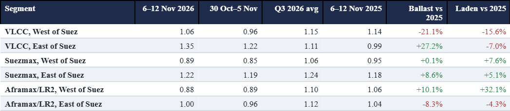

> **Figure 8: Ratio of Average Daily Ballast to Laden Vessel Counts in Each Window**  
> *Ratio of average daily ballast to laden vessel counts in each window. Year-on-year columns compare 6–12 November 2026 with 6–12 November 2025. Aframax/LR2 is a combined size category.*  
> **Interactive Data & Source:** [Signal Ocean Platform](https://www.thesignalgroup.com/weekly-market-monitor/weekly-tanker-market-monitor-week-46-2026) | [Local Asset](../../../../../../corpus/07-signal/images/6afc29ed9bb46b9ad35b3ccc_0c77c907.png)

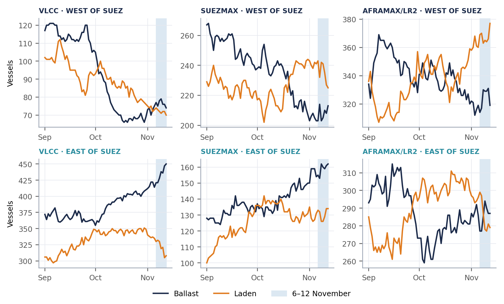

> **Chart 4: Ballast and Laden Vessels West and East of Suez, Daily, VLCC, Suezmax and Aframax/lr2, 1 September–12 November 2026.source: Signal Ocean Vessel Positions and Draft Status.**  
> *Chart 4. Ballast and laden vessels West and East of Suez, daily, VLCC, Suezmax and Aframax/LR2, 1 September–12 November 2026.Source: Signal Ocean vessel positions and draft status.*  
> **Interactive Data & Source:** [Signal Ocean Platform](https://www.thesignalgroup.com/weekly-market-monitor/weekly-tanker-market-monitor-week-46-2026) | [Local Asset](../../../../../../corpus/07-signal/images/6afc29ed9bb46b9ad35b3ce4_934529fb.png)

The wider VLCC fleet remains concentrated East of Suez: the East/West ratio stood at **5.11 on 12 November**, slightly below its 2026 high of 5.19 on 3 November, compared with 3.77 in 2025 and 3.25 in 2024.

## Fleet Distribution and Repositioning

While the ballast VLCC population East of Suez increased during Week 46, the latest fleet distribution shows a modest rise in vessels positioned West of Suez. The western VLCC count increased from **131 to 141** over five days, while the eastern count eased from its 4 November peak of 641 to 629. Nevertheless, about **82%** **of** **the** **fleet** **remained** **East** **of** **Suez**, up from a typical 75%. Active westbound VLCC ballasters declined slightly from 49 to **47**, including 39 originating in the Far East. Brazil remained the leading destination with 20 vessels, followed by South Africa with nine.

Suezmax positioning continued to shift East, with the eastern fleet increasing from 232 vessels in mid-October to **264 on 14 November**, representing approximately 42% of the fleet against a typical 35%. Active westbound Suezmax ballasters declined from 51 to **46**. Aframax ballasters increased marginally from 60 to **61**, including 29 heading towards the US Gulf and ten towards Argentina and Uruguay. The US Gulf Aframax tonnage list stood at 39 vessels on 14 November, compared with an average of approximately 50 in September.

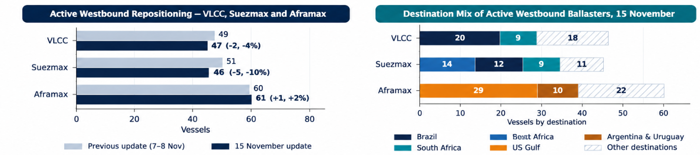

> **Chart 5: Active Westbound VLCC, Suezmax and Aframax Ballasters, Previous Update vs 15 November, and Destination Mix**  
> *Chart 5. Active westbound VLCC, Suezmax and Aframax ballasters, previous update vs 15 November, and destination mix. Active counts represent vessels in transit rather than immediately available tonnage.Source: Signal Maritime Key Insights, 8 and 15 November 2026. Previous update: VLCC and Suezmax 8 November, Aframax 7 November. “Other destinations” is the segment total minus the listed destinations. Signal Maritime fleet counts use a different vessel population from the Signal Ocean position data above.*  
> **Interactive Data & Source:** [Signal Ocean Platform](https://www.thesignalgroup.com/weekly-market-monitor/weekly-tanker-market-monitor-week-46-2026) | [Local Asset](../../../../../../corpus/07-signal/images/6afc29ed9bb46b9ad35b3cd5_da9a6260.png)

## US Gulf Loadings and Atlantic Demand

US Gulf crude loadings reached **125.5 million barrels** in October, up 18% from September, with the daily average increasing by 14% to approximately **4.0 million b/d**. During 1–12 November, tracked loadings averaged **3.1 million b/d**, although the figure remains provisional and covers only the first 12 days of the month. The slower pace of US Gulf loadings in early November came alongside an increase in Atlantic ballast tonnage and further declines in VLCC earnings. While fewer cargoes may have contributed to the softer freight market, the growing ballast supply and weaker fixing sentiment also played a role, making it difficult to attribute the correction to cargo demand alone.

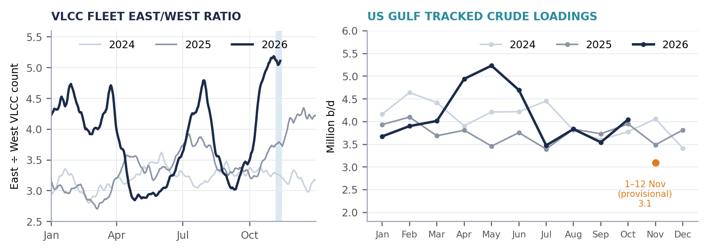

> **Chart 6: VLCC Fleet East/west Ratio by Calendar Day, 2024–2026, and US Gulf Tracked Crude Loadings, Monthly Average in Million B/d, 2024–2026, with Provisional 1–12 November 2026**  
> *Chart 6. VLCC fleet East/West ratio by calendar day, 2024–2026, and US Gulf tracked crude loadings, monthly average in million b/d, 2024–2026, with provisional 1–12 November 2026. Volumes include all destinations and vessel sizes.Sources: Signal Ocean Fleet Distribution; Signal Ocean cargo flows by loading date. November 2026 data are provisional.*  
> **Interactive Data & Source:** [Signal Ocean Platform](https://www.thesignalgroup.com/weekly-market-monitor/weekly-tanker-market-monitor-week-46-2026) | [Local Asset](../../../../../../corpus/07-signal/images/6afc29ed9bb46b9ad35b3ce8_1ea56f9e.png)

The decline in Atlantic VLCC freight rates has reduced the transportation-cost component of long-haul crude shipments to Asia, potentially improving the relative economics of West African and Brazilian cargoes. However, the extent of any improvement in delivered competitiveness also depends on crude-grade price differentials and refinery demand. The key freight consideration is whether lower voyage costs encourage additional Atlantic-to-Asia cargo movements, providing employment for vessels already positioned in the Atlantic Basin.

## Hormuz Freight Watch: Macro Risks

Security risks continue to weigh on tanker operations in the Gulf. The Joint Maritime Information Center’s 12 November advisory recorded further projectile strikes on tankers in the Gulf and Strait of Hormuz on 10–11 November. Repeated attacks continue to restrict the pool of owners willing to accept Gulf employment, while elevated war-risk insurance costs and operational delays add to voyage expenses and limit effective vessel availability. Meanwhile, the recovery in Middle East oil production and exports is changing the cargo outlook. The IEA's 13 November assessment projects a **1.7 million b/d global oil supply surplus in Q4**, the first since the conflict began, although further attacks on shipping could disrupt the recovery. OPEC's November report places October crude production among participating OPEC+ countries at **41.23 million b/d**, up approximately **2.04 million b/d** from September, based on secondary sources. Higher Middle East exports could support additional tanker employment, although continued security risks and limited owner participation in Gulf trades may constrain the impact on freight. Seven OPEC+ producers are scheduled to meet on 29 November.

## Key Takeaways

The Week 46 correction extended across both Atlantic and Gulf VLCC markets, although Atlantic earnings experienced the sharper percentage decline. East of Suez, the growing ballast population points to a change in vessel positioning, but does not establish an equivalent increase in commercially available Gulf tonnage. The next test will be whether additional cargo requirements absorb vessels repositioning across both basins. The pace of Atlantic long-haul employment, Gulf loading activity and owners’ willingness to accept regional risks will remain central to the freight balance.

***Disclaimer:*** *This report has been prepared by Signal Group for general information purposes only. It does not constitute, and should not be relied upon as, investment, financial, trading, legal or commercial advice, or as a recommendation to enter into any transaction. While reasonable efforts have been made to ensure the information is accurate and reliable at the date of publication, no representation or warranty, express or implied, is given as to its accuracy, completeness or continued availability. Certain figures may be estimates or provisional and may subsequently be revised. Market conditions and other external factors may change without notice and may not be reflected in this report. Readers should conduct their own assessment and seek appropriate professional advice before making any decision. To the fullest extent permitted by law, Signal Group accepts no liability for any loss or damage arising from the use of, or reliance on, this report.*

***Copyright notice:*** *© 2026 Signal Group. All rights reserved. This report may be republished in full or in part provided that Signal Group is credited and an active link to the source is included. Any other copying, reproduction, modification or redistribution requires the prior written consent of Signal Group. Third-party data and content remain the property of their respective owners and are used subject to the applicable terms and licences.*
