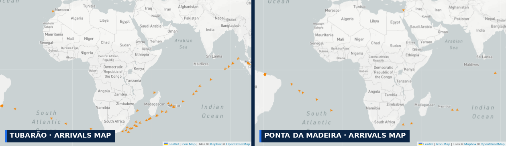
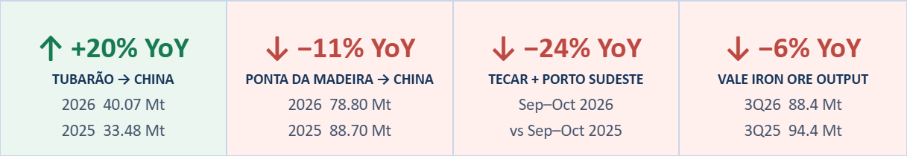
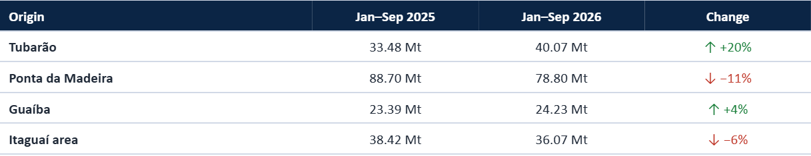
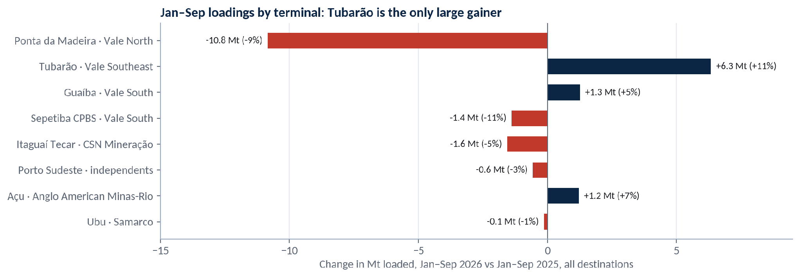
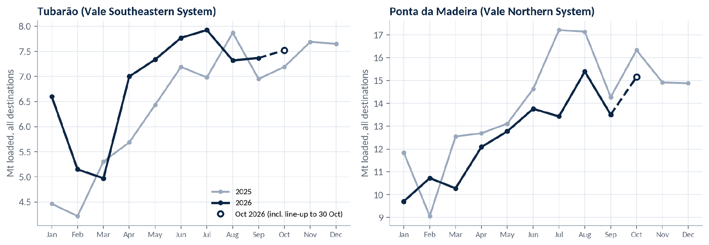
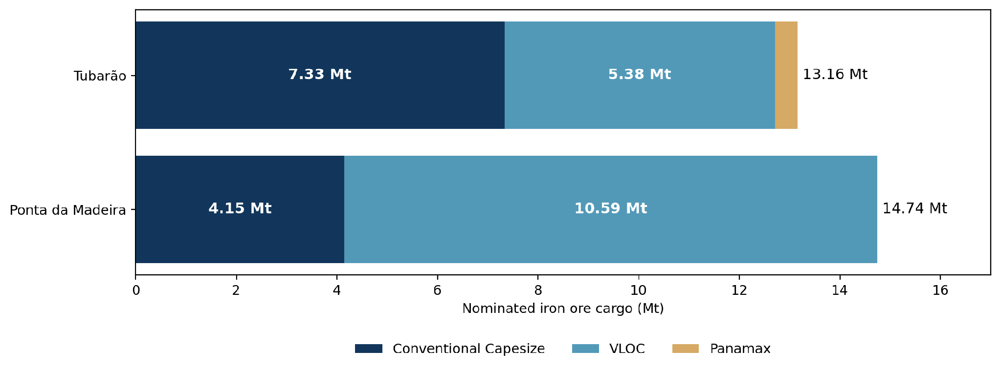
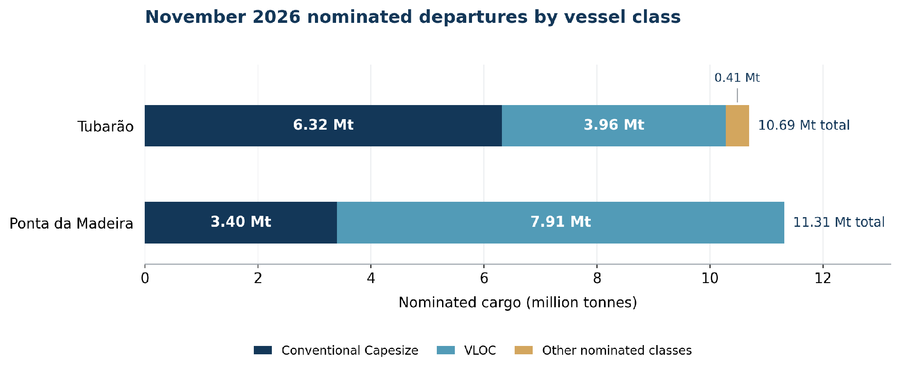
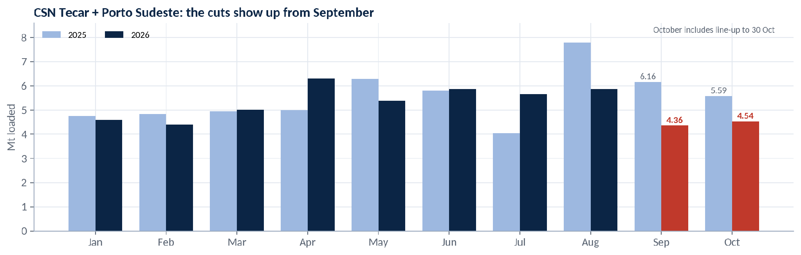

# Market Insights | Iron Ore Spotlight

*Published on 03 November 2026*

## SIGNAL OCEAN · MARKET INSIGHTS · IRON ORE SPOTLIGHT

## Tubarão Gains, Ponta Da Madeira Retreats: Brazil’s Iron Ore Freight Outlook

### Maria Bertzeletou | Senior Market Analyst | 3 November 2026

> **Figure 1: Arrivals Maps for Tubarão (Left) and Ponta Da Madeira (Right): Tonnage Positioning Across the South Atlantic for Vale’s Two Main Export Ports**  
> *Arrivals maps for Tubarão (left) and Ponta da Madeira (right): tonnage positioning across the South Atlantic for Vale’s two main export ports (Source: Signal Ocean Platform, Port Insights, 25 Oct 2026).*  
> **Interactive Data & Source:** [Signal Ocean Platform](https://www.thesignalgroup.com/newsroom/market-insights-iron-ore-spotlight) | [Local Asset](../../../../../../corpus/07-signal/images/6ae99b3289cac6b14a2768df_e2875977.png)

## SPOTLIGHT | TUBARÃO, PONTA DA MADEIRA & PRODUCTION CUTS

## Brazil’s Iron Ore: Tubarão Gains, Northern Supply WeakensBrazil’s Iron Ore: Tubarão Gains, Northern Supply Weakens

> **Figure 2: 6ae99b7b6ffb3e8ad63013f0 8d9796f5**  
> **Interactive Data & Source:** [Signal Ocean Platform](https://www.thesignalgroup.com/newsroom/market-insights-iron-ore-spotlight) | [Local Asset](../../../../../../corpus/07-signal/images/6ae99b7b6ffb3e8ad63013f0_8d9796f5.png)

**Brazilian iron ore exports have diverged across major loading systems in 2026. Tubarão has recorded stronger China-bound shipments, while Ponta da Madeira (PDM) has declined amid weaker output at Vale’s Northern System. The difference matters for freight, but cargo growth alone does not establish additional spot Capesize demand: vessel size, contractual coverage and the timing of Atlantic ballast arrivals determine how much export activity reaches the C3 market.**

## Brazilian Terminals | China-Bound Export Divergence

Tubarão’s estimated China-bound shipments increased by 6.59 Mt to 40.07 Mt in January–September 2026, up 20% year on year. Ponta da Madeira moved in the opposite direction, losing 9.90 Mt to 78.80 Mt (−11%). Guaíba recorded a more modest increase of 4% to 24.23 Mt, while the wider Itaguaí area declined 6% to 36.07 Mt. The contrast indicates that Brazil’s China trade is not strengthening evenly across its export corridors.

> **Table 1: China-Bound Voyage Estimates by Brazilian Origin, January–september 2025 vs 2026**  
> *Table 1: China-bound voyage estimates by Brazilian origin, January–September 2025 vs 2026 (Source: Signal Ocean Platform, Dry Bulk Flows).*  
> **Interactive Data & Source:** [Signal Ocean Platform](https://www.thesignalgroup.com/newsroom/market-insights-iron-ore-spotlight) | [Local Asset](../../../../../../corpus/07-signal/images/6ae99bc895f47452ef6940df_07325d7c.png)

**Across all destinations**, Tubarão's iron ore loadings increased by approximately 6.3 Mt (+11%) year on year during January–September 2026, while Ponta da Madeira declined by 10.8 Mt (−9%). Figure 1 highlights the contrasting export performance of Vale's Southeastern and Northern Systems, with Tubarão recording stronger loading activity amid weaker volumes at Ponta da Madeira.

> **Figure 1: Change in Iron Ore Loadings by Terminal and Associated Producer, January–september 2026 vs 2025, All Destinations**  
> *Figure 1: Change in iron ore loadings by terminal and associated producer, January–September 2026 vs 2025, all destinations (Source: Signal Ocean Platform, Dry Bulk Flows).*  
> **Interactive Data & Source:** [Signal Ocean Platform](https://www.thesignalgroup.com/newsroom/market-insights-iron-ore-spotlight) | [Local Asset](../../../../../../corpus/07-signal/images/6ae99c7b0e8d38f57ee425b6_9e580527.png)

## Monthly Loadings | Tubarão Steadier, PDM Recovering From September

**Figure 2 presents monthly iron ore loadings to all export destinations, with October volumes remaining indicative.** Tubarão recorded a rebound in loading activity during 2026, with volumes strengthening from the lower levels seen earlier in the year and remaining firm through the third quarter. September loadings reached approximately 7.4 Mt, with October indications rising slightly to 7.5 Mt. Ponta da Madeira followed a more variable monthly pattern, despite its weaker cumulative export performance year on year. Its October loading indications increased to approximately 15.2 Mt from 13.5 Mt in September (+13%).

Ponta da Madeira's performance also reflects developments within Vale's Northern System. According to Vale's third-quarter results, Northern System iron ore production declined by 6.9 Mt year on year to 42.8 Mt, largely reflecting reduced run-of-mine availability at Serra Norte, while stronger Serra Sul output provided a partial offset. Vale nevertheless maintained its full-year production guidance of 335–345 Mt, expecting operational improvements during the final quarter. These developments provide important context for PDM's export performance, although production volumes and seaborne loadings do not necessarily move in parallel.

The improvement in loading activity was also reflected across Brazilian iron ore export ports, where estimated volumes reached 28.4 Mt during 1–25 October, up 5.8% from the corresponding September period but 2.3% below the same period in 2025. The month-on-month increase points to firmer shipment activity, although the year-on-year decline indicates that the recovery remains uneven across Brazil's export terminals.

> **Figure 2: Monthly Iron Ore Loadings at Tubarão and Ponta Da Madeira, All Destinations, 2025 vs 2026**  
> *Figure 2: Monthly iron ore loadings at Tubarão and Ponta da Madeira, all destinations, 2025 vs 2026. October 2026 includes stems lined up to 30 October (Source: Signal Ocean Platform, Dry Bulk Flows).*  
> **Interactive Data & Source:** [Signal Ocean Platform](https://www.thesignalgroup.com/newsroom/market-insights-iron-ore-spotlight) | [Local Asset](../../../../../../corpus/07-signal/images/6ae99cac03d0a51107a2348c_970de7bc.png)

## Port Insights | Tubarão Leads in Conventional Capesize Nominations

The 28 October Port Insights data show contrasting iron ore loading programmes at Tubarão and Ponta da Madeira. Tubarão recorded 67 nominated loading calls representing 13.16 Mt, compared with 57 calls and 14.74 Mt at Ponta da Madeira. Conventional Capesizes accounted for 44 calls (7.33 Mt) at Tubarão, compared with 24 calls (4.15 Mt) at PDM. In contrast, PDM’s programme was dominated by 33 VLOC nominations representing 10.59 Mt, against 16 VLOC calls (5.38 Mt) at Tubarão. Despite PDM’s larger nominated cargo volume, Tubarão recorded 20 more conventional Capesize calls, highlighting the different vessel requirements at the two terminals.

> **Figure 3: Iron Ore Loading Nominations by Vessel Class — Tubarão vs Ponta Da Madeira, 28 October 2026**  
> *Figure 3. Iron ore loading nominations by vessel class — Tubarão vs Ponta da Madeira, 28 October 2026. Source: Signal Ocean Platform, Port Insights. Nominated calls and indicated cargo volumes; not completed exports.*  
> **Interactive Data & Source:** [Signal Ocean Platform](https://www.thesignalgroup.com/newsroom/market-insights-iron-ore-spotlight) | [Local Asset](../../../../../../corpus/07-signal/images/6ae99cd1191b1388171b3db2_60063bf9.png)

The November departure schedules reinforce this difference. Tubarão recorded approximately 10.7 Mt of nominated departures, including 38 conventional Capesize calls (6.32 Mt) and 12 VLOC calls (3.96 Mt). At Ponta da Madeira, November nominations reached approximately 11.3 Mt, comprising 25 VLOC calls (7.91 Mt) and 20 conventional Capesize calls (3.40 Mt). The higher VLOC concentration at PDM contrasts with Tubarão’s stronger conventional Capesize representation, an important distinction when assessing potential vessel employment on Brazil’s long-haul iron ore routes.

> **Figure 4: November 2026 Nominated Departures by Vessel Class — Tubarão vs Ponta Da Madeira**  
> *Figure 4. November 2026 nominated departures by vessel class — Tubarão vs Ponta da Madeira. Source: Signal Ocean Platform, Port Insights, 28 October 2026 snapshot. Scheduled departures and indicated cargo volumes; not completed exports.*  
> **Interactive Data & Source:** [Signal Ocean Platform](https://www.thesignalgroup.com/newsroom/market-insights-iron-ore-spotlight) | [Local Asset](../../../../../../corpus/07-signal/images/6ae99edc86cb06d5fe8c4481_e4f3ca72.png)

Cargo composition provides further context. At Tubarão, iron ore pellets accounted for 51 nominated calls and approximately 7.78 Mt, or 59% of indicated tonnage. At Ponta da Madeira, iron ore fines dominated the loading programme, with VLOCs representing approximately 72% of nominated cargo tonnage. The contrasting cargo and vessel profiles highlight how differences in export activity between the two ports translate into different fleet requirements. The nominated programmes provide a forward view of potential loading activity, while actual Capesize employment will depend on the execution of scheduled departures and the availability of vessels positioning towards Brazil.

## Production Outlook | Supply Constraints

Brazil’s iron ore production outlook remains uneven. Vale reported 88.4 Mt in the third quarter, down 6% year on year, with lower ore availability at Serra Norte partly offset by stronger Serra Sul performance. Both operations belong to the Northern System, providing operational context for weaker exports through Ponta da Madeira. Vale nevertheless maintained its annual guidance of 335–345 Mt. The extent to which production translates into export availability will depend on inventories, logistics and the execution of loading programmes.

Supply pressure is more evident among smaller producers. CSN Mineração reduced its production-plus-purchases guidance to 39–41 Mt from 45–47 Mt, while several independent miners announced suspensions or output adjustments. These developments coincide with weaker terminal activity: combined September–October loadings at Tecar and Porto Sudeste fell to 8.90 Mt from 11.75 Mt a year earlier, a reduction of 2.85 Mt. The decline highlights a weaker source of conventional Capesize cargo demand alongside the larger nominated programmes at Vale’s ports.

> **Figure 6: Monthly Iron Ore Loadings at Csn’s Tecar Terminal and Porto Sudeste Combined, 2025 vs 2026**  
> *Figure 6: Monthly iron ore loadings at CSN’s Tecar terminal and Porto Sudeste combined, 2025 vs 2026 (Source: Signal Ocean Platform, Dry Bulk Flows).*  
> **Interactive Data & Source:** [Signal Ocean Platform](https://www.thesignalgroup.com/newsroom/market-insights-iron-ore-spotlight) | [Local Asset](../../../../../../corpus/07-signal/images/6ae99f03cad4361360d2858c_be63b7fa.png)

Anglo American reported Minas-Rio production of 6.3 Mt in the third quarter, up 24% year on year. Samarco reported production of 4.3 Mt, up 4%. However, sales declined 5% to 3.9 Mt. Separately, Signal Ocean Platform’s Dry Bulk Flows records show that Açu’s China-bound shipments increased to 9.18 Mt in January–September from 5.15 Mt a year earlier. Ubu shipped only 0.37 Mt to China over the same period, with South Korea, Egypt and the US among its main destinations. The stronger China-bound flow from Açu therefore has a more direct connection to Brazil–China vessel employment than Samarco’s production recovery.

For freight, lower shipments at Tecar and Porto Sudeste may constrain spot Capesize enquiry, while increased Açu–China volumes support long-haul employment. Sustained support for C3 will depend on scheduled cargoes materialising and conventional Capesize demand absorbing available Atlantic tonnage. Vale’s Northern System performance, independent producer restarts, Chinese buying and ballast arrivals remain the main indicators to watch.

**POWERED BY SIGNAL OCEAN PLATFORM | Explore vessel arrivals, loading programmes and port activity through** [Signal Ocean Platform](https://www.thesignalgroup.com/signal-ocean/platform) Port Insights.

***Disclaimer:*** *This report has been prepared by Signal Group for general information purposes only. It does not constitute, and should not be relied upon as, investment, financial, trading, legal or commercial advice, or as a recommendation to enter into any transaction. While reasonable efforts have been made to ensure that the information is accurate and reliable at the date of publication, no representation or warranty, express or implied, is given as to its accuracy, completeness or continued availability. Certain figures may be estimates or provisional and may subsequently be revised. Market conditions and other external factors may change without notice and may not be reflected in this report. Readers should conduct their own assessment and seek appropriate professional advice before making any decision. To the fullest extent permitted by law, Signal Group accepts no liability for any loss or damage arising from the use of, or reliance on, this report.*

***Copyright notice:*** *© 2026 Signal Group. All rights reserved. Except where otherwise stated or permitted by law, this report may not be copied, reproduced, modified, published or redistributed, in whole or in part, without the prior written consent of Signal Group. Third-party data and content remain the property of their respective owners and are used subject to the applicable terms and licences.*
