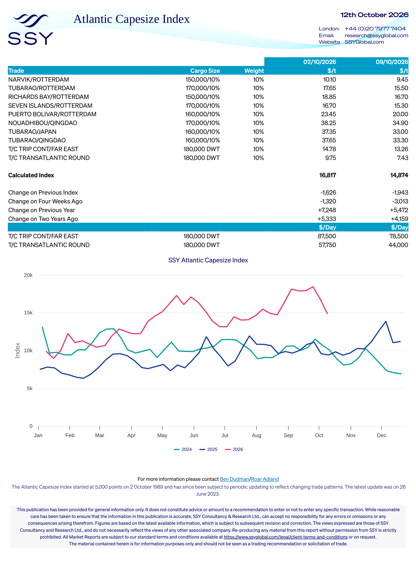

# SSY Atlantic Capesize Index — Week 41, 2026

**Issue Date:** 2026-10-09  
**Assessment Dates:** Current: 2026-10-09 | Previous: 2026-10-02  
**Source Document:** `corpus/01-brokers/ssy/2026/ssy_12_10_2026_ssy_atlantic_capesize_index_12_october_2026.pdf`

## Route Freight Rates ($/t)

| Route | Cargo Size | Weight (%) | 2026-10-02 ($/t) | 2026-10-09 ($/t) |
|---|---|---|---|---|
| NARVIK/ROTTERDAM | 150,000/10% | 10% | 10.10 | 9.45 |
| TUBARAO/ROTTERDAM | 170,000/10% | 10% | 17.65 | 15.50 |
| RICHARDS BAY/ROTTERDAM | 150,000/10% | 10% | 18.85 | 16.70 |
| SEVEN ISLANDS/ROTTERDAM | 170,000/10% | 10% | 16.70 | 15.30 |
| PUERTO BOLIVAR/ROTTERDAM | 160,000/10% | 10% | 23.45 | 20.00 |
| NOUADHIBOU/QINGDAO | 170,000/10% | 10% | 38.25 | 34.90 |
| TUBARAO/JAPAN | 160,000/10% | 10% | 37.35 | 33.00 |
| TUBARAO/QINGDAO | 160,000/10% | 10% | 37.65 | 33.30 |
| T/C TRIP CONT/FAR EAST | 180,000 DWT | 10% | 14.78 | 13.26 |
| T/C TRANSATLANTIC ROUND | 180,000 DWT | 10% | 9.75 | 7.43 |

## Calculated Index & Historical Changes

| Metric | 2026-10-02 | 2026-10-09 |
|---|---|---|
| **Calculated Index** | 16,817 | 14,874 |
| Change on Previous Index | -1,626 | -1,943 |
| Change on Four Weeks Ago | -1,320 | -3,013 |
| Change on Previous Year | +7,248 | +5,472 |
| Change on Two Years Ago | +5,333 | +4,159 |

## Timecharter Equivalents ($/Day)

| Route | Cargo Size | 2026-10-02 ($/Day) | 2026-10-09 ($/Day) |
|---|---|---|---|
| T/C TRIP CONT/FAR EAST | 180,000 DWT | $87,500 | $78,500 |
| T/C TRANSATLANTIC ROUND | 180,000 DWT | $57,750 | $44,000 |

## Index Background & Contact

**Index Definition:** The Atlantic Capesize Index started at 5,000 points on 2 October 1989 and has since been subject to periodic updating to reflect changing trade patterns. The latest update was on 26 June 2023.  
**Contact:** For more information please contact Ben Dudman/Roar Adland  

## Market Charts & Quantitative Vectors

### SSY Capesize Routes & FFA Trajectories (Page 1)

*Extracted to time series: `ssy_capesize_routes_points.csv`*
