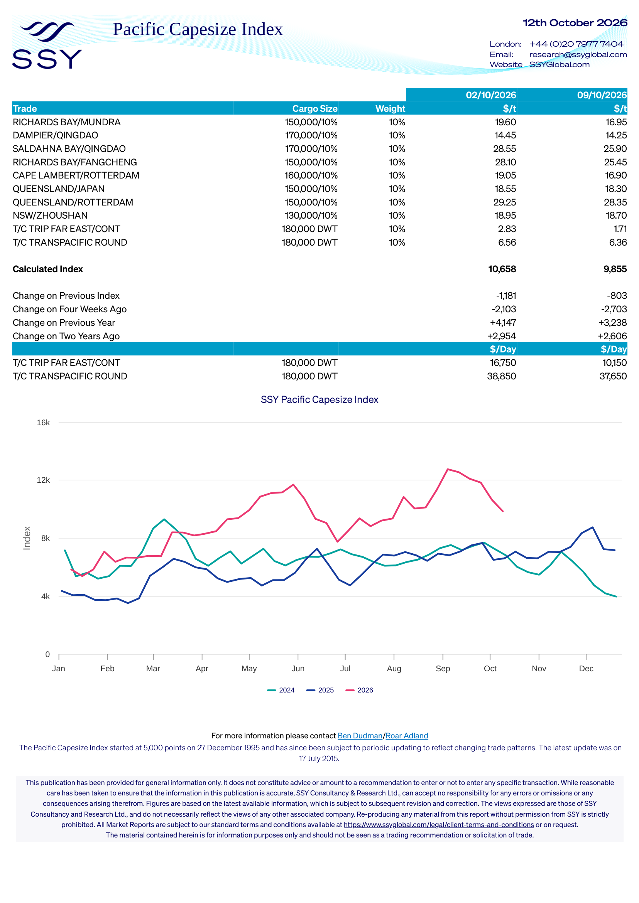

# SSY Pacific Capesize Index — Week 41, 2026

**Issue Date:** 2026-10-09  
**Assessment Dates:** Current: 2026-10-09 | Previous: 2026-10-02  
**Source Document:** `corpus/01-brokers/ssy/2026/ssy_12_10_2026_ssy_pacific_capesize_index_12_october_2026.pdf`

## Route Freight Rates ($/t)

| Route | Cargo Size | Weight (%) | 2026-10-02 ($/t) | 2026-10-09 ($/t) |
|---|---|---|---|---|
| RICHARDS BAY/MUNDRA | 150,000/10% | 10% | 19.60 | 16.95 |
| DAMPIER/QINGDAO | 170,000/10% | 10% | 14.45 | 14.25 |
| SALDAHNA BAY/QINGDAO | 170,000/10% | 10% | 28.55 | 25.90 |
| RICHARDS BAY/FANGCHENG | 150,000/10% | 10% | 28.10 | 25.45 |
| CAPE LAMBERT/ROTTERDAM | 160,000/10% | 10% | 19.05 | 16.90 |
| QUEENSLAND/JAPAN | 150,000/10% | 10% | 18.55 | 18.30 |
| QUEENSLAND/ROTTERDAM | 150,000/10% | 10% | 29.25 | 28.35 |
| NSW/ZHOUSHAN | 130,000/10% | 10% | 18.95 | 18.70 |
| T/C TRIP FAR EAST/CONT | 180,000 DWT | 10% | 2.83 | 1.71 |
| T/C TRANSPACIFIC ROUND | 180,000 DWT | 10% | 6.56 | 6.36 |

## Calculated Index & Historical Changes

| Metric | 2026-10-02 | 2026-10-09 |
|---|---|---|
| **Calculated Index** | 10,658 | 9,855 |
| Change on Previous Index | -1,181 | -803 |
| Change on Four Weeks Ago | -2,103 | -2,703 |
| Change on Previous Year | +4,147 | +3,238 |
| Change on Two Years Ago | +2,954 | +2,606 |

## Timecharter Equivalents ($/Day)

| Route | Cargo Size | 2026-10-02 ($/Day) | 2026-10-09 ($/Day) |
|---|---|---|---|
| T/C TRIP FAR EAST/CONT | 180,000 DWT | $16,750 | $10,150 |
| T/C TRANSPACIFIC ROUND | 180,000 DWT | $38,850 | $37,650 |

## Index Background & Contact

**Index Definition:** The Pacific Capesize Index started at 5,000 points on 27 December 1995 and has since been subject to periodic updating to reflect changing trade patterns. The latest update was on 17 July 2015.  
**Contact:** For more information please contact Ben Dudman/Roar Adland  

## Market Charts & Quantitative Vectors

### SSY Capesize Routes & FFA Trajectories (Page 1)

*Extracted to time series: `ssy_capesize_routes_points.csv`*
