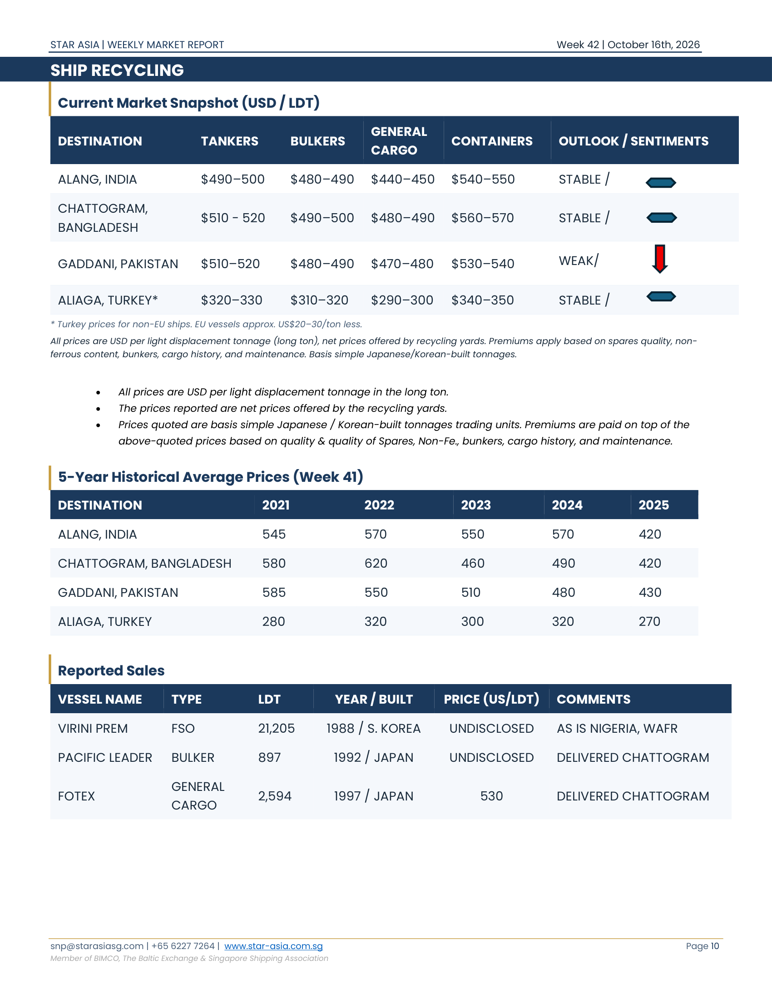
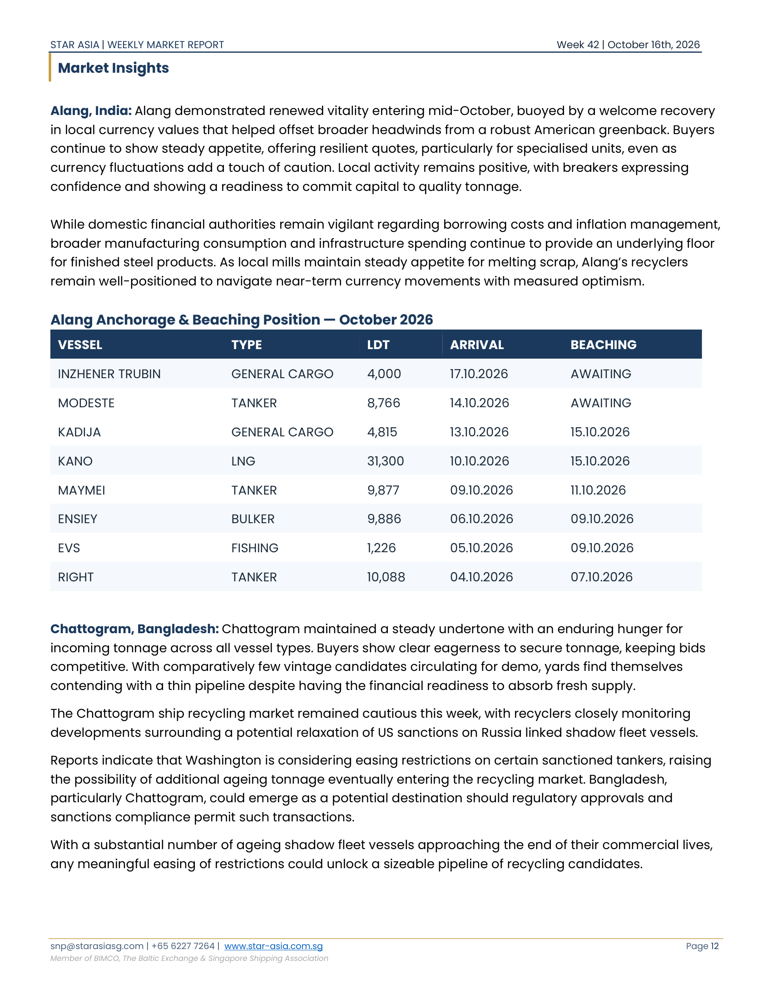
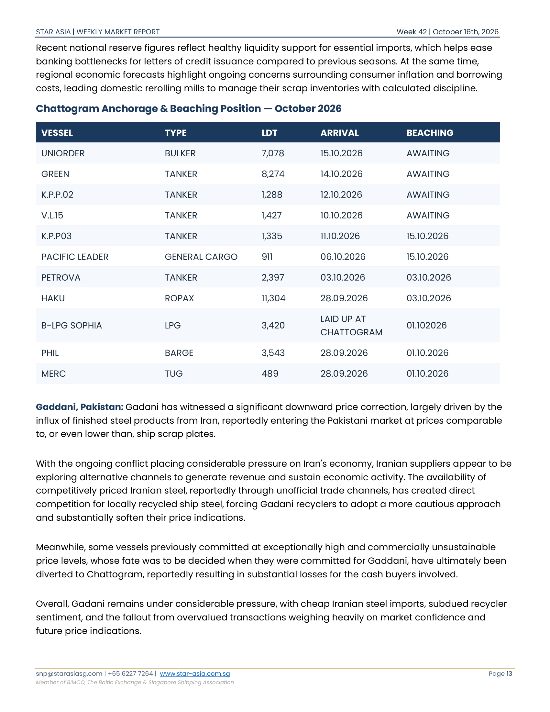
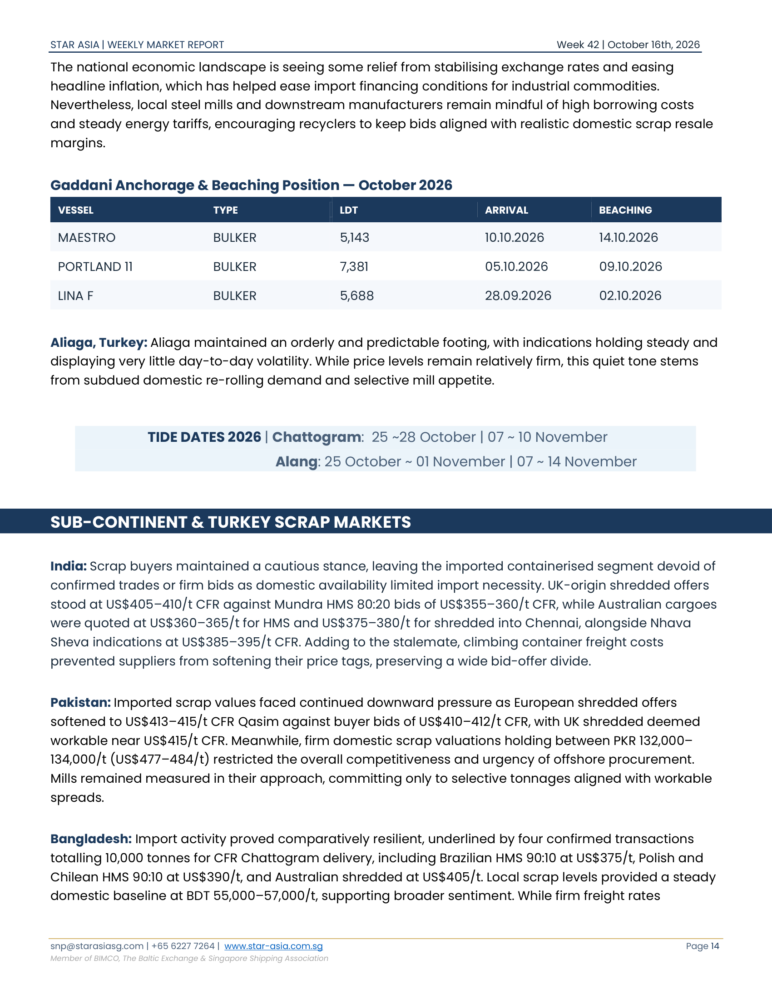

# Star Asia Weekly Demolition Report - Week 42, 2026

**Issue Date:** 2026-10-16 | **Report Week:** 42 | **Publisher:** Star Asia Shipbroking  
**Source Document:** `corpus/01-brokers/star_asia/2026/star_asia_19_10_2026_star_asia_shipbroking_weekly_market_report_week_42.pdf`  

---

## Page 1

## MARKET OVERVIEW

Big news this week, President Donald Trump waived the Graham Act's Russia-related tariffs and sanctions, delaying 100% duties on goods from the top five buyers of Russian crude and 500% tariffs on US imports of Russian energy. The measures remain law but are suspended, allowing future enforcement. The move clears a hurdle to Trump's plan to work with President Vladimir Putin to release Russian diesel supplies and lower record-high US diesel prices before the Nov. 3 midterms. It also avoids tension with China, India, and Turkey. However, congressional pushback and renewed Russia-Ukraine strikes keep geopolitical and energy-market uncertainty elevated. On the other hand, what can truly be said this week that has not already been said before? Another week rolls in, and the strait continues to remain blocked, leaving the entire maritime industry stuck in an uneasy limbo of second-guessing and waiting for a resolution that still feels out of reach. With ships forced into long detours around the bottom of Africa, voyage days are piling up, schedules are fraying, and shipowners are left playing an endless game of musical chairs with vessel availability. The prolonged standoff has kept everyone from charterers to operators guessing, turning standard forward planning into an exercise of pure patience. Meanwhile, the wider financial stage offers little comic relief, as global finance chiefs gathered in Bangkok found themselves sweating over soaring borrowing costs instead of routine policy talk. Discussions at the International Monetary Fund and World Bank's meetings reveal mounting unease over escalating borrowing costs and persistent sovereign debt, with interest rates in advanced economies holding near historic highs. This financial tightening, driven partly by elevated energy costs stemming from Middle Eastern hostilities, is casting a shadow over trade demand and squeezing emerging markets that must service more expensive debt. While long-running policy debates over export imbalances between the United States and China continue to simmer in the background, international leaders are increasingly focused on the immediate threat that surging bond yields and heavy fiscal deficits pose to global growth stability.

Meanwhile, the bunker market has become increasingly fragmented. With merchant fleets steering clear of traditional bunkering locations near the Persian Gulf, procurement strategies have fundamentally shifted from routine, spot-market purchases toward cautious, long-lead planning. Demand is concentrating heavily in major centres like Singapore, while secondary ports across the Indian Ocean, Africa, and South America are experiencing an unexpected influx of refuelling calls. Operating in less familiar ports introduces notable disparities in fuel pricing, access to compliant supplies, and local barge availability.

## Page 2

# DRY BULK | BDI: 2,511 ▼13.92% (w-o-w)

Dry bulk saw a correction at this week's closing, as the benchmark Baltic Dry Index dropped 200 points wo-w to 2,511 points, slipping 13.9%, largely weighed down by broader post-holiday easing across the larger vessel segments. While Capesize spot returns have fallen by roughly US$20,000 from their multi-year peaks in early September as transportation costs reach decade highs relative to ore prices, daily earnings still sit comfortably above US$30,000. Forward sentiment remains underpinned by futures trading at a premium to spot levels and widespread fleet friction, which is poised to tighten further after the Suez Canal Authority introduced mandatory pre-transit trials and inspections for vessels aged 25 and older-a measure impacting a global merchant fleet where over 150 million gross tons now exceed 25 years (up 75% over five years). On the cargo side, strong long-haul fundamentals continue to take shape, highlighted by a 104% y-o-y surge in overall US dry bulk exports to China reaching approximately 24 million tons year-to-date, led by a 176% y-o-y leap in grain volumes following eased bilateral tariffs and import commitments, with demand for US maize and soybeans expected to accelerate further as Black Sea disruptions persist and China prepares to import at least 10 million tons of US coal over the next two years.

## Segment Highlights

**Capesize:** Capesize market experienced a pronounced 13.9% contraction, primarily weighed down by an acute lack of fresh Atlantic enquiry and a growing buildup of ballast tonnage across the basin. Spot earnings retreated sharply across all core benchmarks as miner participation lagged, driving T/A rates down to US$35,680's, Pacific R/V to US$29,000's and Brazil R/V to US$28,875's per day. Post-holiday trading in China should help establish a floor, though Atlantic overhang will likely cap any immediate recovery.

**Panamax / Kamsarmax:** Panamax traded broadly sideways, as localised tonnage tightness for October laycans across Indonesia and EC South America helped counteract expanding ballast lists and softer Pacific coal flows. Driven by prompt capacity shortages and steady North American grain fixtures, key route earnings advanced, with F/H rates rising to US$31,200's and Indonesian R/V surging to US$20,500's.

**Supramax / Ultramax:** Supramax maintained a constructive tone, buoyed by expanding NOPAC grain stems, active Indonesian coal flows into the subcontinent, and steady Mediterranean inquiry offsetting minor drops on long-haul USG routes. Prompt tonnage tightness and resilient intra-Asian demand helped push major benchmark earnings higher, with T/A returns rising to US$29,775's and Pacific-India runs advancing to US$20,800's. Sustained B/H interest and regional grain movements should keep freight levels well supported.

**Handysize:** Handysize maintained a mixed week, as the Mediterranean remained stable on balanced fundamentals while quieter Asian activity was cushioned by tightening tonnage lists and steady enquiry. Benchmark route earnings pushed firmly higher, with F/H rates jumping to US$15,745's and Inter-Pacific voyages advancing to US$17,300's.

## Page 3

### Baltic Dry Index (BDI)

**BDI:** 2,511 (WoW: -13.92% | YoY: +21.36%)

| BCI | BPI | BSI | BHSI |
| :---: | :---: | :---: | :---: |
| 3,249 | 2,314 | 1,865 | 1,011 |
| WoW: -25.14% | WoW: -4.54% | WoW: +2.81% | WoW: +1.51% |
| YoY: +4.10% | YoY: +26.66% | YoY: +30.97% | YoY: +14.24% |

### Vessel Values (USD Million)

| TYPE | DWT | NB CONTRACT | NB PROMPT | 5 YRS | 10 YRS | 15 YRS |
| :--- | :---: | :---: | :---: | :---: | :---: | :---: |
| CAPESIZE | 180,000 | $76M | $82M | $71M | $56M (E) | $35M |
| KAMSARMAX | 82,000 | $38M | $45M | $38M | $31M (E) | $25M |
| ULTRAMAX | 64,000 | $35M | $44M | $38M (E) | $29M | $19M |
| HANDY | 38,000 | $31M | $37M | $29M | $23M | $18M |

### Sale & Purchase - Reported Fixtures

| VESSEL | TYPE | DWT | YEAR / BUILT | PRICE (USD M) | BUYER |
| :--- | :---: | :---: | :---: | :---: | :--- |
| OAK / JUNIPER | SMAX | 57,275 | 2011 / CHINA | 16.5 EACH | ASIAN BUYERS |
| LOCOMOTION | HANDY | 38,046 | 2013 / JAPAN | 19.5 | UNDISCLOSED |
| ZBB SERENITY | HANDY | 37,302 | 2010 / CHINA | 12.0 | TURKISH BUYERS |
| LIMA STRAIT | HANDY | 37,187 | 2012 / S. KOREA | 15.2 | UNDISCLOSED |
| ASL CRYSTAL | HANDY | 38,582 | 2019 / PHILIPPINES | 27.8 | ASIAN BUYERS |

## Page 4

### Dry Bulk Annual Averages (USD / Day)

| SEGMENT (AVG) | 2022 | 2023 | 2024 | 2025 | 2026 YTD |
| :--- | :---: | :---: | :---: | :---: | :---: |
| CAPESIZE | $22,350 | $16,300 | $22,715 | $21,650 | $41,000 |
| PANAMAX | $20,550 | $14,725 | $16,355 | $14,385 | $19,450 |
| SUPRAMAX | $20,450 | $14,570 | $16,300 | $14,250 | $19,500 |
| HANDY | $20,770 | $12,300 | $13,875 | $12,655 | $17,000 |

## Page 5

# TANKERS | BDTI: 7,727 ▼-2.98% (w-o-w)

Brent crude is back above US$106 per barrel on Wednesday. While vessel-tracking services such as Vortexa, and TankerTrackers suggest aggregate Middle Eastern loadings are approaching pre-crisis baselines, operational security through the Strait of Hormuz has severely deteriorated. Maritime intelligence observed just 2 tankers braving the passage on October 12-both navigating covertly with deactivated transponders-while confirming that at least 6 crude carriers were struck on October 11 alone. Maritime security bodies echo this escalation, with the U.K. Maritime Trade Operations reporting 9 vessel attacks within the first week of October, with broader industry estimates tracking a dozen tanker strikes during the first week of the month. This has driven freight expenditures to historic extremes, with shipping charges now consuming nearly a third of total landed cargo costs, up from less than 5% before the outbreak of hostilities. At the same time, the global safety net of emergency petroleum inventories has reached critical depletion, leaving markets acutely vulnerable ahead of peak seasonal winter demand. Industry leaders have voiced grave concerns over this disappearing buffer; Saudi Aramco highlighted a cumulative deficit of 3 billion barrels since the conflict began against approximately 1 billion barrels deployed from state reserves, leaving worldwide commercial stockpiles hovering at bare minimum operating levels where further drawdowns risk compromising systemic storage integrity.

## Segment Highlights

**VLCC:** MEG surged as winter restocking demand and a buoyant Atlantic drawing ballasters away combined to sharply deplete available tonnage, trips to China ended the week around WS1,318 for TD3. While heightened Iranian attacks have temporarily capped spot rates, persistent competition for monthend stems and owner bargaining leverage kept freight rates elevated

**Suezmax:** WAFR rose as the clearance of prompt stems and early November volumes collided with a shortage of ballast tonnage drawn to buoyant markets East of Suez. 130,000mt Nigeria/UKC (TD20) rose another 103 points to WS981. While charterers pushing fixing windows past three weeks have taken some steam out of owners' momentum, structurally tight vessel availability kept rates firmly elevated.

**Aframax:** MEG rates surged roughly 27% as steady Asia-bound demand and vessel departures toward higher-paying Mediterranean trades severely pinched regional tonnage against elevated security risks. Across the Med, despite relatively muted fixing activity, uncompromised owners are holding back on prompt offers to cherry-pick favourable stems, keeping charterers under pressure. 80,000mt Ceyhan/Lavera closed higher at WS780.

**LR1 / LR2:** MEG LR2 rates saw a slight dip this week as East Asian demand clashed with tonnage shortages. TC1 MEG/Japan ended the week a point lower at WS928. In the LR1 segment, slight discount was also seen with TC5 route settling at WS940, 8 points shy from last week.

**MR:** In the Far East, rates declined as regional cargo activity slowed under the influence of China's National Day. TC17 MEG/East Africa also fell slightly ending the week at WS893 levels. The TC14 route USG/UKC also dipped some 95 points to WS285 mark.

## Page 6

### Baltic Tanker Indices

| BDTI | BCTI |
| :---: | :---: |
| 7,727 | 2,522 |
| WoW: -2.98% | WoW: +4.95% |
| YoY: +540.18% | YoY: +357.71% |

### Vessel Values (USD Million)

| TYPE | DWT | NB CONTRACT | NB PROMPT | 5 YRS | 10 YRS | 15 YRS |
| :--- | :---: | :---: | :---: | :---: | :---: | :---: |
| VLCC | 310,000 | $130M | $175M | $141M (E) | $112M (E) | $64M |
| SUEZMAX | 160,000 | $90M | $115M | $95M (E) | $85M (E) | $56M |
| AFRAMAX | 115,000 | $78M | $95M | $80M (E) | $70M (E) | $51M |
| LR1 | 73,000 | $67M | $74M | $64M (E) | $55M (E) | $33M |
| MR | 51,000 | $51M | $60M | $49M (E) | $40M (E) | $30M |

### Sale & Purchase - Reported Fixtures

| VESSEL | TYPE | DWT | YEAR / BUILT | PRICE (USD M) | BUYER |
| :--- | :---: | :---: | :---: | :---: | :--- |
| VIERA | VLCC | 306,999 | 2002 / S. KOREA | 75.0 | UNDISCLOSED |
| SOUTHERN EMPEROR | VLCC | 297,376 | 2004 / CHINA | 110.0 | UNDISCLOSED |
| NICOLAOS | SUEZ | 164,758 | 2010 / S. KOREA | 90.0 | UNDISCLOSED |
| MILITOS | SUEZ | 164,751 | 2012 / S. KOREA | 95.5 | UNDISCLOSED |
| YELLOW TRADER | SUEZ | 158,609 | 2004 / S. KOREA | 60.0 | UNDISCLOSED |
| LXH | SUEZ | 151,174 | 2004 / S. KOREA | 61.5 | UNDISCLOSED |
| ASEAN FORWARDER | LR1 | 74,543 | 2006 / JAPAN | 26.8 | UNDISCLOSED |
| ASIAN PHOENIX | LR1 | 72,782 | 2006 / CHINA | 20.0 | UNDISCLOSED |

## Page 7

### Tanker Annual Averages (USD / Day)

| SEGMENT (AVG) | 2022 | 2023 | 2024 | 2025 | 2026 YTD |
| :--- | :---: | :---: | :---: | :---: | :---: |
| VLCC | $25,215 | $41,550 | $45,950 | $45,075 | $178,500 |
| SUEZMAX | $25,645 | $40,625 | $41,175 | $35,685 | $132,000 |
| AFRAMAX | $24,400 | $41,850 | $41,950 | $33,050 | $75,000 |
| MR | $20,050 | $28,800 | $30,750 | $23,000 | $31,500 |

## Page 8

# CONTAINERS

SCFI index rose 0.42% on Friday to 3,679.58 points as transpacific rates held firm and Europe posted a modest rebound under carrier price defence, which counteracted post-holiday demand moderation. To protect spot levels against softening seasonal volumes, carriers have maintained strict capacity discipline, with Drewry reporting 34 scheduled cancellations out of 713 planned sailings on major East- West corridors through November 15-comprising 50% on Asia-Europe and Mediterranean routes, 32% across transpacific services, and 18% on transatlantic loops. In the Middle East, spot rates saw a minor post-holiday dip but stayed firmly anchored at elevated baseline levels. Tensions escalated dramatically in the Strait of Hormuz following strikes on two vessels operated by Global Feeder Shipping (GFS)-the 4,350 TEU GFS Giselle, which sustained minor damage, and the 2,824 TEU GFS Pride, which subsequently sank while deployed on its fortnightly shuttle connecting Khalifa, Jebel Ali, and Karachi. In response, mainline operators are establishing safe corridors outside the chokepoint, with Maersk introducing a dedicated feeder link connecting India to Khor Fakkan, alongside its joint relaunch with Hapag-Lloyd of the FM1 service deploying the 8,440 TEU Maersk Athabasca from Qingdao on October 17 to serve Khor Fakkan directly at the entrance of the Gulf.

### Vessel Values (USD Million)

| SIZE (TEU) | TYPE | NB CONTRACT | NB PROMPT | 5 YRS | 10 YRS | 15 YRS |
| :--- | :---: | :---: | :---: | :---: | :---: | :---: |
| 900 - 1,200 | Geared | $25M | $29M | $23M | $18M | $12M |
| 1,600 - 1,850 | Gearless | $32M | $38M | $30M (E) | $25M (E) | $18M |
| 2,700 - 2,900 | Gearless | $44M | $46M | $40M | $35M | $26M |
| 5,100 - 5,300 | Gearless | $55M | $79M | $64M | - | $39M |

### Sale & Purchase - Reported Fixtures

| VESSEL | TYPE | TEU | YEAR / BUILT | PRICE (USD M) | BUYER |
| :--- | :---: | :---: | :---: | :---: | :--- |
| TAIZHOU JIANXING JX4350TEU-10 | PMAX | 4,350 | 2027 / CHINA | 58.5 | SM LINE |
| NEW DAYANG NDY2007 / NEW DAYANG NDY2008 | PMAX | 3,100 | 2028 / CHINA | 55.0 EACH | GREEK BUYERS |

## Page 9

### Container Annual Averages (USD / Day)

| SEGMENT (AVG) | 2022 | 2023 | 2024 | 2025 | 2026 YTD |
| :--- | :---: | :---: | :---: | :---: | :---: |
| 1000 TEU | $29,580 | $10,950 | $11,900 | $16,150 | $18,750 |
| 1,700 TEU | $44,585 | $13,050 | $18,580 | $27,325 | $35,500 |
| 2,750 TEU | $63,500 | $16,450 | $27,475 | $37,900 | $45,000 |
| 9,000 TEU | $145,525 | $51,700 | $75,775 | $107,025 | $115,250 |

## Page 10

### Ship Recycling - Current Market Snapshot (USD / LDT)

| DESTINATION | TANKERS | BULKERS | GENERAL CARGO | CONTAINERS | OUTLOOK / SENTIMENTS |
| :--- | :---: | :---: | :---: | :---: | :---: |
| ALANG, INDIA | $490-500 | $480-490 | $440-450 | $540-550 | STABLE |
| CHATTOGRAM, BANGLADESH | $510 - 520 | $490-500 | $480-490 | $560-570 | STABLE |
| GADDANI, PAKISTAN | $510-520 | $480-490 | $470-480 | $530-540 | WEAK |
| ALIAGA, TURKEY | $320-330 | $310-320 | $290-300 | $340-350 | STABLE |

*Turkey prices for non-EU ships. EU vessels approx. US$20-30/ton less.*

All prices are USD per light displacement tonnage (long ton), net prices offered by recycling yards. Premiums apply based on spares quality, non-ferrous content, bunkers, cargo history, and maintenance. Basis simple Japanese/Korean-built tonnages. • All prices are USD per light displacement tonnage in the long ton. • The prices reported are net prices offered by the recycling yards. • Prices quoted are basis simple Japanese / Korean-built tonnages trading units. Premiums are paid on top of the above-quoted prices based on quality & quality of Spares, Non-Fe., bunkers, cargo history, and maintenance.

### 5-Year Historical Average Prices (USD / LDT)

| DESTINATION | 2021 | 2022 | 2023 | 2024 | 2025 |
| :--- | :---: | :---: | :---: | :---: | :---: |
| ALANG, INDIA | 545 | 570 | 550 | 570 | 420 |
| CHATTOGRAM, BANGLADESH | 580 | 620 | 460 | 490 | 420 |
| GADDANI, PAKISTAN | 585 | 550 | 510 | 480 | 430 |
| ALIAGA, TURKEY | 280 | 320 | 300 | 320 | 270 |

### Demolition - Reported Sales

| VESSEL NAME | TYPE | LDT | YEAR / BUILT | PRICE (US/LDT) | COMMENTS |
| :--- | :---: | :---: | :---: | :---: | :--- |
| VIRINI PREM | FSO | 21,205 | 1988 / S. KOREA | UNDISCLOSED | AS IS NIGERIA, WAFR |
| PACIFIC LEADER | BULKER | 897 | 1992 / JAPAN | UNDISCLOSED | DELIVERED CHATTOGRAM |
| FOTEX | GENERAL CARGO | 2,594 | 1997 / JAPAN | 530 | DELIVERED CHATTOGRAM |

## Page 11

## Page 12

## Market Insights

**Alang, India:** Alang demonstrated renewed vitality entering mid-October, buoyed by a welcome recovery in local currency values that helped offset broader headwinds from a robust American greenback. Buyers continue to show steady appetite, offering resilient quotes, particularly for specialised units, even as currency fluctuations add a touch of caution. Local activity remains positive, with breakers expressing confidence and showing a readiness to commit capital to quality tonnage.

While domestic financial authorities remain vigilant regarding borrowing costs and inflation management, broader manufacturing consumption and infrastructure spending continue to provide an underlying floor for finished steel products. As local mills maintain steady appetite for melting scrap, Alang's recyclers remain well-positioned to navigate near-term currency movements with measured optimism.

## Alang Anchorage & Beaching Position - October 2026

| VESSEL | TYPE | LDT | ARRIVAL | BEACHING |
|---|---|---|---|---|
| INZHENER TRUBIN | GENERAL CARGO | 4,000 | 17.10.2026 | AWAITING |
| MODESTE | TANKER | 8,766 | 14.10.2026 | AWAITING |
| KADIJA | GENERAL CARGO | 4,815 | 13.10.2026 | 15.10.2026 |
| KANO | LNG | 31,300 | 10.10.2026 | 15.10.2026 |
| MAYMEI | TANKER | 9,877 | 09.10.2026 | 11.10.2026 |
| ENSIEY | BULKER | 9,886 | 06.10.2026 | 09.10.2026 |
| EVS | FISHING | 1,226 | 05.10.2026 | 09.10.2026 |
| RIGHT | TANKER | 10,088 | 04.10.2026 | 07.10.2026 |

**Chattogram, Bangladesh:** Chattogram maintained a steady undertone with an enduring hunger for incoming tonnage across all vessel types. Buyers show clear eagerness to secure tonnage, keeping bids competitive. With comparatively few vintage candidates circulating for demo, yards find themselves contending with a thin pipeline despite having the financial readiness to absorb fresh supply.

The Chattogram ship recycling market remained cautious this week, with recyclers closely monitoring developments surrounding a potential relaxation of US sanctions on Russia linked shadow fleet vessels.

Reports indicate that Washington is considering easing restrictions on certain sanctioned tankers, raising the possibility of additional ageing tonnage eventually entering the recycling market. Bangladesh, particularly Chattogram, could emerge as a potential destination should regulatory approvals and sanctions compliance permit such transactions.

With a substantial number of ageing shadow fleet vessels approaching the end of their commercial lives, any meaningful easing of restrictions could unlock a sizeable pipeline of recycling candidates.

## Page 13

Recent national reserve figures reflect healthy liquidity support for essential imports, which helps ease banking bottlenecks for letters of credit issuance compared to previous seasons. At the same time, regional economic forecasts highlight ongoing concerns surrounding consumer inflation and borrowing costs, leading domestic rerolling mills to manage their scrap inventories with calculated discipline.

## Chattogram Anchorage & Beaching Position - October 2026

| VESSEL | TYPE | LDT | ARRIVAL | BEACHING |
|---|---|---|---|---|
| UNIORDER | BULKER | 7,078 | 15.10.2026 | AWAITING |
| GREEN | TANKER | 8,274 | 14.10.2026 | AWAITING |
| K.P.P.02 | TANKER | 1,288 | 12.10.2026 | AWAITING |
| V.L.15 | TANKER | 1,427 | 10.10.2026 | AWAITING |
| K.P.P03 | TANKER | 1,335 | 11.10.2026 | 15.10.2026 |
| PACIFIC LEADER | GENERAL CARGO | 911 | 06.10.2026 | 15.10.2026 |
| PETROVA | TANKER | 2,397 | 03.10.2026 | 03.10.2026 |
| HAKU | ROPAX | 11,304 | 28.09.2026 | 03.10.2026 |
| B-LPG SOPHIA | LPG | 3,420 | LAID UP AT CHATTOGRAM | 01.10.2026 |
| PHIL | BARGE | 3,543 | 28.09.2026 | 01.10.2026 |
| MERC | TUG | 489 | 28.09.2026 | 01.10.2026 |

**Gaddani, Pakistan:** Gadani has witnessed a significant downward price correction, largely driven by the influx of finished steel products from Iran, reportedly entering the Pakistani market at prices comparable to, or even lower than, ship scrap plates.

With the ongoing conflict placing considerable pressure on Iran's economy, Iranian suppliers appear to be exploring alternative channels to generate revenue and sustain economic activity. The availability of competitively priced Iranian steel, reportedly through unofficial trade channels, has created direct competition for locally recycled ship steel, forcing Gadani recyclers to adopt a more cautious approach and substantially soften their price indications.

Meanwhile, some vessels previously committed at exceptionally high and commercially unsustainable price levels, whose fate was to be decided when they were committed for Gaddani, have ultimately been diverted to Chattogram, reportedly resulting in substantial losses for the cash buyers involved.

Overall, Gadani remains under considerable pressure, with cheap Iranian steel imports, subdued recycler sentiment, and the fallout from overvalued transactions weighing heavily on market confidence and future price indications.

## Page 14

The national economic landscape is seeing some relief from stabilising exchange rates and easing headline inflation, which has helped ease import financing conditions for industrial commodities. Nevertheless, local steel mills and downstream manufacturers remain mindful of high borrowing costs and steady energy tariffs, encouraging recyclers to keep bids aligned with realistic domestic scrap resale margins.

## Gaddani Anchorage & Beaching Position - October 2026

| VESSEL | TYPE | LDT | ARRIVAL | BEACHING |
|---|---|---|---|---|
| MAESTRO | BULKER | 5,143 | 10.10.2026 | 14.10.2026 |
| PORTLAND 11 | BULKER | 7,381 | 05.10.2026 | 09.10.2026 |
| LINA F | BULKER | 5,688 | 28.09.2026 | 02.10.2026 |

**Aliaga, Turkey:** Aliaga maintained an orderly and predictable footing, with indications holding steady and displaying very little day-to-day volatility. While price levels remain relatively firm, this quiet tone stems from subdued domestic re-rolling demand and selective mill appetite.

## TIDE DATES 2026 | Chattogram:  25 ~28 October | 07 ~ 10 November Alang: 25 October ~ 01 November | 07 ~ 14 November

# SUB-CONTINENT & TURKEY SCRAP MARKETS

**India:** Scrap buyers maintained a cautious stance, leaving the imported containerised segment devoid of confirmed trades or firm bids as domestic availability limited import necessity. UK-origin shredded offers stood at US$405-410/t CFR against Mundra HMS 80:20 bids of US$355-360/t CFR, while Australian cargoes were quoted at US$360-365/t for HMS and US$375-380/t for shredded into Chennai, alongside Nhava Sheva indications at US$385-395/t CFR. Adding to the stalemate, climbing container freight costs prevented suppliers from softening their price tags, preserving a wide bid-offer divide.

**Pakistan:** Imported scrap values faced continued downward pressure as European shredded offers softened to US$413-415/t CFR Qasim against buyer bids of US$410-412/t CFR, with UK shredded deemed workable near US$415/t CFR. Meanwhile, firm domestic scrap valuations holding between PKR 132,000-134,000/t (US$477-484/t) restricted the overall competitiveness and urgency of offshore procurement. Mills remained measured in their approach, committing only to selective tonnages aligned with workable spreads.

**Bangladesh:** Import activity proved comparatively resilient, underlined by four confirmed transactions totalling 10,000 tonnes for CFR Chattogram delivery, including Brazilian HMS 90:10 at US$375/t, Polish and Chilean HMS 90:10 at US$390/t, and Australian shredded at US$405/t. Local scrap levels provided a steady domestic baseline at BDT 55,000-57,000/t, supporting broader sentiment. While firm freight rates

## Page 15

maintained a selective tone in mill procurement, ongoing negotiations kept both buyers and sellers actively engaged across key origins.

**Turkiye:** Deep-sea import benchmarks held stable amid scarce US and Baltic offerings, though reports emerged of an unconfirmed Turkish booking for two UK-origin HMS 80:20 cargoes at US$388-390/t CFR. Tradable levels for US-origin HMS 80:20 clustered around US$395/t within a US$395-400/t CFR range, supported by buoyant US domestic pricing and constrained export supply, while European material stood at US$385-390/t CFR. The scarcity of concluded high-grade transactions continues to keep broader near-term market direction delicately balanced.

# COMMODITIES, BUNKERS & RATES

## Commodities Focus

In the ferrous sector, Iron ore prices have slipped below USD 90 per metric tonne for the first time since 2024, reflecting mounting pressure on the global steel market amid weakening fundamentals and subdued demand from China.

Chinese crude steel production stood at approximately 651 million tonnes during the first eight months of the year, marking its lowest output for the corresponding period since 2018. The slowdown highlights persistent weakness in the country's steel sector, where sluggish demand and narrowing profit margins continue to weigh on production. With Chinese steel mills operating on razor-thin margins, there is little incentive to replenish iron ore inventories, further dampening demand for the key steelmaking raw material.

The continued weakness in iron ore prices, coupled with declining Chinese steel production, signals a bearish outlook for the broader steel market, potentially exerting additional downward pressure on global scrap and ship recycling prices.

Base metals faced similar macroeconomic strain; Copper prices fell for a third consecutive session as stronger-than-expected US inflation data raised expectations of tighter monetary policy, dampening market sentiment. Supply concerns also eased following a preliminary labour agreement at Chile's Escondida mine, reducing the likelihood of strike-related disruptions.

Meanwhile, the US strategic stockpiling programme continues to influence global copper flows, with an initial 12,000 tonnes reportedly delivered from the Democratic Republic of Congo under the USD 12 billion Project Vault initiative.

The near-term outlook remains cautious, with monetary policy uncertainty and easing supply risks weighing on prices. However, US stockpiling could tighten availability in other markets, potentially providing longer-term price support.

On the contrary, China's power sector is dealing with severe fuel inflation as benchmark thermal coal exceeded 1,000 yuan (US$150) per ton on October 12 for the first time in two years-a 25% jump since mid-July-propelled by a 3% y-o-y drop in domestic coal output through August, delayed mine recertifications following the Shanxi disaster, an annual railway maintenance window ending October 26th, and reduced

## Page 16

import flows from Indonesia where planned export curbs and El Niño droughts have hindered barge logistics.

### Iron Ore

| COMMODITY (USD/MT) | GRADE | THIS WEEK | LAST WEEK | LAST YEAR | WoW | YoY |
| :--- | :--- | :---: | :---: | :---: | :---: | :---: |
| Iron Ore Lumps, CNF Rizhao | Fe 64/63% (S. Africa) | $101 | $105 | $103 | -3.8% | -1.94% |
| Iron Ore Fines, CNF Qingdao | Fe 62.5% (Brazil) | $91 | $95 | $113 | -4.21% | -19.4% |

### Industrial Metal Rates

| INDEX | UNITS | PRICE | CHANGE | % CHANGE | CONTRACT |
| :--- | :--- | :---: | :---: | :---: | :---: |
| Copper (Comex) | USD / lb. | 662.55 | +6.90 | +1.05% | DEC 2026 |
| 3Mo Copper (LME) | USD / MT | 14,347.00 | -143.50 | -0.99% | N/A |
| 3Mo Aluminium (LME) | USD / MT | 2,987.00 | -0.50 | -0.02% | N/A |
| 3Mo Zinc (LME) | USD / MT | 3,664.50 | -54.00 | -1.45% | N/A |
| 3Mo Tin (LME) | USD / MT | 50,125.00 | -321.00 | -0.64% | N/A |

### Crude Oil & Natural Gas

| INDEX | UNITS | PRICE | CHANGE | % CHANGE | CONTRACT |
| :--- | :--- | :---: | :---: | :---: | :---: |
| WTI Crude Oil (Nymex) | USD / bbl. | 97.65 | -0.32 | -0.33% | NOV 2026 |
| Brent Crude (ICE) | USD / bbl. | 105.71 | -0.21 | -0.20% | DEC 2026 |
| Crude Oil (Tokyo) | JPY / kl | 108,500.00 | +500.00 | +0.46% | OCT 2026 |
| Natural Gas (Nymex) | USD / MMBtu | 3.08 | -0.16 | -4.85% | NOV 2026 |

*All rates at C.O.B. London time, October 16th, 2026*

### Exchange Rates

| CURRENCY PAIR | OCTOBER 16 | OCTOBER 9 | WoW % |
| :--- | :---: | :---: | :---: |
| USD / CNY (China) | 6.69 | 6.69 | 0 |
| USD / BDT (Bangladesh) | 123.03 | 123.29 | +0.21% |
| USD / INR (India) | 94.80 | 96.78 | +2.05% |
| USD / PKR (Pakistan) | 276.78 | 276.94 | +0.06% |
| USD / TRY (Turkey) | 49.41 | 49.34 | -0.14% |

## Page 17

### Bunker Prices (USD / ton)

| PORT | VLSFO (0.5%) | HSFO (3.5%) | MGO (0.1%) |
| :--- | :---: | :---: | :---: |
| SINGAPORE | $906 | $741 | $1445 |
| HONG KONG | $921 | $788 | $1445 |
| FUJAIRAH | $1014 | $749 | $1707 |
| ROTTERDAM | $717 | $622 | $1500 |
| HOUSTON | $787 | $530 | $1481 |

## Market Charts & Quantitative Vectors

### Star Asia Demolition Price Trends (Page 10)

*Extracted to time series: `star_asia_scrap_price_trends_series.csv`*

### Star Asia Demolition Price Trends (Page 12)

*Extracted to time series: `star_asia_scrap_price_trends_series.csv`*

### Star Asia Demolition Price Trends (Page 13)

*Extracted to time series: `star_asia_scrap_price_trends_series.csv`*

### Star Asia Demolition Price Trends (Page 14)

*Extracted to time series: `star_asia_scrap_price_trends_series.csv`*
