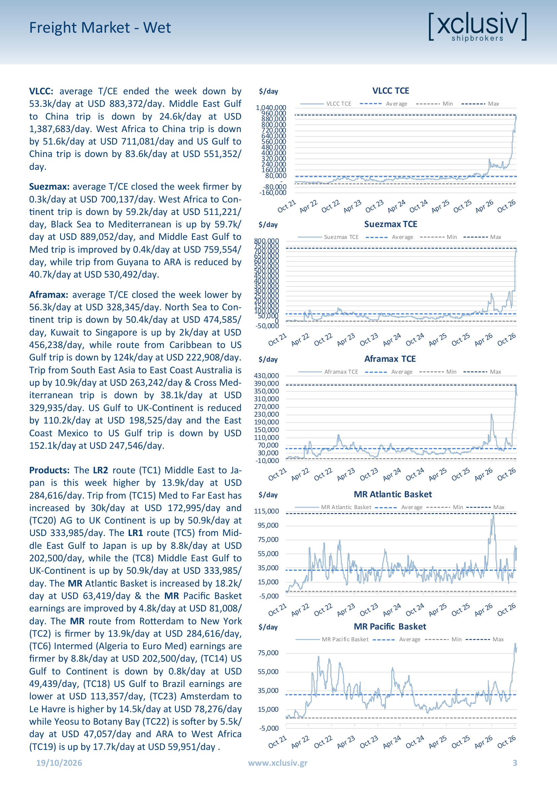

# Xclusiv Shipbrokers Weekly Market Report - Week 42, 2026

- **Publisher**: Xclusiv Shipbrokers Inc.
- **Issue Date**: 2026-10-19 (Week 42)
- **Source**: `corpus/01-brokers/xclusiv/2026/xclusiv_2026_xclusiv-2026_10_19.pdf`
- **Pages**: 9 (Cover-to-cover extraction of useful pages 1 to 7; final 2 pages discarded per notes)

---

## Market Overview

### Editorial: Product Tankers: Less Cargo, Higher Earnings – The Mar- ket Paradox :

The product tanker market has experienced an extraordi- nary freight rally between early August and mid-October 2026, despite a significant contraction in global refined petroleum product trade. While declining cargo volumes would normally translate into weaker vessel demand and softer freight rates, the opposite has occurred. Refinery disruptions, geopolitical developments and changing ves- sel employment have created a market increasingly driv- en by tonnage availability and geographical imbalances rather than underlying cargo growth.

According to Signal Ocean data, global seaborne refined product shipments declined by 10.9% year-on-year be- tween 1 August and 15 October, falling from 265.96 mil- lion MT in 2025 to 237.07 million MT in 2026. Clean petroleum products accounted for most of this contraction, declin- ing by 12.1% to 186.75 million MT, with naphtha recording the steepest reduction at 23.7%, followed by jet fuel at 14.5%, diesel at 10.3% and gasoline at 9.9%. Meanwhile, fuel oil shipments decreased by 5.8% to 50.32 million MT, highlighting the broader weakness in refined product transportation demand.

Interestingly, this contraction has coincided with an exceptional strengthening in freight earnings. Between 3 August and 14 October, all 18 monitored Baltic Exchange product tanker routes registered gains, with LR2 and LR1 vessels leading the rally. The LR2 Middle East Gulf–UK Continent route (TC20) surged from USD 108,734/day to USD 324,060/ day, an increase of 198%, while the LR1 equivalent (TC8) climbed 173% to USD 234,399/day. Similarly, the LR2 Middle East Gulf–Japan route (TC1) reached USD 284,762/day, compared to USD 138,253/day in early August. The Mediterra- nean–Far East LR2 route (TC15) recorded an even more remarkable 414% increase, reaching USD 172,513/day.

The MR market has followed a similar upward trajectory, although geographical differences remain considerable. South Korea–Singapore (TC11) earnings increased by 261% to USD 64,144/day, while West Coast India–Japan (TC12) climbed 280% to USD 50,642/day. Singapore–Australia (TC7) strengthened by 188% to USD 67,775/day. Conversely, the Atlantic market experienced a less pronounced recovery, with US Gulf–UK Continent (TC14) increasing by just 35%, illustrating the stronger momentum across Eastern Hemisphere trades.

A particularly important development is the changing employment pattern of larger product-capable tankers. During the examined period, Aframaxes engaged in crude trad- ing increased by 20.3% year-on-year to 858 vessels, while crude-trading Panamaxes rose 18.6% to 134 units. Con- versely, clean-trading LR2 participation declined by 39.2% to 158 vessels, while LR1 participation fell 9.6% to 208 units. With crude tanker earnings reaching excep- tionally elevated levels, owners have increasingly found dirty trading more attractive, effectively withdrawing substantial capacity from the clean market. Importantly, returning these vessels to refined product transportation requires tank cleaning, preparation and additional time, preventing an immediate supply response.

Looking ahead, geopolitical developments could further support this imbalance. The recent US–Russia agreement facil- itating Russian diesel shipments, alongside Washington’s temporary sanctions relief, could generate additional product tanker employment and reshape trading routes.

However, the actual increase in shipments remains uncertain. Should additional cargo demand materialise while LR vessels continue favouring lucrative crude employment, clean tanker availability could tighten further. Consequently, freight earnings may remain elevated despite declining overall trade volumes, with vessel deployment and geopolitical developments increasingly determining the market’s direction.

### In a Nutshell

- Global refined product shipments declined 10.9% y-o-y, yet
- tanker freight earnings surged dramatically .  (Page 1)
- LR2 TC20 earnings skyrocketed 198%, reaching USD 324,060/
- day despite weakening cargo demand. (Page 1)
- Exceptional crude earnings attracted LR vessels, tightening
- clean tanker supply and availability.  (Page 1)
- Geopolitical developments may boost product demand,
- while delayed LR returns sustain rates. (Page 1)
- Crude oil held below $90 a barrel on Monday, with markets
- balancing easing supply pressures against renewed geopo-
- litical risks. (Page 8)

### Baltic Exchange Freight Indices

| Index | Current | Previous | Change (%) | 3Y Trend / Historical Averages |
|---|---|---|---|---|
| BDI | 2,511 | 2,917 | -13.9% | 2026: 2,604 / 2025: 1,676 / 2024: 1,756 |
| BCI | 3,249 | 4,340 | -25.1% | 2026: 4,102 / 2025: 2,557 / 2024: 2,724 |
| BPI | 2,314 | 2,424 | -4.5% | 2026: 2,055 / 2025: 1,483 / 2024: 1,570 |
| BSI | 1,865 | 1,814 | 2.8% | 2026: 1,479 / 2025: 1,128 / 2024: 1,243 |
| BHSI | 1,011 | 996 | 1.5% | 2026: 823 / 2025: 661 / 2024: 704 |
| BDTI | 7,556 | 7,964 | -5.1% | 2026: 2,867 / 2025: 1,068 / 2024: 1,094 |
| BCTI | 2,538 | 2,403 | 5.6% | 2026: 1,502 / 2025: 667 / 2024: 821 |

---

## Freight Market Analysis

### Dry Bulk Freight

Capesize: The Capesize C5TC average declined by USD 9.9k/day closing the week at USD 25,961/ day. Trip from Continent to F.East is down by 11.4k/day at USD 67,167/day, Transatlantic R/V is lower by 12.4k/day at USD 31,500/day, and Boli- var to Rotterdam is lower by 12.7k/day at USD 36,480/day, while Transpacific R/V is reduced by 11.2k/day at USD 26,468/day. Trip from Tubarao to Rotterdam is reduced by 15.3k/day at USD 12,890/day, China-Brazil R/V is lower by 6.7k/day at USD 27,373/day, and trip from Saldanha Bay to Qinqdao is reduced by 15.3k/day at USD 12,890/ day .

Kamsarmax/Panamax: The Kamsarmax P5TC Timecharter average started the week at USD 21,813/day closing with a decline at USD 20,827/ day. Trip from Skaw-Gib to F.East is softer by 1.6k/ day at USD 29,097/day, Pacific R/Vis up by 0.6k/ day at USD 21,904/day, while Transatlantic R/V is reduced by 1.7k/day at USD 20,545/day, and Sin- gapore R/V via Atlantic is decreased by 1.8k/day at USD 19,829/day .

Ultramax/Supramax: The Ultramax S11TC average closed the week about USD 0.6k/day higher than its opening at USD 23,573/day. The Supramax S10TC average closed the week about 0.6k/day higher than its opening at USD 21,539/day. The Baltic Su- pramax Asia S3TC average closed the week about 0.9k/day higher than previous week at USD 23,106/ day. N.China one Australian or Pacific R/V is im- proved by 1.1k/day at USD 24,019/day, USG to Skaw Passero is firmer by 0.2k/day at USD 31,919/ day. S.China trip via Indonesia to EC India is up by 1.1k/day at USD 27,307/day, trip from S.China via Indonesia to S.China pays USD 17,581/day, while Med/B.Sea to China/S.Korea is increased by .9k/day at USD 26,075/day.

Handysize: The Handysize HS7TC average closed the week improved by .3k/day at USD 18,200/day. Skaw-Passero trip to Boston-Galveston pays 0.2k/ day more at USD 14,850/day, Brazil to Cont. pays 1.9k/day more at USD 28,472/day, S.E. Asia trip to Spore/Japan 0.2k/day is firmer at USD 17,625/day, China/S.Korea/Japan round trip is increased by 0.5k/day at USD 17,706/day, and trip from U.S. Gulf to Cont. is reduced by 1k/day at USD 20,429/day, while N.China-S.Korea-Japan trip to S.E.Asia is in- creased by 0.3k/day at USD 18,275/day .

### Tanker Freight

VLCC: average T/CE ended the week down by 53.3k/day at USD 883,372/day. Middle East Gulf to China trip is down by 24.6k/day at USD 1,387,683/day. West Africa to China trip is down by 51.6k/day at USD 711,081/day and US Gulf to China trip is down by 83.6k/day at USD 551,352/ day.

Suezmax: average T/CE closed the week firmer by 0.3k/day at USD 700,137/day. West Africa to Con- tinent trip is down by 59.2k/day at USD 511,221/ day, Black Sea to Mediterranean is up by 59.7k/ day at USD 889,052/day, and Middle East Gulf to Med trip is improved by 0.4k/day at USD 759,554/ day, while trip from Guyana to ARA is reduced by 40.7k/day at USD 530,492/day.

Aframax: average T/CE closed the week lower by 56.3k/day at USD 328,345/day. North Sea to Con- tinent trip is down by 50.4k/day at USD 474,585/ day, Kuwait to Singapore is up by 2k/day at USD 456,238/day, while route from Caribbean to US Gulf trip is down by 124k/day at USD 222,908/day. Trip from South East Asia to East Coast Australia is up by 10.9k/day at USD 263,242/day & Cross Med- iterranean trip is down by 38.1k/day at USD 329,935/day. US Gulf to UK-Continent is reduced by 110.2k/day at USD 198,525/day and the East Coast Mexico to US Gulf trip is down by USD 152.1k/day at USD 247,546/day.

Products: The LR2 route (TC1) Middle East to Ja- pan is this week higher by 13.9k/day at USD 284,616/day. Trip from (TC15) Med to Far East has increased by 30k/day at USD 172,995/day and (TC20) AG to UK Continent is up by 50.9k/day at USD 333,985/day. The LR1 route (TC5) from Mid- dle East Gulf to Japan is up by 8.8k/day at USD 202,500/day, while the (TC8) Middle East Gulf to UK-Continent is up by 50.9k/day at USD 333,985/ day. The MR Atlantic Basket is increased by 18.2k/ day at USD 63,419/day & the MR Pacific Basket earnings are improved by 4.8k/day at USD 81,008/ day. The MR route from Rotterdam to New York (TC2) is firmer by 13.9k/day at USD 284,616/day, (TC6) Intermed (Algeria to Euro Med) earnings are firmer by 8.8k/day at USD 202,500/day, (TC14) US Gulf to Continent is down by 0.8k/day at USD 49,439/day, (TC18) US Gulf to Brazil earnings are lower at USD 113,357/day, (TC23) Amsterdam to Le Havre is higher by 14.5k/day at USD 78,276/day while Yeosu to Botany Bay (TC22) is softer by 5.5k/ day at USD 47,057/day and ARA to West Africa (TC19) is up by 17.7k/day at USD 59,951/day .

---

## Newbuilding Market

### Indicative Newbuilding Prices ($ mills)

| Sector | Vessel Type | Oct 2026 | Oct 2025 | ±% | Avg 2029 | Avg 2026 | Avg 2025 |
|---|---|---|---|---|---|---|---|
| Dry | Capesize | 76.5 | 73.5 | 4% | 75.1 | 74.2 | 73.2 |
| Dry | Kamsarmax | 38.5 | 36.3 | 6% | 37.4 | 36.6 | 37.5 |
| Dry | Ultramax | 36.0 | 36.0 | 0% | 35.0 | 35.9 | 35.1 |
| Dry | Handysize | 31.5 | 31.5 | 0% | 31.0 | 31.5 | 31.1 |
| Tanker | VLCC | 131.5 | 126.0 | 4% | 130.4 | 126.6 | 129.4 |
| Tanker | Suezmax | 90.5 | 85.9 | 5% | 89.7 | 87.5 | 87.6 |
| Tanker | Aframax | 78.0 | 72.0 | 8% | 75.8 | 73.0 | 72.7 |
| Tanker | Panamax | 62.5 | 59.0 | 6% | 59.8 | 59.5 | 60.2 |
| Tanker | MR2 | 52.5 | 48.5 | 8% | 51.3 | 49.3 | 50.2 |

*Above prices/trends refer to Chinese shipbuilding*
*Above prices/trends refer to S. Korean shipbuilding*

### Newbuilding Orders

| Type | Units | Size | Yard | Buyer | Price | Delivery | Comments |
|---|---|---|---|---|---|---|---|
| LNG | 5 | 174,000 CBM | HUDONG ZHONGHUA | MISC | N/A | 2030 |  |
| VLGC | 4 | 93,000 CBM | HD HYUNDAI HEAVY | BGN | 116.7 EACH | 2030 | LPG DF |
| TANKER | 3 | 157,000 DWT | JIANGSU NEW HANTONG | LIQUIMAR TANKERS | 84 EACH | H2 2030 | SCRUBBER FITTED |
| TANKER | 6 | 74,000 DWT | JIANGSU NEW HANTONG | EMARAT MARITIME | N/A | 2029-30 |  |
| BC | 1 | 82,000 DWT | HENGLI | EURODRY | 37 | Q3 2029 |  |
| BC | 4+2 | 82,000 DWT | JIANGSU WATTS ENERGY | YZJ MARITIME | N/A | 2029-30 |  |
| CONTAINER | 2 | 14,000 TEU | HUDONG ZHONGHUA |  | N/A | 2029-30 | SCRUBBER FITTED |
| CONTAINER | 2 | 9,200 TEU | SWS | DANAOS | 109 EACH | 2029 |  |

---

## Sale & Purchase Market

### Dry Secondhand Prices ($ mills)

| Vessel Type | Tenor | Oct 2026 | Oct 2025 | ±% | Avg 2026 | Avg 2025 | Avg 2024 |
|---|---|---|---|---|---|---|---|
| Capesize | Resale | 85.0 | 75.5 | 13% | 81.3 | 75.7 | 75.7 |
| Capesize | 5 Year | 76.0 | 63.0 | 21% | 71.5 | 62.6 | 62.6 |
| Capesize | 10 Year | 60.0 | 48.0 | 25% | 55.3 | 45.6 | 43.1 |
| Capesize | 15 Year | 41.0 | 28.6 | 43% | 36.4 | 27.4 | 27.9 |
| Kamsarmax | Resale | 47.0 | 38.7 | 21% | 44.0 | 38.7 | 41.8 |
| Kamsarmax | 5 Year | 42.0 | 32.5 | 29% | 38.0 | 32.3 | 32.3 |
| Kamsarmax | 10 Year | 34.0 | 25.4 | 34% | 29.3 | 24.8 | 27.3 |
| Kamsarmax | 15 Year | 23.0 | 16.2 | 42% | 20.2 | 15.6 | 18.1 |
| Ultramax | Resale | 44.0 | 37.9 | 16% | 42.4 | 37.8 | 40.6 |
| Ultramax | 5 Year | 39.0 | 31.1 | 26% | 36.9 | 31.1 | 31.1 |
| Ultramax | 10 Year | 30.5 | 23.0 | 33% | 28.3 | 22.9 | 26.0 |
| Supramax | 15 Year | 20.0 | 15.5 | 29% | 17.6 | 15.0 | 15.9 |
| Handysize | Resale | 38.0 | 33.0 | 15% | 36.0 | 33.0 | 34.0 |
| Handysize | 5 Year | 31.5 | 26.5 | 19% | 29.6 | 25.9 | 25.9 |
| Handysize | 10 Year | 24.0 | 20.4 | 18% | 22.7 | 19.0 | 19.8 |
| Handysize | 15 Year | 15.0 | 12.0 | 25% | 13.6 | 11.7 | 12.3 |

### Dry S&P Activity Commentary

On the Ultramax sector, the “Bulk Guatemala” - 61K/2013 Iwagi was sold for USD 23 mills to Lianson Fleet Group basis an old sale. Moving down the sizes, the Supramax “Ever Progress” - 57K/2012 Jiangsu Han- tong was sold for USD 16.24 mills via auction, while the Japanese-built “Jin Xing” - 55K/2007 Oshima changed hands for USD 14.6 mills to Heng Fa Shipping. Finally, on the Handysize sector, the “Stellar Isabela” - 38K/2017 Shimanami found new owners for high USD 24 mills.

### Bulk Carrier Sales

| Section | Name | Type | DWT | Year | Country | Yard | Buyers | Price ($M) | Comments |
|---|---|---|---|---|---|---|---|---|---|
| Bulk Carriers | MARITIME KING | Kamsarmax | 95,675 | 2011 | JAPAN | IMABARI | UNDISCLOSED | $19.0M | - |
| Bulk Carriers | BULK GUATEMALA | Ultramax | 61,446 | 2013 | JAPAN | IWAGI | LIANSON FLEET GROUP | $23.0M | OLD SALE |
| Bulk Carriers | EVER PROGRESS | Supramax | 56,592 | 2012 | CHINA | JIANGSU HANTONG | UNDISCLOSED | $16.24M | AUCTION |
| Bulk Carriers | JIN XING | Supramax | 55,496 | 2007 | JAPAN | OSHIMA | HENG FA SHIPPING | $14.6M | - |
| Bulk Carriers | STELLAR ISABELA | Handysize | 37,993 | 2017 | JAPAN | SHIMANAMI | UNDISCLOSED | $24.0M | - |

### Tanker Secondhand Prices ($ mills)

| Vessel Type | Tenor | Oct 2026 | Oct 2025 | ±% | Avg 2026 | Avg 2025 | Avg 2024 |
|---|---|---|---|---|---|---|---|
| VLCC | Resale | 230.0 | 147.0 | 56% | 178.9 | 146.6 | 144.2 |
| VLCC | 5 Year | 210.0 | 116.9 | 80% | 150.1 | 115.4 | 115.4 |
| VLCC | 10 Year | 185.0 | 85.6 | 116% | 123.4 | 85.3 | 84.1 |
| VLCC | 15 Year | 160.0 | 57.7 | 177% | 93.2 | 56.2 | 57.1 |
| Suezmax | Resale | 140.0 | 93.8 | 49% | 115.8 | 94.3 | 98.4 |
| Suezmax | 5 Year | 125.0 | 76.6 | 63% | 99.1 | 76.5 | 76.5 |
| Suezmax | 10 Year | 110.0 | 60.5 | 82% | 82.2 | 61.0 | 66.3 |
| Suezmax | 15 Year | 92.0 | 40.6 | 127% | 62.1 | 40.8 | 47.4 |
| Aframax | Resale | 100.0 | 74.6 | 34% | 90.4 | 75.6 | 84.3 |
| Aframax | 5 Year | 85.0 | 62.0 | 37% | 78.3 | 62.8 | 62.8 |
| Aframax | 10 Year | 72.5 | 50.3 | 44% | 67.1 | 50.9 | 58.2 |
| Aframax | 15 Year | 60.0 | 35.3 | 70% | 48.0 | 35.1 | 41.6 |
| MR2 | Resale | 60.0 | 51.0 | 18% | 55.1 | 51.3 | 54.3 |
| MR2 | 5 Year | 52.0 | 42.5 | 22% | 48.2 | 41.5 | 41.5 |
| MR2 | 10 Year | 42.0 | 33.3 | 26% | 38.3 | 31.4 | 37.5 |
| MR2 | 15 Year | 30.0 | 20.6 | 45% | 26.9 | 20.5 | 26.5 |

### Tanker S&P Activity Commentary

On the Suezmax sector, the “Maran Poseidon” - 158K/2010 HHI was sold for USD 98.5 mills, while the “Zouzou N.” - 150K/2010 New Times changed hands for USD 103 mills. Moving down the sizes, Chinese buyers acquired the coated Aframax “Afra Mare” - 105K/2008 HHI for USD 59 mills. Finally, on the MR2 sector, the “Prive Angel” - 51K/2008 STX found new owners for USD 24.5 mills basis prompt delivery in Fujairah. .

### Tanker Sales

| Section | Name | Type | DWT | Year | Country | Yard | Buyers | Price ($M) | Comments |
|---|---|---|---|---|---|---|---|---|---|
| Tankers | MARAN POSEIDON | Suezmax | 158,267 | 2010 | S. KOREA | HHI | UNDISCLOSED | $98.5M | - |
| Tankers | ZOUZOU N. | Suezmax | 149,991 | 2010 | CHINA | NEW TIMES | UNDISCLOSED | $103.0M | - |
| Tankers | AFRA MARE | Aframax | 105,348 | 2008 | S. KOREA | HHI | CHINESE | $59.0M | COATED, SCRUBBER FITTED |
| Tankers | PRIVE ANGEL | MR2 | 51,246 | 2008 | S. KOREA | STX | UNDISCLOSED | $24.5M | PROMPT DELIVERY IN FUJAIRAH |

---

## Demolition Market

### Indicative Demolition Scrap Prices ($/LDT)

| Segment | Country | Price ($/LDT) |
|---|---|---|
| Bulkers | India | $455.0 |
| Bulkers | Bangladesh | $500.0 |
| Bulkers | Pakistan | $500.0 |
| Bulkers | Turkey | $290.0 |
| Tankers | India | $475.0 |
| Tankers | Bangladesh | $520.0 |
| Tankers | Pakistan | $520.0 |
| Tankers | Turkey | $300.0 |

### Reported Demolition Sales

| Name | Type | Year | DWT | LDT | Country | Price ($/LDT) | Buyers | Comments |
|---|---|---|---|---|---|---|---|---|
| VIRINI PREM | OFFSHORE | 1988 | 183,257 | 20,870 | S. KOREA | N/A | NIGERIA | - |
| FOTEX | GC | 1997 | 8,668 | 2,600 | JAPAN | $530.0 | BANGLADESH | - |
| FUNCHAL | PASSENGER | 1961 | 2,975 | 5,895 | DENMARK | N/A | N/A | - |

---

## Legal Disclaimer

> *All information & data contained in this report has been taken from market sources and proprietary databases. All data, info, charts, views and news contained in this report are property of Xclusiv Shipbrokers Inc.*

## Market Charts & Quantitative Vectors

### Xclusiv Tanker & Dry Bulk TCE Benchmarks (Page 3)

*Extracted to time series: `xclusiv_freight_benchmarks_series.csv`*
