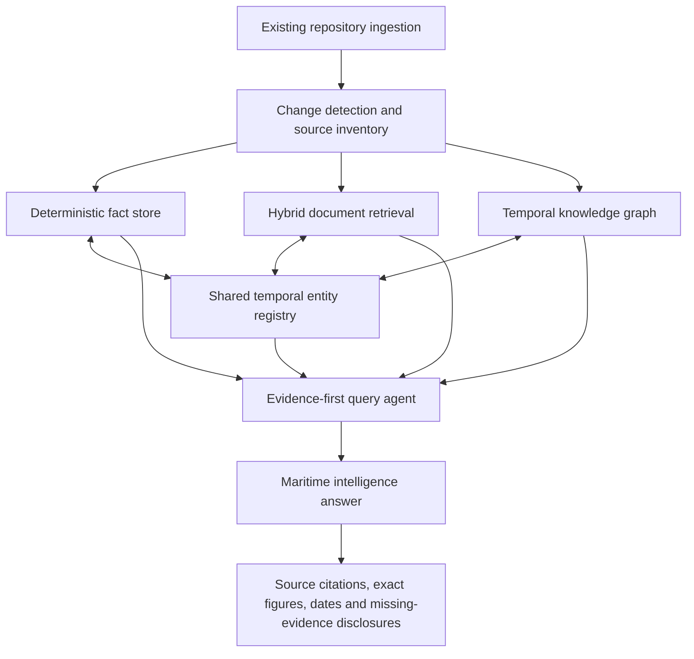
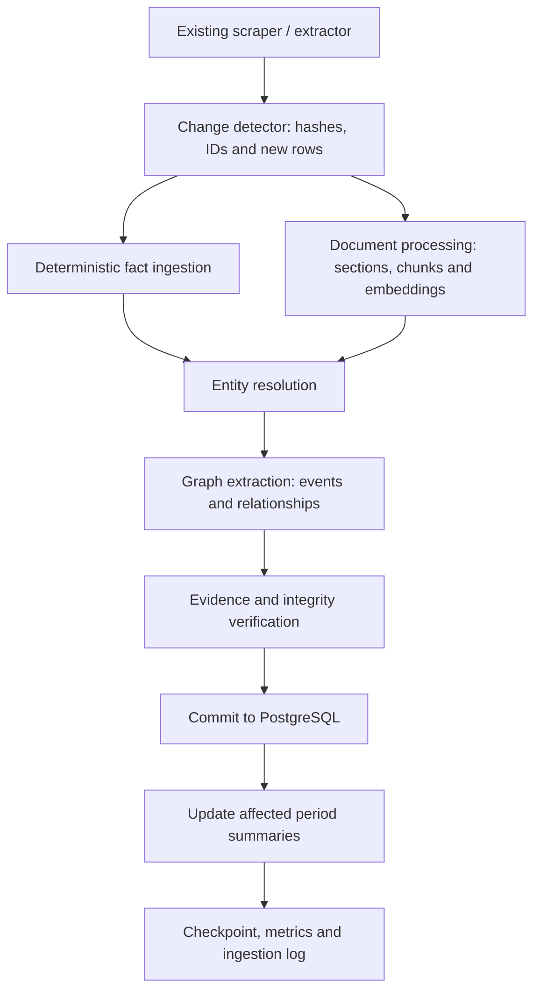
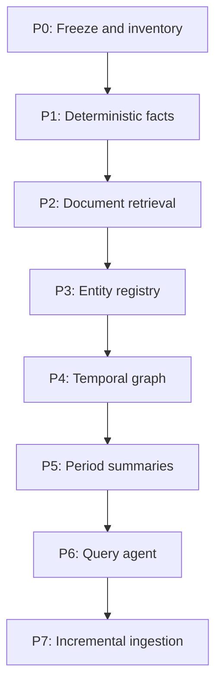

# Maritime Knowledge Intelligence System

## Architecture recommendation, implementation plan, costs, evaluation and risks

**Prepared:** 8 November 2026  
**Based on:** [Shipping repository GraphRAG brief](https://github.com/yieldchaser/Shipping/blob/main/docs/GRAPHRAG_BRIEF.md) and the repository's existing engineering documentation.

---

# Executive recommendation

**Build a hybrid maritime intelligence system with PostgreSQL at its centre, not a conventional end-to-end GraphRAG index.**

The recommended system combines four complementary capabilities:

1. A deterministic, temporal fact database for every numeric observation and structured transaction.
2. Hybrid full-text and vector retrieval for broker commentary, SEC narratives and books.
3. A relatively thin, evidence-backed knowledge graph for entities, events, ownership, fixtures, sales and other relationships.
4. A query agent that knows when to use SQL, document search, graph traversal or a combination of all three.

The distinction is important: a freight-rate observation is not the same thing as a commercial relationship, and neither is the same thing as a broker's explanation of why the market moved.

The system should preserve those distinctions rather than attempting to convert the entire corpus into LLM-generated graph triples.

The repository already contains much of the difficult groundwork: normalized Markdown, structured sidecars, authoritative numeric series, source-document hashes, publication metadata and extensive extraction-quality audits. The proposed system should exploit that work rather than duplicate it.

## 1. What is in the repository

The supplied brief establishes the following baseline, measured on 8 November 2026.

| Material | Corpus size | Interpretation |
|---|---:|---|
| Broker reports | 19,329 Markdown files | Primary qualitative market intelligence |
| Structured table sidecars | 6,142 JSON files | Valuable transactional evidence |
| SEC filings | 1,364 Markdown files | Company financials, fleet, strategy and disclosures |
| Books | 12 | Long-horizon conceptual knowledge |
| Numeric series | 166 CSVs, 727,192 rows | Authoritative quantitative observations |
| Total Markdown | Approximately 105–110 million tokens | Substantial indexing and extraction task |

One especially important detail: the numeric CSVs are already derived from the Markdown and report sidecars. They should be treated as the authoritative numeric layer, not regenerated from LLM interpretations.

The repository's engineering documentation also establishes several important points:

- The existing architecture separates raw source material from canonical extracted Markdown.
- `knowledge/` is explicitly legacy and must not become a new GraphRAG input.
- The repository has already addressed significant historical extraction problems.
- The pre-GraphRAG audit records successful knowledge validation and source-inventory checks on 8 November 2026.
- The extraction pipeline has publisher-specific repairs and incremental ingestion logic.

The remaining work is primarily a new knowledge and retrieval layer, not a replacement document-extraction platform.

**Important qualification:** the repository contains a more detailed [`docs/GRAPHRAG_BUILD_PLAN.md`](https://github.com/yieldchaser/Shipping/blob/main/docs/GRAPHRAG_BUILD_PLAN.md). It is an important existing design document, not independent evidence that its proposed implementation has been completed. Its proposed architecture is largely sound, and this recommendation retains much of it while tightening several areas described below.

---

## 2. What the current state of the art suggests

There is a temptation to assume that the newest GraphRAG framework is automatically the best choice. Research does not support that assumption.

### 2.1 Microsoft's GraphRAG

[Microsoft GraphRAG](https://github.com/microsoft/graphrag) constructs entities, relationships, claims and community summaries from unstructured text. It provides local, global and DRIFT-style retrieval.

Its global search is particularly interesting for questions such as:

- What structural forces have shaped the tanker market over the last decade?
- What recurring supply-side constraints appear across the reports?
- How have the principal themes in maritime economics changed?

However, it is not my choice for the core database. Its standard indexing pipeline involves LLM-based extraction and summarisation, creating substantial processing costs and another opportunity for unsupported relationships or inaccurate numerical summaries. The project's current README also describes it as largely in maintenance mode, with bug fixes and dependency updates rather than new features.

I would borrow its useful ideas—particularly community summaries and local/global retrieval—rather than make it a critical framework dependency.

### 2.2 HippoRAG 2 and graph-based retrieval

[HippoRAG 2](https://proceedings.mlr.press/v267/gutierrez25a.html) is particularly interesting for its use of graph-based retrieval and Personalized PageRank (PPR).

Rather than simply finding the nearest text chunks, the system identifies relevant entities and uses their graph connections to discover related evidence.

Consider a question about Frontline:

`Frontline → fleet composition → VLCC exposure → TD3C → Middle East crude exports → broker commentary`

A graph traversal can connect those concepts even when they do not appear together in one report.

This is exactly where a graph can outperform isolated vector retrieval.

I would borrow the PPR retrieval idea rather than adopt an entire framework without modification.

### 2.3 Temporal GraphRAG

The [TG-RAG paper](https://arxiv.org/abs/2510.13590), published as an October 2025 preprint, is particularly relevant. It proposes a temporal knowledge graph coupled to a hierarchy of time-based summaries, with incremental updates to new time periods rather than rebuilding everything.

For maritime markets, time is fundamental.

A vessel can change owner. A shipyard can receive an order. A tanker route can experience temporary disruption. A broker can publish an assessment that is later revised.

The system must distinguish:

- When something happened.
- When a source reported it.
- When the system ingested it.
- Whether the information remains current.

I would adopt this temporal approach directly.

### 2.4 Hybrid retrieval and contextual retrieval

[Anthropic's Contextual Retrieval research](https://www.anthropic.com/research/contextual-retrieval) supports combining lexical retrieval, dense embeddings and reranking. Anthropic reported substantial retrieval improvements in its own experiments, including up to a 67% reduction in top-20 retrieval failures when contextual retrieval and reranking were combined. This is a vendor experiment, not a guaranteed result on maritime material, but the underlying design is valuable.

This is especially important because maritime corpora are full of identifiers and abbreviations:

- TD3C
- C5
- BPI
- VLCC
- 170,000 DWT
- IMO numbers
- Company tickers

A vector model may understand the concept of a tanker market, but exact lexical matching is indispensable when retrieving a specific route, vessel or assessment.

### 2.5 GraphRAG benchmark results

The ICLR 2026 paper [*When to Use Graphs in RAG: A Comprehensive Analysis for Graph Retrieval-Augmented Generation*](https://proceedings.iclr.cc/paper_files/paper/2026/hash/6c9e01d6cefbbf4cdd265032550e767f-Abstract-Conference.html) is particularly important. It evaluates when graph structures actually improve retrieval and reasoning.

The implication is that graph augmentation is not uniformly beneficial: simpler fact retrieval and more complicated contextual reasoning need to be evaluated separately.

That is why I would not send every question through the graph.

| Query | Best retrieval method |
|---|---|
| TD3C TCE in a particular week | SQL |
| What did Fearnleys say about VLCCs? | Hybrid text search |
| Every source mentioning a named vessel | Entity registry + full-text search |
| What caused tanker rates to rise? | Hybrid search + graph |
| How did fleet growth interact with freight rates? | SQL + graph + text |
| How has the structural economics of shipping changed? | Books + global temporal summaries |

The architecture should be query-dependent.

---

## 3. The architecture to build

### 3.1 System overview



The central design has three data layers and one shared entity registry:

- **Facts:** SQL observations and structured transactions.
- **Text:** BM25/full-text plus vector retrieval.
- **Graph:** entities, events and temporal relationships.
- **Entity registry:** canonical identities, aliases, identifiers and validity periods shared across the other layers.

A query agent orchestrates the layers and verifies the resulting evidence.

### 3.2 Layer A — The deterministic fact store

This is the most important part of the system.

I would put all 166 existing series CSVs into PostgreSQL, preserving each observation as an individual record.

The core fields would be:

| Field | Purpose |
|---|---|
| `obs_id` | Permanent observation identifier |
| `series_id` | E.g. Baltic C5, TD3C, Fearnleys VLCC |
| `period` | Date or measurement period |
| `value` | Exact numeric value |
| `unit` | USD/day, USD/tonne, index points, etc. |
| `raw_cell` | Original printed value |
| `doc_id` | Source report |
| `table_ord` | Table reference |
| `row_ord` | Row reference |
| `col_ord` | Column reference |
| `published_at` | When the information became public |
| `ingested_at` | When the system recorded it |
| `method` | Parser or source CSV |
| `supersedes` | Earlier record, where revised |

I would deliberately implement two time dimensions:

- **Valid time:** when the market observation or commercial event relates to.
- **Knowledge time:** when the system learned about it.

This allows two different questions:

1. "What was the TD3C assessment for week 40, 2025?"
2. "What did the system know about that assessment as of 10 October 2025?"

Those are not necessarily the same thing.

An observation should never be overwritten merely because a broker corrects a published number. The correction creates a new version with a relationship to the old one.

**Critical rule: no LLM writes numeric values into this database.** A deterministic parser takes the values from existing CSVs, sidecars and structured SEC data. The LLM may help classify an unfamiliar table layout, but should never read its cells to create authoritative financial or freight observations.

### 3.3 Layer B — Hybrid document retrieval

This stores the prose and structured text from:

- `data/extracted/md/`
- `corpus/10-companies/`
- `corpus/books/`

I would create three levels.

**1. Document**  
The complete report, filing or book, with its original metadata.

**2. Section**  
A logical section, preserving the headings and document hierarchy.

**3. Chunk**  
A retrieval unit, normally approximately 500–900 tokens, with overlap where necessary.

Do not indiscriminately split Markdown every 500 tokens.

For example:

- Keep a short broker commentary section together.
- Keep a table together when practical.
- Repeat table headers if splitting a genuinely large table.
- Keep a vessel transaction row intact.
- Preserve SEC section headings and book chapter context.

A chunk should also have a contextual prefix, such as:

`Publisher: Fearnleys | Sector: Tankers | Issue date: 2026-10-30 | Section: VLCC Market Commentary`

This is an excellent use of contextual retrieval because the information identifying a passage sometimes sits in its heading rather than in its text.

#### Retrieval stack

| Component | Choice |
|---|---|
| Relational database | PostgreSQL 17 |
| Vector retrieval | pgvector |
| Lexical retrieval | PostgreSQL GIN full-text index |
| Exact/fuzzy identifier matching | B-tree + pg_trgm |
| Hybrid combination | Reciprocal Rank Fusion (RRF) |
| Reranking | Qwen3-Reranker-0.6B, tested against a lexical baseline |

PostgreSQL's full-text search and GIN indexes are mature, while `pg_trgm` supports indexed fuzzy matching. `pgvector` supports HNSW and IVFFlat. HNSW is a reasonable option if exact search becomes too slow, but I would benchmark recall before introducing approximate search.

The embedding model I would test first is [Qwen3-Embedding-0.6B](https://huggingface.co/Qwen/Qwen3-Embedding-0.6B).

It supports up to 1,024 dimensions, a 32k-token context and multilingual retrieval. The model card lists an Apache 2.0 licence.

One practical consideration: do not run the embedding model on the i3 laptop. Its CPU and 8 GB RAM are a poor fit for a 100-million-token embedding job.

Use a hosted embedding endpoint for the initial build. Keep the model and dimensions fixed thereafter.

I would also avoid embedding every numerical CSV row. There is little benefit in asking semantic similarity search to retrieve something SQL can retrieve exactly.

### 3.4 Layer C — The maritime knowledge graph

The graph should represent entities, relationships, commercial transactions and events—not serve as a second copy of the numeric database.

I would begin with the following entity types:

| Type | Canonical identifier |
|---|---|
| Vessel | IMO number |
| Company | CIK, LEI, canonical company ID |
| Port | UN/LOCODE |
| Route | Baltic route code or canonical route ID |
| Commodity | Controlled commodity ID |
| Freight index | Canonical index ID |
| Shipyard | Canonical shipyard ID |
| Broker | Publisher ID |
| Event | Stable event ID |
| Person | Only where commercially useful and adequately sourced |

The graph would have a controlled relationship vocabulary.

| Relationship | Example |
|---|---|
| `OWNED_BY` | Vessel → Owner |
| `OPERATED_BY` | Vessel → Operator |
| `CHARTERED_BY` | Vessel → Charterer |
| `REPORTED_SOLD` | Vessel → Buyer |
| `SOLD_BY` | Vessel → Seller |
| `ORDERED_AT` | Vessel → Shipyard |
| `ASSESSED_ON` | Freight index → Route |
| `DISRUPTED_BY` | Route → Event |
| `AFFECTED` | Event → Port |
| `REPORTED_BY` | Event → Broker |

Every relationship needs its own evidence.

#### Illustrative commercial relationship

```text
Vessel A --[REPORTED_SOLD]--> Buyer B

Evidence attached to the edge:
  Report date:       2026-10-30
  Transaction date:  Unknown
  Price:             Only if printed
  Source:            Fearnleys report
  Evidence:          Exact quotation
  Confidence:        Extraction confidence
  Status:            Reported, not independently confirmed
```

A source saying that a vessel *is reported sold* must not become an assertion that the sale was legally completed.

Similarly, an undisclosed buyer must remain undisclosed. No amount of entity resolution should invent its identity.

#### Entity resolution

Entity resolution deserves special treatment.

Suppose a vessel appears as:

- MV Ocean Star
- Ocean Star
- M/V Ocean Star
- Oceanstar
- Ocean Star (81,200 DWT, 2016)

These might be the same physical vessel, but name matching alone is insufficient.

I would implement a three-stage resolver.

**Stage 1: Deterministic resolution**

Use exact IMO identifiers, CIKs, LEIs, UN/LOCODEs and controlled route codes. These should be the strongest identifiers.

**Stage 2: Probabilistic matching**

For vessels without IMO:

- Normalized vessel name.
- DWT.
- Year built.
- Shipyard.
- Vessel type.
- Report date.
- Historical aliases.

Use a combination of rules and Splink-style probabilistic record linkage.

**Stage 3: LLM-assisted ambiguity resolution**

Only when necessary. A model may evaluate two candidates and return:

- same entity;
- different entity;
- insufficient evidence.

It must explain the matching evidence and must not silently merge records.

For a one-owner system, I would accept lower recall rather than dangerous false-positive merges.

An erroneous merger between two similarly named vessels can contaminate dozens of historical sales and charter relationships.

Entity aliases should also be temporal. A company name can change; vessels can be renamed; ownership changes.

---

## 4. Technology choices and storage

I would not introduce a separate graph database initially.

PostgreSQL is capable of storing all four layers:

- Documents and metadata.
- Observations and numeric facts.
- Entity and alias registries.
- Graph edges and event relationships.
- Embeddings and search indexes.

The graph can be traversed using recursive SQL, with Python's `igraph` available for PPR or other graph algorithms.

This creates one central database, one backup regime and one principal operational system.

The alternative is [Neo4j](https://neo4j.com/docs/neo4j-graphrag-python/current/). Neo4j has a well-maintained Python GraphRAG package supporting graph construction, vector search and graph retrieval.

It is technically credible. I would simply not make it the starting choice for this project. Your numeric observations, temporal facts and source lineage are just as important as graph traversal. A separate graph database introduces another synchronization boundary.

Likewise, [ParadeDB's `pg_search`](https://www.paradedb.com/learn/search-in-postgresql/bm25) is worth benchmarking. It brings BM25 search into PostgreSQL through an extension.

I would start with PostgreSQL's built-in search, then add ParadeDB only if the benchmark demonstrates a material improvement.

### Deployment

The deployment choice is still open. I would not run PostgreSQL with a large HNSW index on the 8 GB laptop as the production service.

My preference is a modest hosted PostgreSQL instance or a persistent free/low-cost hosted service that provides adequate storage and backup. The initial indexing and processing can happen elsewhere, with the laptop acting as the control and development machine.

One important qualification: free hosting should not be assumed to be permanent or sufficient for this corpus. The actual storage allowance, compute limits, backup retention and connection limits must be verified before committing to a provider.

---

## 5. SEC filings: a separate ingestion strategy

I would not treat SEC filings as ordinary broker reports.

There are two different types of information inside them.

### 5.1 Financial facts

Use SEC XBRL company facts wherever applicable.

For example:

- Revenue.
- Operating income.
- Net income.
- Total debt.
- Cash.
- Capital expenditure.
- Assets.
- Liabilities.

The [SEC provides public EDGAR data APIs](https://www.sec.gov/search-filings/edgar-application-programming-interfaces) through `data.sec.gov`.

Each fact should be anchored to its accession number, filing date, fiscal period and XBRL concept.

Important: XBRL is not sufficient for everything. Some foreign private issuers and maritime companies use extensions or disclose operational metrics only in their narrative or tables.

### 5.2 Narrative and operating facts

These require separate treatment:

- Fleet composition.
- Time-charter equivalent earnings.
- Operating expenses per day.
- Charter coverage.
- Newbuilding commitments.
- Debt maturities.
- Vessel acquisitions and disposals.
- Management guidance.
- Commercial strategy.

For these, use the existing SEC Markdown, preserve the section and table structure, and extract relevant statements into the evidence-backed graph.

I would introduce an important additional distinction:

`COMPANY_REPORTED_METRIC`

An operating metric reported by a company is not necessarily directly comparable to an identically named metric from another company.

For example, two shipping companies may calculate TCE using different voyage-expense treatments.

Every financial and operating metric should therefore carry its definition, units, fiscal period and methodology where disclosed.

Do not blindly merge values just because their labels match.

---

## 6. How to use the $145 API budget

This is where I would be disciplined.

Your brief gives specific router prices and identifies approximately $145 in remaining credit. It also says the credit should be used soon.

I would not spend it extracting every individual entity and relationship from 110 million tokens. That is a poor allocation of the budget.

Instead, use the expensive LLM stage selectively.

### 6.1 Processing method by task

| Operation | Method |
|---|---|
| Document inventory | Python |
| Frontmatter parsing | Python |
| Series ingestion | Python / SQL |
| Sidecar table parsing | Python |
| SEC XBRL | Deterministic |
| Chunk creation | Python |
| Embeddings | Hosted embedding service |
| Initial entity linking | Deterministic |
| Ambiguous entity matching | LLM selectively |
| Event and relationship extraction | LLM |
| Numeric verification | Python |
| Citation verification | Python |
| Period summaries | LLM on selected evidence |

The existing build plan specifies DeepSeek Flash for high-volume extraction, with a stronger model reserved for difficult cases and important summaries. I broadly agree.

But I would add a hard token budget per document and per extraction task.

A useful strategy is to cache results by:

`document_sha256 + chunk_sha256 + prompt_version + schema_version + model`

That means an interrupted job can resume, and a prompt change only requires reprocessing the affected extraction stage.

### 6.2 Proposed allocation

| Use | Allocation | Share |
|---|---:|---:|
| Narrative entity and event extraction | $75 | 52% |
| Ambiguous entity resolution | $20 | 14% |
| Temporal/period summaries | $15 | 10% |
| Gold-set evaluation and model comparison | $20 | 14% |
| Retries and prompt corrections | $15 | 10% |
| **Total** | **$145** | **100%** |

I would use the cheapest model that passes a particular task's quality test, not the most capable model everywhere.

### 6.3 A major cost-saving opportunity: do not extract every entity mention

Your corpus has thousands of repetitive reports.

A broker might mention the same route, fleet trend or company hundreds of times.

The objective should not be to produce hundreds of thousands of redundant entity descriptions. It should be to preserve meaningful evidence:

- New relationships.
- New events.
- Changes in state.
- Distinct commercial transactions.
- Material explanations.
- Important disagreements among sources.

For example, if five brokers independently discuss congestion at a particular port, retain all five pieces of evidence, but avoid creating five different port entities and five redundant event objects.

This is one place where canonical entities and event deduplication are essential.

### 6.4 Will $145 be sufficient?

The answer is conditional.

The brief's approximate 105–110 million tokens are not a reliable forecast of the LLM extraction cost, because the system should not send all those tokens through an LLM.

For illustration, assuming 6 million input tokens at $0.30 per million and 600,000 output tokens at $1.20 per million:

```text
6 × $0.30 + 0.6 × $1.20 = $2.52
```

That is merely the theoretical model charge at the quoted rate, not a cost prediction.

The actual cost driver is how many chunks you select, how much repeated context you send, output verbosity, cache hit rates and retries.

I would cap the build at $120 for normal extraction and reserve $25 for evaluation and reprocessing, with a hard stop at $145. Embedding charges, infrastructure and any additional paid services must be accounted for separately.

**I would not authorize the complete extraction job until a measured pilot establishes the cost per representative document.**

---

## 7. How new material enters automatically

This is the most important operational requirement.

The repository already has scrapers and extractors operating through GitHub Actions. There is no reason to introduce another acquisition system.

The new system should subscribe to the outputs of the existing pipeline.

### 7.1 Incremental ingestion workflow



### 7.2 Idempotency is mandatory

The same document must never generate duplicate entities, observations or relationships simply because GitHub Actions ran twice.

I would use deterministic IDs:

```text
doc_id   = SHA256(normalized_document_bytes)
chunk_id = SHA256(doc_id + section_id + chunk_content)
edge_id  = SHA256(relation_type + subject_id + object_id + evidence_id + temporal_context)
```

Numeric records should have a natural unique key based on source, series, period and publication version, with explicit handling for repeated printed rows.

A document's content hash and its source-document hash should be stored separately.

This distinction lets the system tell the difference between a changed extraction and an actual new publication.

### 7.3 How incremental updates work

| Incoming change | Required action |
|---|---|
| New report | Process document, create chunks, observations and graph evidence |
| Existing report with changed extraction | Reprocess affected records and preserve extraction history |
| New CSV rows | Insert only new observations |
| Existing observation corrected | Add a revision and supersession link |

A new weekly report should not cause 20,000 historical files to be re-embedded.

### 7.4 How a wrong extraction is corrected

This requires a proper correction mechanism, rather than simply deleting an edge.

Suppose the model reads:

`Vessel A sold to Buyer X`

But the source actually says:

`Vessel A reportedly sold by Seller X`

The correction workflow should:

1. Mark the erroneous edge as rejected.
2. Preserve its original evidence and extraction metadata in the audit history.
3. Record the replacement relationship.
4. Re-run queries involving that entity.
5. Rebuild only affected time-period summaries.
6. Record the parser/model/prompt version responsible.

For an erroneous entity merge, an alias-resolution history must allow the merge to be reversed and all dependent relationships recalculated.

This is why entity identity should not be represented solely by a mutable canonical name.

### 7.5 Separate repository ingestion from knowledge-base ingestion

I would separate the pipeline into two stages.

**Stage 1: Repository ingestion**  
The current GitHub Actions workflow continues doing what it already does.

**Stage 2: Knowledge-base ingestion**  
A separate workflow consumes the successful outputs, processes only changed material and updates the database.

Do not make a successful PDF scrape depend on an expensive LLM call succeeding.

A temporary API outage must not prevent a broker report from entering the canonical repository.

Use a durable job ledger, exponential retries, batch checkpoints and a dead-letter queue for files that repeatedly fail.

Because Actions cron schedules can run late, checkpoints must be based on source changes and ingestion state, not on assumptions about scheduled execution time.

---

## 8. Query-time intelligence: how the system should answer questions

A conventional RAG system often retrieves chunks and asks the LLM to reason over them.

For this corpus, I would introduce an explicit query planner.

The planner classifies the request into one or more retrieval strategies.

### Example 1: cross-market analysis

**Question:** How did tanker freight markets, listed tanker equity prices and fleet supply move together during 2025, and what did the brokers say caused the changes?

This should not be answered by searching for a paragraph containing the words tanker, equity and fleet.

It should execute a sequence of grounded operations:

1. Identify the tanker market segments and relevant routes.
2. Retrieve weekly freight assessments and relevant TCE observations from SQL.
3. Retrieve tanker fleet growth and orderbook data.
4. Retrieve the appropriate listed-company share-price or market-cap series, subject to the actual data available.
5. Calculate changes and correlations from the exact observations.
6. Retrieve broker commentary for the same dates.
7. Traverse graph connections between routes, ports, cargoes, fleet and disruption events.
8. Compare the explanations across publishers.
9. Produce a narrative with source-level citations and clearly distinguish correlation from causation.

This last point matters enormously.

A broker reporting congestion, a rise in TCE and an increase in an oil price does not establish that the latter caused the former.

The answer must distinguish what the sources claim from what the numerical data demonstrates.

### Example 2: a vessel dossier

**Question:** Show me everything known about this vessel.

The system should return:

- Canonical vessel identity and IMO.
- Names and known aliases.
- Built year, DWT, vessel type and yard.
- Reported historical sales.
- Reported owners and operators.
- Charter fixtures.
- Broker valuation commentary.
- Relevant company filings.
- All source disagreements.
- Numeric observations associated with the vessel.

Each item should be linked to an underlying document and passage or table cell.

That is considerably more useful than generating a generic vessel summary based on a few vector hits.

---

## 9. Long-horizon knowledge and maritime economics books

The books deserve their own retrieval treatment.

They are not simply historical market commentary.

Stopford, Kavussanos and Visvikis, Paine and the maritime history material contain different kinds of knowledge:

- Economic theory.
- Market cycles.
- Shipping supply and demand.
- Asset valuation.
- Shipping finance.
- Historical structural changes.
- Maritime institutions and trade development.

I would preserve the chapter and section hierarchy and build a concept-oriented graph.

For example:

`Freight market → supply elasticity → fleet capacity → orderbook → secondhand prices → investment cycle`

These relationships should be backed by textbook passages, not inferred merely because two ideas are conceptually related.

I would also tag book evidence by publication year and any historical period it explicitly addresses.

That way, the system can distinguish a theoretical proposition from a historical observation and a contemporary broker opinion.

### Temporal summaries

I would borrow the time-tree approach from TG-RAG.

Generate summaries at these levels:

| Level | Example |
|---|---|
| Weekly | Week 40 tanker market |
| Monthly | October 2025 tanker developments |
| Quarterly | Q4 2025 dry bulk market |
| Annual | 2025 shipping market |
| Multi-year | 2015–2025 tanker cycle |

These summaries should be generated from underlying evidence records and carry their source IDs.

Do not treat a previous summary as authoritative evidence for a subsequent summary. Go back to the underlying records when generating higher-level views.

This provides continuity without making a pyramid of progressively detached summaries.

---

## 10. Cost estimates

I would separate the cost of building the index from the cost of operating it.

The API allowance is not the same as the total infrastructure budget.

### 10.1 One-time build

The figures below are engineering estimates, not quoted vendor invoices.

| Component | Estimated cost |
|---|---:|
| Existing CSV and sidecar ingestion | $0 |
| PostgreSQL schema and initial deployment | $0–15 |
| LLM extraction and graph construction | $75–120 |
| Embedding generation | $5–25 |
| Gold-set testing and retries | $10–25 |
| Initial backup and storage overhead | $0–10 |
| **Estimated total** | **$90–195** |

The LLM allocation must remain within the $145 credit. The additional possible costs are embedding and hosting charges.

With careful use of a free database tier, the lower end is plausible. But I would not promise that the entire system can be permanently hosted for free.

### 10.2 Weekly operating costs

| Operation | Expected weekly cost |
|---|---:|
| New Markdown and metadata ingestion | Negligible |
| Numeric CSV updates | Negligible |
| Embeddings for new documents | $0–2 |
| Selective graph extraction | $0.10–2 |
| Period-summary updates | $0–0.50 |
| Database hosting and backups | Depends on plan |

My planning estimate would be approximately **$1–5/week** for a modest report cadence, excluding fixed hosting costs and any significant increase in document volume.

A week containing multiple large filings and unusually heavy broker reports could be more expensive.

### 10.3 Time required

| Stage | Engineering effort |
|---|---:|
| Audit, schemas and source mapping | 2–3 days |
| Deterministic fact store | 2–4 days |
| Text chunking and search | 2–3 days |
| Entity registry and resolution | 3–5 days |
| LLM graph extraction | 2–4 days |
| Query agent and citations | 2–4 days |
| Validation and deployment | 3–5 days |
| **Total** | **16–28 working days** |

The actual wall-clock build depends on API throughput, repository checkout size, database provisioning and embedding throughput.

I would not run the full extraction as one giant GitHub Actions job. Use resumable jobs and a persistent checkpoint store.

---

## 11. Evaluation: how to establish that it works

This is where I would be particularly rigorous.

A graph can look impressive and still be factually unreliable.

Before beginning the full build, I would construct a gold-standard evaluation set from real documents.

### 11.1 Phase 1: a representative pilot

I would select approximately 250–300 documents, not simply the newest 300.

The sample should include:

| Category | Example selection |
|---|---|
| Broker reports | All major publishers, different years |
| Tables | Sales, fixtures, freight rates, demolition |
| SEC filings | Tanker, dry bulk, LNG and diversified issuers |
| Books | Multiple chapters and technical sections |
| Numeric series | Historical and recent values |
| Difficult cases | Undisclosed buyers, aliases, date conflicts |

The sample should deliberately include difficult documents, not just clean examples.

For the pilot, I would process approximately 500–1,000 representative chunks through graph extraction and compare their outputs against human-verified evidence.

### 11.2 Phase 2: six evaluation suites

| Evaluation area | Proposed target | Measurement |
|---|---:|---|
| Numeric accuracy | 100% exactness | Every returned numeric fact matches the authoritative stored row, its unit and period |
| Citation accuracy | ≥99% | Every claim is supported by the cited passage, row or cell |
| Entity resolution | ≥99.5% precision | Measure false merges separately from missed matches |
| Retrieval recall | ≥90% Recall@20 | Test exact identifiers and semantic questions separately |
| Relationship accuracy | ≥98% precision | Measure correct subject, predicate, object, dates and evidence independently |
| Incremental integrity | 100% idempotency | Re-running an unchanged ingestion job creates no duplicate facts or relationships |

These are proposed acceptance thresholds, not results already achieved.

I would distinguish precision from recall throughout.

For example, entity resolution that links 80% of vessels correctly but merges 2% of different vessels is dangerous. It may be better to leave ambiguous vessels unlinked.

### 11.3 Phase 3: an actual maritime question benchmark

I would prepare 100–150 test questions covering the six main use cases in the brief.

**Numeric**

- What was TD3C TCE in week 40 of 2025?
- What was the change in BCI over the specified quarter?

**Entity-centric**

- What sales have been reported for this vessel?
- Which companies have operated this vessel?

**Temporal**

- How did the orderbook change between 2020 and 2025?
- What was known about the vessel's ownership as of a particular date?

**Cross-source**

- What did the company disclose about fleet expansion and how did brokers discuss the same expansion?

**Causal explanations**

- What explanations did brokers offer for the increase in freight rates?
- Did the available numerical evidence support their explanations?

**Structural**

- What do maritime economics books say about supply elasticity?
- How does this concept relate to the actual shipping cycles in the dataset?

Every question should have a reference answer and a list of expected source documents or observations.

### 11.4 Phase 4: compare the alternatives

This is essential.

I would run four systems against the same test questions:

1. BM25 alone.
2. BM25 + vector retrieval.
3. Hybrid retrieval + graph.
4. Hybrid retrieval + graph + temporal summaries.

This lets us determine whether the graph is actually improving performance.

Do not assume that more elaborate indexing produces better answers. The GraphRAG-Bench research makes this sort of comparative evaluation important.

### 11.5 Definition of production readiness

I would require:

- 100% exactness on numerical answers drawn from the fact store.
- No fabricated citations in the gold set.
- At least 99% citation support accuracy.
- No unresolved high-confidence entity collisions.
- At least 90% retrieval recall at 20 for the benchmark.
- No duplicate ingestion after repeat runs.
- Correct historical and publication-time handling.
- Successful recovery from an interrupted build.
- A demonstrable reduction in multi-hop question failures compared with hybrid RAG alone.

For genuinely unanswerable questions, the system must say that it cannot establish the answer from the corpus.

That last property is not optional.

---

## 12. Main risks and what to avoid

### Risk 1: entity resolution contaminates the graph

This is probably the most consequential risk.

An incorrect vessel merge can create false ownership history, false transactions and false charter relationships.

**Mitigation:** exact identifiers first, probabilistic matching second, conservative LLM assistance third. Every merge must be reversible.

### Risk 2: temporal confusion

A broker can discuss a transaction in November that occurred in October. A company can report a fleet composition at a fiscal quarter-end, while the filing arrives weeks later.

**Mitigation:** store event time, reporting time and ingestion time separately. Never infer an unknown date.

### Risk 3: numerical hallucination

A model may confidently quote a rate that looks correct but came from the wrong week, vessel class or unit.

**Mitigation:** prohibit the LLM from authoring numeric observations. Require numeric answer validation against SQL results.

### Risk 4: false causal conclusions

A graph can establish that two things are connected in the evidence. It cannot establish that one caused the other.

**Mitigation:** label broker explanations as source-attributed claims. Statistical analysis belongs in a separate analytical layer.

### Risk 5: embedding model changes

Changing the embedding model after initial construction can make different document generations incompatible.

**Mitigation:** version embeddings and freeze the model, tokenizer, normalization and dimensionality. A deliberate model migration requires a separately managed re-embedding operation.

### Risk 6: LLM extraction drift

New reports may have different terminology, formatting or a new broker's table layout.

**Mitigation:** prompt/version control, schema validation, extraction confidence, source checks and publisher-specific regression tests.

### Risk 7: public repository and database credentials

The repository is public.

**Mitigation:** secrets remain in GitHub Actions environment variables. Never commit database URLs, API keys, personal SEC User-Agent contact details or private connection strings. Also keep production database credentials separate from the GitHub workflow's ordinary repository permissions.

### Risk 8: summaries becoming a substitute for evidence

Period summaries can gradually introduce errors if each summary is generated from earlier summaries.

**Mitigation:** every summary must reference original records, and higher-level summaries should be regenerated from underlying evidence rather than merely paraphrasing lower-level summaries.

### What I would explicitly not do

| Avoid | Reason |
|---|---|
| Feed all 110M tokens through an LLM | Cost and extraction risk |
| Use a single vector database for everything | Poor exact-number handling |
| Treat every extracted entity as a verified entity | Identity contamination |
| Make an LLM the authority on numeric values | Unacceptable error risk |
| Generate a complete graph from every table | Mostly redundant and error-prone |
| Build a separate graph database immediately | Added operational complexity |
| Use one giant indexing workflow | Difficult to resume and audit |
| Embed every observation | SQL is better suited to structured facts |
| Discard the original source and passage | Breaks provenance |
| Use global summaries as proof | They are derived interpretations |

There are two additional choices I would make.

First, I would not introduce a complex multi-agent architecture. A single query planner invoking a small number of well-defined tools is easier to test, monitor and maintain.

Second, I would not introduce forecasting or trading signals into the knowledge graph itself. Your analytical and trading systems can consume its data, but the graph should remain an evidence and knowledge layer. An observation, an analyst's opinion and a quantitative prediction should never become indistinguishable.

---

## 13. Build plan: the order to execute

I would treat the one-time build as a controlled production migration.



### P0 — Freeze and inventory

Establish a reproducible source manifest. Verify hashes, document counts, source links, dates, parser versions and all 166 series. Save an immutable inventory snapshot.

**Exit condition:** zero unexplained missing sources or invalid dates.

### P1 — Build deterministic facts

Load numeric series, structured table sidecars and SEC XBRL. Construct observation IDs and provenance tables. Validate numeric equality against original sources.

**Exit condition:** all included observations trace to printed or authoritative source values.

### P2 — Build document retrieval

Extract document sections, heading-aware chunks, BM25 indexes and embeddings. Benchmark Qwen embeddings against lexical retrieval.

**Exit condition:** retrieval benchmark meets target thresholds.

### P3 — Establish entity registry

Load reference taxonomies and verified entity identifiers. Resolve existing aliases, run probabilistic matching and preserve unresolved candidates.

**Exit condition:** high-precision resolution with reversible merges.

### P4 — Construct temporal graph

Process selected narrative chunks with the LLM. Extract typed relationships, events and state changes with supporting quotations and timestamps.

**Exit condition:** evidence verification and relationship precision pass.

### P5 — Build period summaries

Generate segment-specific weekly, monthly, quarterly and annual summaries from the underlying records.

**Exit condition:** every summary claim links to source IDs.

### P6 — Build query agent

Introduce the SQL, search, graph and summary tools. Add citations and deterministic post-answer verification.

**Exit condition:** benchmark questions are answered correctly and unsupported questions are rejected.

### P7 — Activate incremental ingestion

Connect to existing GitHub Actions outputs. Enable checkpoints, retries, monitoring, dead-letter records and database backups.

**Exit condition:** successful repeated ingestion and recovery tests.

One detail I would insist on: retain a versioned database schema and extraction manifest. The graph is going to grow for years. Future corrections must not require reconstructing the entire historical system.

---

## 14. Direct answers to the six questions in the brief

| Brief question | Recommendation |
|---|---|
| **1. Architecture** | PostgreSQL-centred hybrid system: deterministic fact store, hybrid text retrieval, temporal evidence graph, shared entity registry and period summaries. |
| **2. Tools and storage** | Python, PostgreSQL 17, pgvector, native PostgreSQL full-text search, pg_trgm, optional ParadeDB, Qwen3 embeddings/reranking, SQLite job ledger and Python graph algorithms. |
| **3. Cost and time** | Target $90–195 total including infrastructure and embeddings, subject to the $145 LLM credit cap. Approximately 16–28 engineering days. Weekly variable operating costs approximately $1–5 plus hosting. |
| **4. Incremental ingestion** | Hash-based detection, deterministic upserts, new-chunk embeddings, selective graph extraction, temporal revisions and reversible corrections. |
| **5. Quality** | A 250–300-document pilot, a 100–150-question gold benchmark, deterministic numeric verification, retrieval evaluation and graph precision/recall tests. |
| **6. Risks** | Entity collisions, temporal ambiguity, fabricated numbers, false causal inference, extraction drift, storage and API reliability. Avoid all-in-one GraphRAG, unrestricted LLM extraction and premature multi-database architecture. |

---

## 15. Five refinements to the existing build plan

I largely agree with the repository's existing `docs/GRAPHRAG_BUILD_PLAN.md`. I would retain its three-layer approach and its PostgreSQL-centred design.

There are, however, five refinements I would make before implementation.

### 1. Separate source truth from extracted interpretation more explicitly

The observation store, relationship store and source claims should have distinct validation rules. A source-attributed statement should never silently become an established fact.

### 2. Add a formal entity merge/reversal system

A resolver must preserve the original candidate records and all downstream dependencies. This is particularly important for vessel names and historical ownership.

### 3. Make SEC financial data genuinely comparable

XBRL concept mapping alone is insufficient. Capture units, fiscal periods, dimensions, accounting standards, reporting currency and company-specific definitions.

### 4. Introduce a dedicated contradiction and disagreement layer

Suppose Fearnleys says a vessel was sold for $30 million, while another broker reports $32 million.

Do not automatically select one value as correct. Store two source-attributed observations and establish whether they represent conflicting assessments, different dates, different deal terms or a genuine correction.

### 5. Make the query agent citation-constrained

Every factual sentence should have a supporting evidence identifier. Numeric values should be programmatically checked. An answer that cannot be grounded should be withheld.

---

# Final recommendation

I would build this as a **Maritime Evidence Intelligence System**, with GraphRAG as one component rather than the entire architecture.

The largest advantage isn't that it will generate better summaries. It is that it will let you connect three previously separate things:

- What actually happened in the shipping market, according to recorded observations.
- What shipping companies and brokers said was happening.
- What the historical and economic literature tells us about why such developments matter.

That is the real opportunity in this corpus.

There is a potentially powerful use case here: reconstructing a shipping market cycle across freight, fleet supply, asset values, company financials and broker sentiment, while retaining the ability to trace every assertion back to its original evidence.

I would prioritise getting the fact store and provenance system right before spending heavily on graph extraction. Once those foundations are reliable, the graph becomes significantly more useful.

---

# Research and technical references

The following primary resources are relevant to the design decisions above.

1. [When to Use Graphs in RAG: A Comprehensive Analysis for Graph Retrieval-Augmented Generation — ICLR 2026](https://proceedings.iclr.cc/paper_files/paper/2026/hash/6c9e01d6cefbbf4cdd265032550e767f-Abstract-Conference.html) — evaluates when graph retrieval helps and where it does not.
2. [From RAG to Memory: Non-Parametric Continual Learning for Large Language Models (HippoRAG 2) — ICML 2025](https://proceedings.mlr.press/v267/gutierrez25a.html) — graph retrieval, associative memory and Personalized PageRank.
3. [RAG Meets Temporal Graphs: Time-Sensitive Modeling and Retrieval for Evolving Knowledge (TG-RAG)](https://arxiv.org/abs/2510.13590) — temporal graphs, hierarchical summaries and incremental updates.
4. [Introducing Contextual Retrieval — Anthropic](https://www.anthropic.com/research/contextual-retrieval) — contextualized chunks, lexical retrieval and reranking.
5. [Microsoft GraphRAG repository](https://github.com/microsoft/graphrag) — graph construction, community summaries and project status.
6. [Neo4j GraphRAG for Python documentation](https://neo4j.com/docs/neo4j-graphrag-python/current/) — alternative graph database implementation.
7. [pgvector](https://github.com/pgvector/pgvector) — vector indexing and retrieval in PostgreSQL.
8. [PostgreSQL 17 `pg_trgm` documentation](https://www.postgresql.org/docs/17/pgtrgm.html) — trigram similarity and indexed fuzzy matching.
9. [ParadeDB: Implementing BM25 in PostgreSQL](https://www.paradedb.com/learn/search-in-postgresql/bm25) — PostgreSQL-native BM25 search.
10. [Qwen3-Embedding-0.6B model card](https://huggingface.co/Qwen/Qwen3-Embedding-0.6B) and [Qwen3 Embedding paper](https://arxiv.org/abs/2506.05176) — embedding and reranking model family.
11. [SEC EDGAR Application Programming Interfaces](https://www.sec.gov/search-filings/edgar-application-programming-interfaces) — structured company submissions and XBRL data.

---

## Scope and estimation notes

- Corpus counts and repository status in this document are taken from the supplied brief and repository documentation dated 8 November 2026.
- Architecture choices, implementation sequencing and evaluation thresholds are recommendations, not statements that the system has already been built or tested.
- Cost and engineering-time figures are planning estimates. They require confirmation through a measured pilot, provider pricing checks and a storage/compute benchmark.
- The $145 router-credit allocation is a proposed spending plan. Embeddings, hosting, backups and other services may incur separate charges.
- The quality thresholds are proposed acceptance criteria, not achieved benchmark results.
